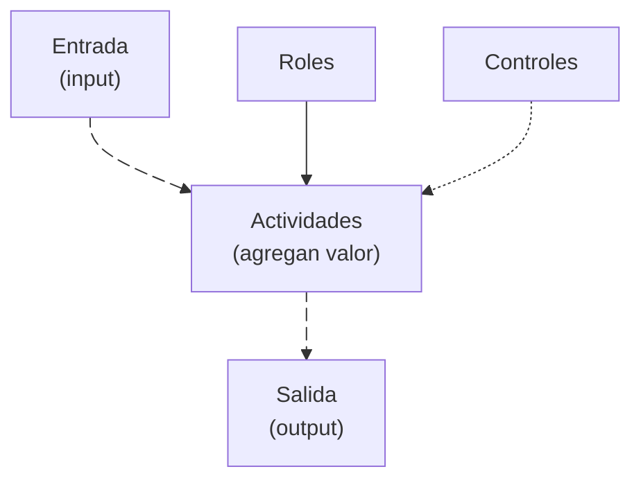

Un **proceso** es un conjunto de actividades ordenadas e interrelacionadas que transforman una o más **entradas** en **salidas** que agregan valor al cliente, con el propósito de alcanzar una meta organizacional. Los procesos ya existen dentro de la organización; el esfuerzo es identificarlos y gestionarlos. {a Apuntes de Administración y diseño de procesos organizacionales · Unidad 1}

Sinónimos útiles: secuencia ordenada · conjunto de actividades · transformación de entradas en salidas con valor. {a Apuntes de Administración y diseño de procesos organizacionales · Unidad 1}

:::clave Analogía del proceso
Pensá en una máquina de café: la entrada es el agua y el café molido, las actividades son calentar y filtrar, la salida es la taza servida. Si alguna entrada falla o una actividad se saltea, la salida (la taza) no tiene el valor esperado. {d}
:::

## Elementos mínimos de un proceso

- **Entrada (input):** todo aquello que dispara o da inicio a la ejecución del proceso.
- **Actividades:** acciones a realizar; se prioriza incorporar las que agregan valor.
- **Salida (output):** resultado del proceso; puede ser material, recurso o información usada por otro proceso.
- **Roles:** participante(s) que ejecutan la(s) actividad(es).
- **Controles:** actividad de seguimiento del desempeño del proceso. {a Apuntes de Administración y diseño de procesos organizacionales · Unidad 1}

Los controles **no agregan valor**; se establecen solo donde sean necesarios. Lo que no se controla no se puede medir, y lo que no se mide no se puede mejorar. {a Apuntes de Administración y diseño de procesos organizacionales · Unidad 1}


{d}

:::clave Por qué identificar las partes del proceso
Identificar las partes del proceso permite definir y clarificar responsabilidades (evitar «eso no me corresponde»), establecer controles necesarios (ni de más ni de menos) y estandarizar la ejecución para reducir errores y evitar que se trasladen a otros procesos. {a Apuntes de Administración y diseño de procesos organizacionales · Unidad 1}
:::

## Estandarización

Garantiza que el proceso se ejecute siempre de la misma manera para disminuir errores y evitar su traslado a procesos posteriores. Mitiga la ejecución basada en criterios personales («yo lo hago así») mediante la normalización. {a Apuntes de Administración y diseño de procesos organizacionales · Unidad 1}

## Gestión basada en procesos (BPM)

La **gestión basada en procesos** es la comprensión y gestión de los procesos interrelacionados **como un sistema**, para contribuir a la eficacia y eficiencia de la organización en el logro de sus resultados previstos (ISO 9001). Permite controlar interrelaciones e interdependencias entre procesos, mejorando el desempeño global. Es el paradigma de gestión más efectivo para organizaciones que buscan mejora de resultados, innovación y mejora continua. {a Apuntes de Administración y diseño de procesos organizacionales · Unidad 1}

**BPM (Business Process Management)** es la disciplina que otorga a las organizaciones agilidad operativa, adaptabilidad, innovación y control estratégico de sus procesos de negocio. {a Apuntes de Administración y diseño de procesos organizacionales · Unidad 1}

## Beneficios de aplicar gestión por procesos

- Aumento de productividad y competitividad mediante automatización.
- Agilidad para adaptarse a cambios del mercado.
- Trazabilidad completa de actividades.
- Detección y corrección de uso ineficiente de recursos (tiempos muertos, cuellos de botella).
- Satisfacción del usuario interno y externo.
- Decisiones más rápidas con información en tiempo real.
- Eliminación de duplicidad de actividades.
- Cumplimiento de regulaciones y normativas. {a Apuntes de Administración y diseño de procesos organizacionales · Unidad 1}

:::ejemplo Proceso de atención de pedidos (antes y después del enfoque por procesos)
1. Antes: cada área (ventas, depósito, facturación) trabajaba por su cuenta; los pedidos se perdían y se duplicaban tareas. {d}
2. Después: se identifica el proceso «atender pedido», se mide el tiempo total y se eliminan los pasos sin valor. {d}
3. Resultado: menos errores, menos tiempo muerto y un único responsable del flujo. {d}
:::

## Pasos para adoptar un enfoque basado en procesos

1. **Identificación** y secuencia de los procesos → Mapa de procesos.
2. **Descripción** de cada proceso.
3. **Seguimiento y medición** para conocer resultados.
4. **Mejora** de los procesos con base en el seguimiento realizado. {a Apuntes de Administración y diseño de procesos organizacionales · Unidad 1}

## Enfoque organizacional vs. enfoque en procesos

- **Enfoque organizacional:** gestión basada en el organigrama (estructura vertical), donde cada área trabaja de forma aislada. Problemas típicos: pérdida de visibilidad de las operaciones en conjunto, actividades repetitivas y duplicación, objetivos encontrados o contradictorios, información vía jerárquica, mejoras de alcance limitado.
- **Enfoque en procesos:** gestión transversal que prioriza los procesos de negocio por sobre la estructura jerárquica. El proceso es la forma natural de organizar el trabajo. Responsables de proceso con autonomía y autocontrol; decisiones compartidas, información compartida, mejoras interfuncionales. {a Apuntes de Administración y diseño de procesos organizacionales · Unidad 1}

^ Comparativa clave
| Organizacional | Por procesos |
|---|---|
| «El problema son los empleados» | «El problema es el proceso» |
| Mido individualmente | Mido el proceso |
| Cambio la persona | Cambio el proceso |
| ¿Quién cometió el error? | ¿Qué hizo que cometiéramos ese error? |
| Corrige el error | Reduce el margen de error |
| Impulsado por el resultado final | Impulsado por el consumidor | {a Apuntes de Administración y diseño de procesos organizacionales · Unidad 1}

## Transformación digital y procesos

La digitalización produce 3 cambios principales: en la **oferta** de productos y servicios, en la **cadena de valor** para producirlos y en el **modelo de negocio**. Requiere visión holística, eliminación de tareas sin valor real y simplificación para canales digitales. {a Apuntes de Administración y diseño de procesos organizacionales · Unidad 1}

Actividades clave de la transformación: análisis de deficiencias (puntos críticos de mejora), simulación de impacto, modelado y optimización, automatización (trazabilidad, ahorro de costos, eficacia) e monitoreo en tiempo real (análisis predictivo). {a Apuntes de Administración y diseño de procesos organizacionales · Unidad 1}

```explorable
titulo: Beneficios de la gestión por procesos (BPM)
variante: pasos
nodos:
  - {id: b1, titulo: Productividad, resumen: "Automatización y eliminación de duplicidad", detalle: "Aumenta la productividad y la competitividad mediante automatización y eliminación de actividades duplicadas."}
  - {id: b2, titulo: Agilidad, resumen: "Adaptación a cambios del mercado", detalle: "Permite adaptarse con rapidez a cambios del mercado y a nuevas demandas."}
  - {id: b3, titulo: Trazabilidad, resumen: "Seguimiento completo de actividades", detalle: "Ofrece trazabilidad completa y decisiones más rápidas con información en tiempo real."}
  - {id: b4, titulo: Cumplimiento, resumen: "Regulaciones y normativas", detalle: "Facilita el cumplimiento de regulaciones y normativas."}
o: d
```

```clasificar
titulo: ¿Agrega valor al cliente?
categorias: [Agrega valor, No agrega valor]
items:
  - {x: "Transformar materia prima en producto", cat: 0, porque: "Es la actividad central del proceso."}
  - {x: "Control de calidad del lote", cat: 1, porque: "Los controles no agregan valor; se establecen solo donde sean necesarios."}
  - {x: "Entregar el pedido al cliente", cat: 0, porque: "Es la salida que genera satisfacción."}
  - {x: "Revisar el organigrama", cat: 1, porque: "No es una actividad del proceso de valor."}
o: d
```

```clasificar
titulo: ¿A qué enfoque corresponde cada afirmación?
categorias: [Enfoque organizacional, Enfoque en procesos]
items:
  - {x: "El problema son los empleados", cat: 0, porque: "Es la visión del enfoque organizacional."}
  - {x: "El problema es el proceso", cat: 1, porque: "Es el núcleo del enfoque en procesos."}
  - {x: "Mido individualmente", cat: 0, porque: "El organizacional mide a la persona."}
  - {x: "Mido el proceso", cat: 1, porque: "El enfoque en procesos mide el flujo."}
  - {x: "Cambio la persona", cat: 0, porque: "Corrige al individuo."}
  - {x: "Cambio el proceso", cat: 1, porque: "Rediseña el flujo."}
o: d
```

:::sintesis
- Un proceso transforma entradas en salidas con valor para el cliente.
- La gestión basada en procesos (BPM) gestiona los procesos interrelacionados como un sistema.
- El enfoque en procesos es transversal y prioriza el valor sobre la jerarquía.
- La transformación digital cambia la oferta, la cadena de valor y el modelo de negocio. {a Apuntes de Administración y diseño de procesos organizacionales · Unidad 1}
:::