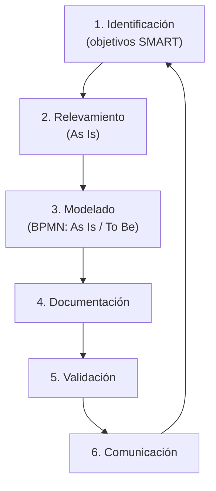

El diseño de un proceso se aborda como un **proyecto estructurado en seis etapas** secuenciales. El objetivo es pasar de una situación actual a una propuesta mejorada, documentada y comunicada. {a Apuntes de Administración y diseño de procesos organizacionales · Unidad 2}

:::didactico Analogía del diseño
Diseñar un proceso es como planificar una obra: primero se definen los objetivos (identificación), se releva el terreno (relevamiento), se dibuja el plano (modelado), se documenta, se valida y se comunica a los obreros. Sin comunicación, el plano no se construye. {d}
:::

## Las seis etapas del diseño


{d}

## 1. Identificación

Definición de los **objetivos** del proceso bajo el método **SMART** e **indicadores** de desempeño. {a Apuntes de Administración y diseño de procesos organizacionales · Unidad 2}

- **SMART:** objetivos **E**specíficos, **M**edibles, **A**lcanzables, **R**elevantes y con **T**iempo definido (Specific, Measurable, Achievable, Relevant, Time-bound).
- Los indicadores permiten medir si el proceso cumple su propósito y sirven de base para el seguimiento y la mejora. {a Apuntes de Administración y diseño de procesos organizacionales · Unidad 2}

## 2. Relevamiento

Recolección de datos sobre el proceso tal como se ejecuta hoy. Técnicas habituales: observación directa, entrevistas a los participantes, cuestionarios, análisis de documentos y registros existentes, y revisión de sistemas de información. {a Apuntes de Administración y diseño de procesos organizacionales · Unidad 2}

El relevamiento busca capturar la realidad (**As Is**), no la versión idealizada. {a Apuntes de Administración y diseño de procesos organizacionales · Unidad 2}

## 3. Modelado

Representación gráfica del proceso mediante la notación **BPMN** (Business Process Model and Notation), que permite estandarizar la comunicación entre áreas técnicas y de negocio. {a Apuntes de Administración y diseño de procesos organizacionales · Unidad 2}

- **As Is:** modelo del proceso actual, tal como se ejecuta.
- **To Be:** modelo del proceso propuesto, con las mejoras incorporadas. {a Apuntes de Administración y diseño de procesos organizacionales · Unidad 2}

La comparación As Is / To Be evidencia las brechas y fundamenta las decisiones de rediseño. {a Apuntes de Administración y diseño de procesos organizacionales · Unidad 2}

## 4. Documentación

Registro formal del proceso: objetivos, alcance, entradas, salidas, actividades, roles, controles, indicadores y anexos. La documentación se mantiene y conserva según las reglas de información documentada (ISO 9001): **mantener** para documentos activos, **conservar** para registros de evidencia. {a Apuntes de Administración y diseño de procesos organizacionales · Unidad 2}

## 5. Validación

Comprobación de la funcionalidad del proceso diseñado: se verifica que cumpla los objetivos, que sea factible de ejecutar con los recursos disponibles y que no genere efectos no deseados en otros procesos. Puede incluir simulación, prueba piloto y revisión por los involucrados. {a Apuntes de Administración y diseño de procesos organizacionales · Unidad 2}

## 6. Comunicación

Difusión y publicación del proceso aprobado: capacitación de los participantes, publicación en los canales oficiales y aseguramiento de que todos comprenden su rol. Sin comunicación, el diseño no se implementa. {a Apuntes de Administración y diseño de procesos organizacionales · Unidad 2}

:::clave Sin comunicación no hay implementación
Un proceso perfectamente diseñado que nadie conoce no se ejecuta. La etapa de comunicación es la que convierte el diseño en práctica. {d}
:::

:::ejemplo Rediseño del proceso de pedidos
1. Identificación: reducir el tiempo de entrega de 5 a 2 días. {d}
2. Relevamiento: se observa que el 40 % del tiempo se pierde esperando aprobaciones. {d}
3. Modelado: se dibuja el As Is y se propone un To Be sin la aprobación intermedia. {d}
4. Documentación, validación y comunicación: se prueba un piloto y se capacita al equipo. {d}
:::

## Mejora continua

El diseño no es un evento único: se integra con el ciclo **PDCA** (Planificar–Hacer–Verificar–Actuar). Tras la implementación se miden los resultados, se detectan desvíos y se vuelven a aplicar las etapas de diseño para ajustar el proceso. La mejora continua (Kaizen) sostiene que toda actividad o proceso es susceptible de mejora. {a Apuntes de Administración y diseño de procesos organizacionales · Unidad 2}

## Buenas prácticas de diseño

- Empezar por los procesos prioritarios (ya existen; no hay que crearlos).
- Mantener la jerarquía de procesos clara y codificada.
- Definir instancias paralelas cuando un proceso no comparte entradas o salidas, sin abusar de la bifurcación.
- Establecer controles solo donde sean necesarios (no agregan valor).
- Alinear el diseño con la estrategia, la misión y los Factores Clave de Éxito. {a Apuntes de Administración y diseño de procesos organizacionales · Unidad 2}

```asociar
titulo: Uní cada etapa con su descripción
pares:
  - [Identificación, "Definir objetivos SMART e indicadores de desempeño"]
  - [Relevamiento, "Recolectar datos del proceso tal como se ejecuta hoy (As Is)"]
  - [Modelado, "Representar el proceso con BPMN (As Is y To Be)"]
  - [Documentación, "Registrar formalmente objetivos, alcance, roles, controles e indicadores"]
  - [Validación, "Comprobar funcionalidad, factibilidad y efectos en otros procesos"]
  - [Comunicación, "Capacitar y publicar el proceso aprobado"]
o: d
```

```clasificar
titulo: ¿As Is o To Be?
categorias: [As Is (proceso actual), To Be (proceso propuesto)]
items:
  - {x: "Modelo del proceso tal como se ejecuta hoy", cat: 0, porque: "Es el As Is."}
  - {x: "Modelo con las mejoras incorporadas", cat: 1, porque: "Es el To Be."}
  - {x: "Se obtiene por relevamiento", cat: 0, porque: "Se captura la realidad actual."}
  - {x: "Se obtiene por rediseño", cat: 1, porque: "Incorpora las mejoras."}
o: d
```

```caso
titulo: Objetivo para un proceso de atención
escenario: El área de atención al cliente quiere mejorar su proceso y debe fijar un objetivo.
pasos:
  - pregunta: ¿Cuál de estos objetivos es SMART?
    opciones:
      - {x: "Reducir el tiempo de respuesta de 5 a 2 días en el próximo trimestre", ok: true, consecuencia: "Es específico, medible, alcanzable, relevante y con tiempo definido."}
      - {x: "Mejorar la atención", ok: false, consecuencia: "No es medible ni tiene plazo."}
      - {x: "Responder más rápido que la competencia", ok: false, consecuencia: "No es medible ni tiene tiempo definido."}
o: d
```

:::sintesis
- El diseño de procesos tiene seis etapas: identificación, relevamiento, modelado, documentación, validación y comunicación.
- As Is es el proceso actual; To Be es el propuesto; BPMN es la notación estándar.
- El diseño se integra con PDCA para la mejora continua. {a Apuntes de Administración y diseño de procesos organizacionales · Unidad 2}
:::