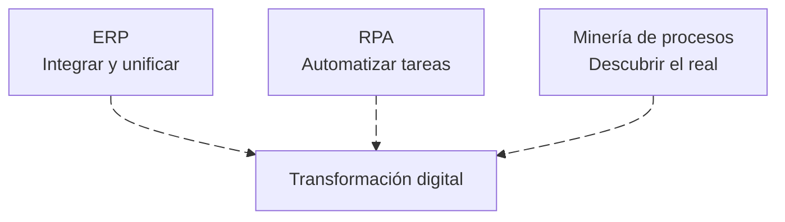

Un **ERP (Enterprise Resource Planning)** es un sistema integrado que unifica los procesos de negocio de una organización en una única base de datos y una única plataforma. Permite la trazabilidad completa, la eliminación de duplicidad y la toma de decisiones con información en tiempo real. {a Apuntes de Administración y diseño de procesos organizacionales · Unidad 3}

Ejemplo de referencia: **Odoo**, ERP de código abierto modular que cubre ventas, compras, inventario, contabilidad, RRHH y producción, entre otros. La implementación de un ERP exige rediseñar los procesos para adaptarlos al sistema (o parametrizar el sistema a los procesos), con impacto en la cadena de valor y en el modelo de negocio. {a Apuntes de Administración y diseño de procesos organizacionales · Unidad 3}

:::didactico Analogía del ERP
Un ERP es como el sistema nervioso central de la organización: conecta todas las áreas a una única «columna vertebral» de datos, de modo que todos vean la misma información en tiempo real. {d}
:::

Aspectos clave de la implementación: {a Apuntes de Administración y diseño de procesos organizacionales · Unidad 3}

- Análisis de procesos actuales y eliminación de lo que no agrega valor.
- Adaptación de procesos clave a los canales digitales.
- Integración de áreas que antes trabajaban en silos. {a Apuntes de Administración y diseño de procesos organizacionales · Unidad 3}

## RPA: automatización robótica de procesos

**RPA (Robotic Process Automation)** es la tecnología que permite automatizar tareas repetitivas, basadas en reglas y de alto volumen, mediante «robots» de software que interactúan con las interfaces de los sistemas existentes, sin modificarlos. {a Apuntes de Administración y diseño de procesos organizacionales · Unidad 3}

Características: {a Apuntes de Administración y diseño de procesos organizacionales · Unidad 3}

- Opera sobre sistemas legados sin necesidad de integración profunda.
- Ejecuta procesos de forma rápida, precisa y continua (24/7).
- Libera a las personas de tareas manuales y repetitivas para que se enfoquen en actividades de mayor valor. {a Apuntes de Administración y diseño de procesos organizacionales · Unidad 3}

Buenas prácticas: {a Apuntes de Administración y diseño de procesos organizacionales · Unidad 3}

- Automatizar procesos estables, bien documentados y con reglas claras.
- Medir el retorno de la automatización (tiempo, errores, costos).
- Mantener la gobernanza: control de cambios, monitoreo y mantenimiento de los robots. {a Apuntes de Administración y diseño de procesos organizacionales · Unidad 3}

:::ejemplo RPA en una PyME
1. Proceso: copiar datos de correos a una planilla de Excel, todos los días. {d}
2. Con RPA: un robot lee los correos y completa la planilla sin intervención humana. {d}
3. Resultado: cero errores de tipeo y horas liberadas para tareas de mayor valor. {d}
:::

## Minería de procesos (Process Mining)

**Minería de procesos** es la disciplina que usa datos de los sistemas de información (event logs) para descubrir, monitorear y mejorar procesos de forma automática. {a Apuntes de Administración y diseño de procesos organizacionales · Unidad 3}

- **Entrada:** registros de eventos (logs) generados por los sistemas.
- **Salida:** modelo del proceso real, que se compara con el proceso documentado.
- **Utilidad:** detectar desviaciones, cuellos de botella y oportunidades de mejora; identificar procesos tal como realmente ocurren (As Is) en lugar de como se cree que ocurren. {a Apuntes de Administración y diseño de procesos organizacionales · Unidad 3}

Se vincula con la **IA aplicada a la identificación de procesos**, que asiste en el descubrimiento, clasificación y priorización de procesos organizacionales, complementando técnicas tradicionales (brainstorming, dinámicas de grupo). {a Apuntes de Administración y diseño de procesos organizacionales · Unidad 3}

## Relación entre las tres tecnologías

^ Comparativa
| Tecnología | Foco | Cuándo usarla |
|---|---|---|
| ERP | Integrar y unificar procesos en una plataforma | Al rediseñar la gestión integral de la organización |
| RPA | Automatizar tareas repetitivas sobre sistemas existentes | Cuando el proceso está estable pero es manual y de alto volumen |
| Minería de procesos | Descubrir y analizar el proceso real a partir de datos | Para diagnosticar, controlar y mejorar procesos existentes | {a Apuntes de Administración y diseño de procesos organizacionales · Unidad 3}

Las tres convergen en la **transformación digital** de los procesos: análisis de deficiencias, simulación de impacto, modelado y optimización, automatización y monitoreo en tiempo real. {a Apuntes de Administración y diseño de procesos organizacionales · Unidad 3}


{d}

```clasificar
titulo: ¿Qué tecnología corresponde a cada necesidad?
categorias: [ERP, RPA, Minería de procesos]
items:
  - {x: "Unificar ventas, compras, inventario y contabilidad en una plataforma", cat: 0, porque: "Es el foco del ERP."}
  - {x: "Automatizar la carga manual de facturas en un sistema legado", cat: 1, porque: "Es una tarea repetitiva sobre sistemas existentes."}
  - {x: "Descubrir cuellos de botella a partir de los logs del sistema", cat: 2, porque: "Es el foco de la minería de procesos."}
  - {x: "Rediseñar la gestión integral de la organización", cat: 0, porque: "Corresponde a un ERP."}
  - {x: "Automatizar tareas repetitivas de alto volumen", cat: 1, porque: "Es el foco del RPA."}
  - {x: "Comparar el proceso real con el documentado", cat: 2, porque: "Es el foco de la minería de procesos."}
o: d
```

```asociar
titulo: Uní cada tecnología con su foco
pares:
  - [ERP, "Integrar y unificar procesos en una plataforma"]
  - [RPA, "Automatizar tareas repetitivas sobre sistemas existentes"]
  - [Minería de procesos, "Descubrir y analizar el proceso real a partir de datos"]
o: d
```

```caso
titulo: Una empresa con procesos manuales y de alto volumen
escenario: Una empresa tiene procesos estables, bien documentados, manuales y de alto volumen, sobre sistemas legados.
pasos:
  - pregunta: ¿Qué tecnología conviene aplicar primero?
    opciones:
      - {x: "RPA, para automatizar las tareas repetitivas", ok: true, consecuencia: "RPA opera sobre sistemas existentes sin modificarlos."}
      - {x: "ERP, para reemplazar todos los sistemas", ok: false, consecuencia: "Es costoso y no es la primera respuesta para tareas manuales estables."}
      - {x: "Minería de procesos, para descubrir el proceso real", ok: false, consecuencia: "Útil para diagnosticar, pero el proceso ya está documentado."}
o: d
```

:::sintesis
- El ERP integra y unifica procesos en una plataforma única.
- El RPA automatiza tareas repetitivas sobre sistemas existentes.
- La minería de procesos descubre el proceso real a partir de los logs.
- Las tres convergen en la transformación digital de los procesos. {a Apuntes de Administración y diseño de procesos organizacionales · Unidad 3}
:::