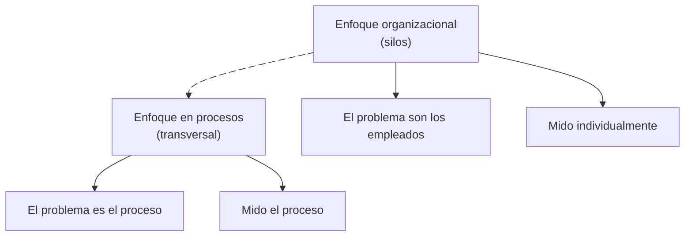

La transición hacia una gestión basada en procesos es un **cambio organizacional** de fondo: deja de organizarse por áreas (silos) para organizarse por procesos transversales. No es solo un cambio técnico; es un cambio cultural. {a Apuntes de Administración y diseño de procesos organizacionales · Unidad 4}

:::didactico Analogía del cambio
Cambiar de gestión por áreas a gestión por procesos es como pasar de tocar cada instrumento por separado a tocar en orquesta: el foco deja de ser «quién toca» y pasa a ser «cómo suena el conjunto». {d}
:::

## Estrategias para la transición

- **Liderazgo y compromiso de la alta dirección:** rendir cuentas por la eficacia del SGC, integrar los procesos en el negocio, asegurar política, objetivos y recursos.
- **Comunicación y toma de conciencia:** que todas las personas conozcan la política de calidad, los objetivos relevantes, su contribución a la eficacia del sistema y las consecuencias del incumplimiento.
- **Capacitación y competencia:** asegurar la competencia necesaria (educación, formación, experiencia) y tomar acciones ante brechas.
- **Gestión del cambio planificada:** cambios al SGC de manera planificada, considerando propósito y consecuencias, integridad del sistema, recursos y reasignación de responsabilidades.
- **Mejora continua:** medir, evaluar y optimizar basándose en resultados (PDCA). {a Apuntes de Administración y diseño de procesos organizacionales · Unidad 4}

## Núcleo del cambio organizacional

- Pasar de «el problema son los empleados» a «el problema es el proceso».
- Medir el proceso en lugar de medir individualmente.
- Cambiar el proceso en lugar de cambiar a la persona.
- Reducir el margen de error en lugar de corregir el error aislado.
- Impulsar por el consumidor en lugar de por el resultado final. {a Apuntes de Administración y diseño de procesos organizacionales · Unidad 4}


{d}

:::clave El cambio es cultural
La gestión por procesos no se instala con un software: requiere que las personas dejen de pensar en silos y empiecen a pensar en el flujo de valor hacia el cliente. {d}
:::

## Factores de éxito

- Enfoque al cliente y satisfacción del usuario.
- Compromiso de las personas y gestión de las relaciones.
- Toma de decisiones basada en evidencia.
- Gestión de riesgos y oportunidades.
- Documentación y trazabilidad de los procesos.
- Auditoría interna y revisión por la dirección para verificar conformidad y eficacia. {a Apuntes de Administración y diseño de procesos organizacionales · Unidad 4}

## Resultado esperado

Una organización que gestiona sus procesos interrelacionados **como un sistema**, logrando eficacia y eficiencia en el logro de sus resultados previstos, con capacidad de adaptarse, innovar y mejorar continuamente. {a Apuntes de Administración y diseño de procesos organizacionales · Unidad 4}

:::ejemplo Transición en una empresa de servicios
1. Antes: cada área (ventas, soporte, facturación) optimizaba sus propios indicadores y los clientes se quejaban del tiempo total. {d}
2. Durante: la dirección lidera el cambio, capacita y mide el proceso completo «atender cliente». {d}
3. Después: se reducen los tiempos y aumenta la satisfacción; la mejora continua sostiene los resultados. {d}
:::

```clasificar
titulo: ¿Es una estrategia de transición hacia la gestión por procesos?
categorias: [Es una estrategia, No lo es]
items:
  - {x: "Liderazgo y compromiso de la alta dirección", cat: 0, porque: "Es una estrategia clave."}
  - {x: "Comunicación y toma de conciencia", cat: 0, porque: "Es una estrategia clave."}
  - {x: "Capacitación y competencia", cat: 0, porque: "Es una estrategia clave."}
  - {x: "Gestión del cambio planificada", cat: 0, porque: "Es una estrategia clave."}
  - {x: "Mejora continua (PDCA)", cat: 0, porque: "Es una estrategia clave."}
  - {x: "Comprar un ERP", cat: 1, porque: "El cambio es cultural, no solo tecnológico."}
  - {x: "Reducir personal", cat: 1, porque: "No es una estrategia del apunte."}
o: d
```

```asociar
titulo: Uní cada visión con su enfoque
pares:
  - ["El problema son los empleados", "Enfoque organizacional"]
  - ["El problema es el proceso", "Enfoque en procesos"]
  - ["Mido individualmente", "Enfoque organizacional"]
  - ["Mido el proceso", "Enfoque en procesos"]
  - ["Cambio la persona", "Enfoque organizacional"]
  - ["Cambio el proceso", "Enfoque en procesos"]
o: d
```

```caso
titulo: Resistencia al cambio en un área
escenario: Un área se resiste a dejar de trabajar por silos y a adoptar procesos transversales.
pasos:
  - pregunta: ¿Qué estrategia priorizar?
    opciones:
      - {x: "Liderazgo y compromiso de la alta dirección", ok: true, consecuencia: "La dirección debe rendir cuentas y asegurar recursos."}
      - {x: "Comprar un software de gestión", ok: false, consecuencia: "El cambio es cultural, no solo tecnológico."}
      - {x: "Despedir a los resistentes", ok: false, consecuencia: "El enfoque es mejorar el proceso, no cambiar a la persona."}
o: d
```

:::sintesis
- La gestión por procesos es un cambio cultural, no solo técnico.
- Las estrategias incluyen liderazgo, comunicación, capacitación, gestión planificada y mejora continua.
- El núcleo del cambio es pasar de culpar a las personas a mejorar los procesos. {a Apuntes de Administración y diseño de procesos organizacionales · Unidad 4}
:::