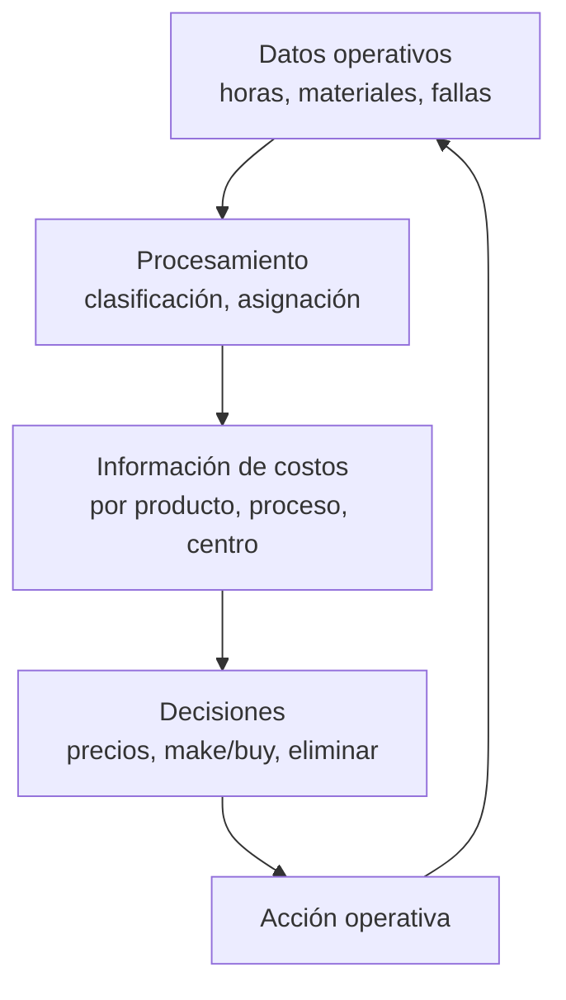

La **contabilidad de costos** es un sistema de información para la gestión interna: su propósito es determinar, clasificar y analizar el costo de producción de bienes y servicios para **controlar recursos, valuar inventarios, fijar precios y tomar decisiones**. {a Apuntes de Cálculo de costos y rendimientos · Unidad 1}

Se diferencia radicalmente de la **contabilidad patrimonial** (externa, histórica, obligatoria, informa a terceros sobre la situación patrimonial) porque la de costos es **interna, analítica, predictiva y orientada a la gestión**. {a Apuntes de Cálculo de costos y rendimientos · Unidad 1}

:::clave No son dos contabilidades distintas, son dos finalidades
La contabilidad patrimonial responde «¿cómo está la empresa?» (foto del pasado). La de costos responde «¿cuánto cuesta producir esto y cómo puedo mejorarlo?» (película para decidir el futuro). {d}
:::

## Sistema de información y marco general

Un sistema de información para la gestión interna requiere datos **confiables, oportunos y relevantes**. La contabilidad de costos cumple ese rol: transforma datos operativos (horas, metros, kilos, fallas) en información económica para decidir. {a Apuntes de Cálculo de costos y rendimientos · Unidad 1}


{d}

## Características y funciones

| Característica | Qué significa |
|---|---|
| **Interna** | No la exigen leyes externas; la diseña la empresa para sí misma. |
| **Analítica** | Descompone el costo total en sus partes (MPD, MOD, CIF). |
| **Predictiva** | Usa costos históricos para estimar costos futuros. |
| **Orientada a la gestión** | Sirve para decidir, no solo para registrar. | {a Apuntes de Cálculo de costos y rendimientos · Unidad 1}

**Funciones**: determinar el costo → clasificarlo → analizarlo → controlar recursos → valuar inventarios → fijar precios → tomar decisiones. {a Apuntes de Cálculo de costos y rendimientos · Unidad 1}

## Costo, gasto y pérdida

- **Costo**: gasto incurrido para producir un bien o servicio; **se capitaliza en el inventario** hasta la venta (es un activo mientras no se vende). Ej.: la harina que compró la panadería.
- **Gasto**: erogación del período que **se carga directamente al resultado** (no se capitaliza). Ej.: el alquiler del local, la publicidad.
- **Pérdida**: disminución del patrimonio sin contraprestación, ajena a la actividad principal. Ej.: un incendio, un robo, la obsolescencia total de mercadería. {a Apuntes de Cálculo de costos y rendimientos · Unidad 1}

```asociar
titulo: Costo, gasto o pérdida
pares:
  - [Harina comprada para hacer pan, Costo - se capitaliza en inventario]
  - [Alquiler de la panadería, Gasto - se carga al resultado del mes]
  - [Mermelada que se vence y se tira, Pérdida - disminuye patrimonio sin contraprestación]
  - [Sueldo del panadero, Costo - mano de obra directa]
  - [Publicidad en Instagram, Gasto - venta/administración]
  - [Robo de la caja registradora, Pérdida - ajena a la actividad]
o: d
```

:::sintesis
- Contabilidad patrimonial = externa, histórica, obligatoria. Contabilidad de costos = interna, analítica, predictiva.
- Costo se capitaliza (inventario), gasto va al resultado, pérdida no tiene contraprestación.
- La contabilidad de costos transforma datos operativos en información para decidir. {a Apuntes de Cálculo de costos y rendimientos · Unidad 1}
:::
