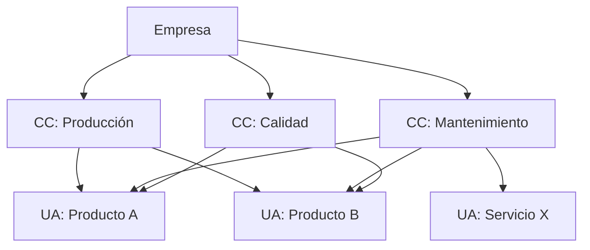

Los **centros de costo** son unidades organizativas o funcionales donde se acumulan los costos para su **control y asignación**. Permiten medir la eficiencia y responsabilizar a los gestores: «¿cuánto cuesta mantener este departamento?» {a Apuntes de Cálculo de costos y rendimientos · Unidad 1}

- **Centro de costo**: unidad donde se acumulan costos (ej.: taller de torneado, sector de pintura, gerencia de producción).
- **Unidad de análisis**: objeto sobre el que se mide el costo (producto, servicio, proyecto, lote). {a Apuntes de Cálculo de costos y rendimientos · Unidad 1}


{d}

## Costos directos e indirectos

La distinción es **trazabilidad**: ¿puedo señalar este costo y decir «este peso fue 100% para el Producto A»? {a Apuntes de Cálculo de costos y rendimientos · Unidad 1}

| Tipo | Definición | Ejemplos |
|---|---|---|
| **Costo directo** | Trazable **directa y exclusivamente** a una unidad de análisis. | MPD (madera para una mesa), MOD (horas del carpintero en esa mesa) |
| **Costo indirecto** | No es trazable directamente; beneficia a **varias** unidades y debe **distribuirse** por criterios (bases de reparto). | Alquiler de la fábrica, luz, supervisión, depreciación de máquinas compartidas | {a Apuntes de Cálculo de costos y rendimientos · Unidad 1}

Los costos indirectos se distribuyen usando **bases de reparto** (drivers): horas máquina, horas mano de obra, metros cuadrados, valor de producción, etc. La elección del driver afecta el costo final de cada producto. {a Apuntes de Cálculo de costos y rendimientos · Unidad 1}

```clasificar
titulo: Directo o indirecto
categorias: [Costo directo, Costo indirecto]
items:
  - {x: Madera para fabricar una mesa, cat: 0, porque: Se puede medir exactamente cuánta madera fue a esa mesa}
  - {x: Sueldo del carpintero que hizo la mesa, cat: 0, porque: Horas medibles en ese producto}
  - {x: Alquiler del taller, cat: 1, porque: Beneficia a todos los productos; se reparte por m² o horas}
  - {x: Electricidad de la fábrica, cat: 1, porque: No hay medidor por producto; se reparte por horas máquina}
  - {x: Tornillos para la mesa, cat: 0, porque: Trazables a ese producto (aunque a veces se tratan como indirectos por ser insignificantes)}
  - {x: Depreciación de la sierra circular, cat: 1, porque: La sierra corta madera para muchos productos}
o: d
```

## Estructura del costo

La estructura organiza los elementos en **niveles** para facilitar el análisis y la toma de decisiones: desde el costo total de la empresa hasta el costo unitario de cada producto. Cada nivel responde a una pregunta distinta de gestión. {a Apuntes de Cálculo de costos y rendimientos · Unidad 1}

```explorable
titulo: Estructura del costo en niveles
variante: capas
nodos:
  - {id: total, titulo: Costo Total Empresa, resumen: Suma de todos los costos, detalle: 'Incluye producción, administración, ventas, financiero. Responde: ¿cuánto cuesta sostener la empresa?'}
  - {id: produccion, titulo: Costo de Producción, resumen: Solo costos de fabricar, detalle: 'MPD + MOD + CIF. Responde: ¿cuánto cuesta fabricar?'}
  - {id: unidad, titulo: Costo Unitario, resumen: Costo de producción / unidades producidas, detalle: 'Base para fijar precio y valuar inventario. Responde: ¿cuánto cuesta cada unidad?'}
o: d
```

:::sintesis
- Los centros de costo acumulan costos por unidad organizativa; las unidades de análisis son los objetos de medición (productos, servicios).
- Costo directo = trazable 100% a un producto. Costo indirecto = se reparte por bases de reparto (drivers).
- La estructura va del total empresarial al costo unitario. {a Apuntes de Cálculo de costos y rendimientos · Unidad 1}
:::
