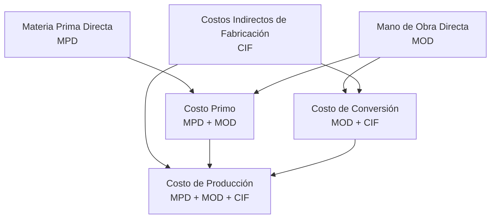

El **costo** es el gasto incurrido para producir un bien o servicio. Sus objetivos: controlar recursos, valuar inventarios, fijar precios, tomar decisiones. {a Apuntes de Cálculo de costos y rendimientos · Unidad 2}

## Los tres elementos del costo de producción


{d}

## Materia Prima Directa (MPD)

Materiales que **forman parte integral del producto** y cuyo costo es **trazable** al mismo. {a Apuntes de Cálculo de costos y rendimientos · Unidad 2}

**Valuación de la MPD**: costo de adquisición + fletes + seguros + aranceles + gastos hasta que llega a planta. **No incluye** descuentos por pronto pago (esos son ingresos financieros). {a Apuntes de Cálculo de costos y rendimientos · Unidad 2}

:::ejemplo Valuación de MPD
Una fábrica compra 1.000 kg de acero a $500/kg.
- Precio lista: $500.000
- Flete: $15.000
- Seguro: $3.000
- Arancel: $10.000
- Descuento 2% por pago a 10 días: -$10.000 (ingreso financiero, NO reduce MPD)
**Costo MPD = $528.000** ($528/kg) {a Apuntes de Cálculo de costos y rendimientos · Unidad 2}
:::

## Mano de Obra Directa (MOD)

Trabajo de los operarios que **transforman directamente** la materia prima en producto terminado. Incluye: sueldos básicos, horas extra, aportes patronales, vacaciones, aguinaldo, capacitación. {a Apuntes de Cálculo de costos y rendimientos · Unidad 2}

:::ejemplo Cálculo de costo horario MOD
Operario: sueldo básico $800.000/mes
- Aportes patronales (23%): $184.000
- Vacaciones + aguinaldo (1/12 c/u): $133.333
- Horas/mes: 176 hs
**Costo horario = ($800.000 + $184.000 + $133.333) / 176 = $6.348/hora**
Si el producto lleva 2,5 hs de MOD → **MOD unitario = $15.870** {a Apuntes de Cálculo de costos y rendimientos · Unidad 2}
:::

## Costos Indirectos de Fabricación (CIF)

Costos de producción **no trazables directamente** al producto: supervisión, mantenimiento, energía, depreciación de planta, seguros, impuestos a la propiedad, alquiler prorrateado, servicios generales. {a Apuntes de Cálculo de costos y rendimientos · Unidad 2}

Se distribuyen mediante **tasas de reparto** preestablecidas (normalmente horas máquina u horas MOD). {a Apuntes de Cálculo de costos y rendimientos · Unidad 2}

## Conceptos derivados (rubros del precio de venta)

| Concepto | Fórmula | Qué incluye |
|---|---|---|
| **Costo Primo** | MPD + MOD | Materiales + mano de obra directa |
| **Costo de Conversión** | MOD + CIF | El costo de «transformar» la materia prima |
| **Costo de Producción** | MPD + MOD + CIF = Primo + CIF | Base para valuar inventarios |
| **Costo de Venta** | Costo de producción de lo vendido | Se carga al resultado al vender |
| **Costo Total** | Costo de producción + admin + ventas + financiero | Para análisis de rentabilidad total | {a Apuntes de Cálculo de costos y rendimientos · Unidad 2}

```asociar
titulo: Relaciona cada concepto con su fórmula
pares:
  - [Costo Primo, MPD + MOD]
  - [Costo de Conversión, MOD + CIF]
  - [Costo de Producción, MPD + MOD + CIF]
  - [Costo de Venta, Costo de producción de lo vendido]
  - [Costo Total, Producción + Admin + Ventas + Financiero]
o: d
```

:::ejemplo Cálculo completo
Una fábrica de muebles produce 100 sillas/mes.
- MPD (madera, tornillos, barniz): $2.500.000
- MOD (2.000 hs × $6.348): $12.696.000
- CIF (tasa $8.000/h máquina × 1.500 hs): $12.000.000 {a Apuntes de Cálculo de costos y rendimientos · Unidad 2}

**Costo Primo** = $2.500.000 + $12.696.000 = **$15.196.000**
**Costo de Conversión** = $12.696.000 + $12.000.000 = **$24.696.000**
**Costo de Producción** = $2.500.000 + $12.696.000 + $12.000.000 = **$27.196.000**
**Costo Unitario** = $27.196.000 / 100 = **$271.960/silla** {a Apuntes de Cálculo de costos y rendimientos · Unidad 2}
:::

:::sintesis
- MPD = materiales trazables al producto (incluye fletes, seguros, aranceles; no descuentos).
- MOD = mano de obra que transforma (sueldo + aportes + beneficios / horas reales).
- CIF = costos indirectos de producción (se reparten por tasas).
- Primo = MPD + MOD; Conversión = MOD + CIF; Producción = MPD + MOD + CIF. {a Apuntes de Cálculo de costos y rendimientos · Unidad 2}
:::
