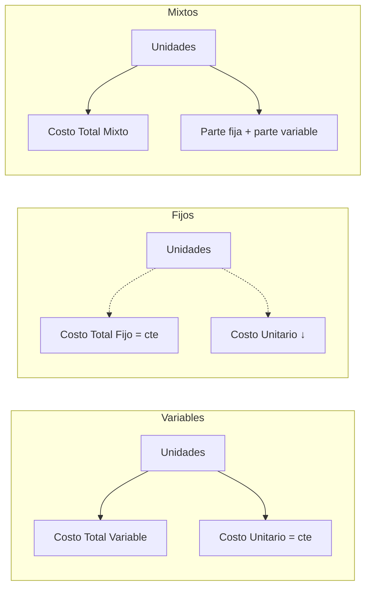
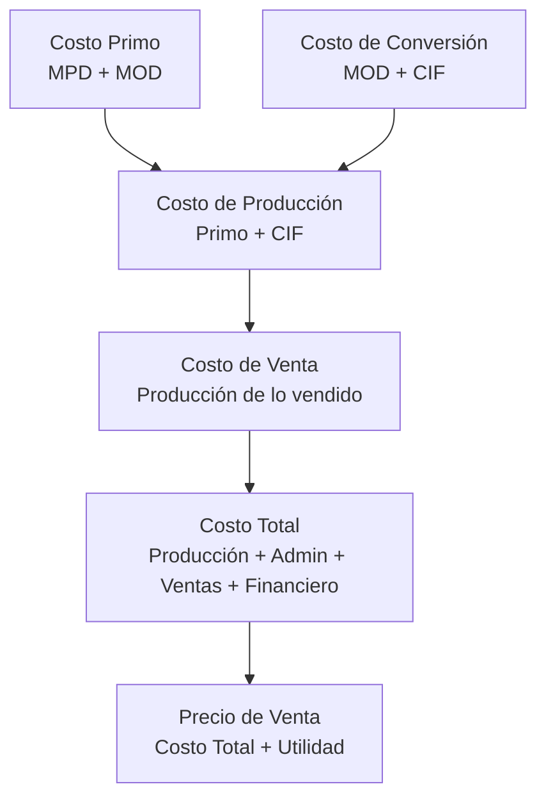

La clasificación permite **analizar el comportamiento del costo** ante cambios de volumen, tomar decisiones de make/buy, y diseñar estructuras de costeo. {a Apuntes de Cálculo de costos y rendimientos · Unidad 2}

## Clasificación por variabilidad (respecto al volumen de producción)

{d}

| Tipo | Costo Total | Costo Unitario | Ejemplos |
|---|---|---|---|
| **Variable** | Aumenta proporcionalmente | Constante | MPD, MOD por pieza, comisiones por venta |
| **Fijo** | Constante en rango relevante | Disminuye al producir más | Alquiler, depreciación, sueldos fijos, seguros |
| **Mixto (semivariable)** | Tiene componente fijo y variable | Variable | Electricidad (cargo fijo + consumo), mantenimiento (base + por uso) | {a Apuntes de Cálculo de costos y rendimientos · Unidad 2}

:::ejemplo Separación de costo mixto (método alto-bajo)
Datos de electricidad:
- Mes alto: 5.000 hs máquina → $450.000
- Mes bajo: 2.000 hs máquina → $270.000 {a Apuntes de Cálculo de costos y rendimientos · Unidad 2}

Variable unitario = ($450.000 - $270.000) / (5.000 - 2.000) = **$60/hs máquina**
Fijo = $450.000 - ($60 × 5.000) = **$150.000**
Ecuación: **Y = $150.000 + $60 × hs máquina** {a Apuntes de Cálculo de costos y rendimientos · Unidad 2}
:::

## Clasificación por asignación (trazabilidad)

- **Directo**: trazable a una unidad de análisis (MPD, MOD).
- **Indirecto**: no trazable directamente; se distribuye (CIF, alquiler, supervisión). {a Apuntes de Cálculo de costos y rendimientos · Unidad 2}

## Clasificación por función

| Función | Qué incluye |
|---|---|
| **Producción** | MPD, MOD, CIF (costo de fabricar) |
| **Administración** | Sueldos gerenciales, oficina, legales, contabilidad |
| **Ventas/Comercialización** | Publicidad, comisiones, flete de entrega, sueldos vendedores |
| **Financiera** | Intereses, comisiones bancarias, diferencias de cambio | {a Apuntes de Cálculo de costos y rendimientos · Unidad 2}

## Clasificación por otros criterios (resumen)

| Criterio | Tipos |
|---|---|
| **Período de relevamiento** | Históricos (ocurridos) vs. Predeterminados (estándar, estimados) |
| **Relación con el resultado** | De producción (inventariable) vs. De período (gasto directo al resultado) |
| **Desembolso** | Requieren salida de caja vs. No requieren (depreciación, amortización) |
| **Control** | Controlables (decide el gerente) vs. No controlables (impuestos) |
| **Momento de imputación** | Actuales (cuando ocurren) vs. Diferidos (se distribuyen en el tiempo) |
| **Alternativas** | Relevantes (cambian entre alternativas) vs. Irrelevantes (iguales en todas) |
| **Disponibilidad** | Disponibles para decisión vs. Comprometidos (contratos) | {a Apuntes de Cálculo de costos y rendimientos · Unidad 2}

## Rubros del precio de venta (orden lógico)

{d}

:::clave El orden importa para el análisis
Cada rubro agrega una capa de costos. **Costo Primo** = decisión de compras/producción. **Costo de Conversión** = eficiencia de planta. **Costo de Producción** = valoración de inventario. **Costo de Venta** = matching ingresos-costos. **Costo Total** = rentabilidad neta. {d}
:::

:::sintesis
- Por variabilidad: fijos (constantes en total), variables (constantes unitarios), mixtos.
- Por asignación: directos (trazables) vs. indirectos (reparto).
- Por función: producción, administración, ventas, financiera.
- Los rubros se acumulan: Primo → Producción → Venta → Total → Precio. {a Apuntes de Cálculo de costos y rendimientos · Unidad 2}
:::
