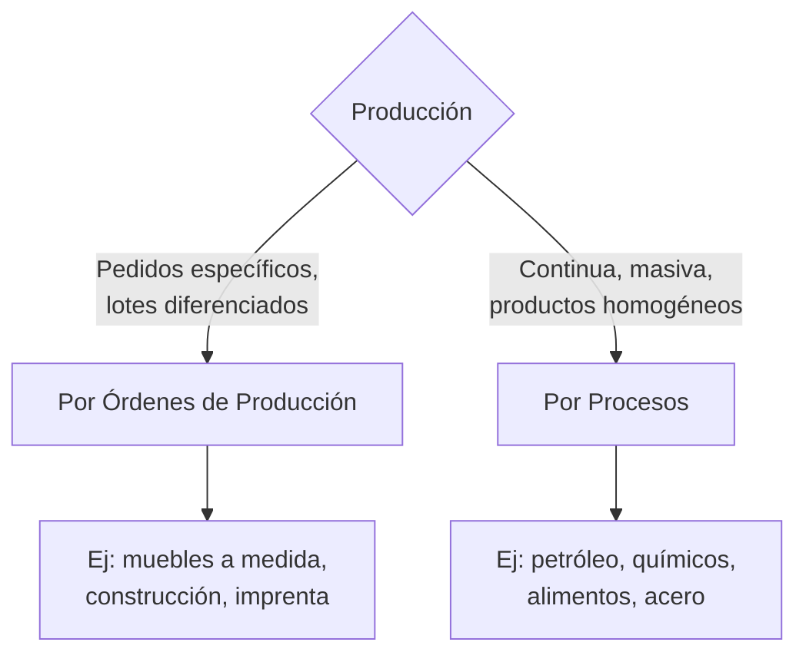

Los sistemas de costos responden a **cómo se acumulan y asignan los costos** a los productos/servicios. La elección depende del tipo de producción. {a Apuntes de Cálculo de costos y rendimientos · Unidad 3}

## Sistemas de costos


{d}

## Por órdenes de producción

Se acumulan costos **por cada orden de trabajo o lote**. Cada orden tiene su hoja de costo (MPD, MOD, CIF aplicado). {a Apuntes de Cálculo de costos y rendimientos · Unidad 3}

- **Cuándo**: productos a medida, lotes pequeños, trazabilidad individual crítica.
- **Documento clave**: hoja de costo por orden (número de orden, cliente, MPD, MOD, CIF aplicado, total, unitario).
- **CIF**: se aplica con tasa predeterminada (ej.: $/hora máquina o $/hora MOD). {a Apuntes de Cálculo de costos y rendimientos · Unidad 3}

## Por procesos

Se acumulan costos **por departamento o proceso productivo** durante un período. El costo unitario = costos del período / unidades equivalentes producidas. {a Apuntes de Cálculo de costos y rendimientos · Unidad 3}

- **Cuándo**: producción continua, masiva, productos homogéneos.
- **Concepto clave**: **unidades equivalentes** (unidades terminadas + unidades en proceso × % avance). Permiten expresar el trabajo en proceso como si fueran unidades terminadas completas para calcular el costo unitario del período.
- **CIF**: se acumula por departamento y se prorratea entre unidades terminadas y en proceso. {a Apuntes de Cálculo de costos y rendimientos · Unidad 3}

:::ejemplo Unidades equivalentes
Departamento de pintura: 10.000 unidades terminadas + 2.000 en proceso al 60%.
Unidades equivalentes = 10.000 + (2.000 × 0,60) = **11.200**.
Si costos del período = $5.600.000 → Costo unitario = $500/u. {a Apuntes de Cálculo de costos y rendimientos · Unidad 3}
:::

```clasificar
titulo: ¿Por órdenes o por procesos?
categorias: [Por órdenes, Por procesos]
items:
  - {x: Fabricación de muebles a medida, cat: 0, porque: Cada pedido es único, lotes pequeños, trazabilidad individual}
  - {x: Refinación de petróleo, cat: 1, porque: Producción continua, masiva, producto homogéneo}
  - {x: Imprenta de libros personalizados, cat: 0, porque: Cada trabajo (orden) tiene specs distintas}
  - {x: Elaboración de yogur en envases estándar, cat: 1, porque: Flujo continuo, producto homogéneo, miles de unidades idénticas}
  - {x: Construcción de una casa, cat: 0, porque: Proyecto único, especificado por el cliente}
  - {x: Producción de cemento, cat: 1, porque: Proceso continuo, salida homogénea}
o: d
```

## Costeo por absorción vs. Costeo variable

La diferencia está en **cómo se tratan los CIF fijos**. {a Apuntes de Cálculo de costos y rendimientos · Unidad 3}

| Aspecto | **Costeo por Absorción (Full Costing)** | **Costeo Variable (Direct Costing)** |
|---|---|---|
| **CIF fijos** | Se inventarían (van al costo del producto) | Son gasto del período (no inventariable) |
| **Costo unitario** | Incluye CIF fijos prorrateados | Solo costos variables |
| **Utilidad** | Depende del volumen producido (absorción de fijos) | Depende solo del volumen vendido |
| **Inventario final** | Más alto (incluye fijos) | Más bajo (solo variables) |
| **Uso** | Externo (GAAP, impuestos), valuación inventarios | Interno (decisiones, CVU, punto de equilibrio) | {a Apuntes de Cálculo de costos y rendimientos · Unidad 3}

:::ejemplo Impacto en utilidad: absorción vs. variable
Produce 10.000, vende 8.000. CIF fijos = $2.000.000. Margen variable unitario = $500.
- **Absorción**: CIF fijos al inventario = $2.000.000 × (2.000/10.000) = $400.000 en inventario.
  Utilidad = (8.000 × $500) - $2.000.000 = **$2.000.000**
- **Variable**: CIF fijos todo gasto = $2.000.000.
  Utilidad = (8.000 × $500) - $2.000.000 = **$2.000.000** (¡igual aquí porque no hay inventario inicial!) {a Apuntes de Cálculo de costos y rendimientos · Unidad 3}

Si hubiera inventario inicial de 1.000 (absorción), la utilidad difiere porque en absorción los fijos «viajan» en el inventario. {a Apuntes de Cálculo de costos y rendimientos · Unidad 3}
:::

**Conclusión**: para **decisiones internas** (CVU, punto de equilibrio, make/buy, pedidos especiales) se usa **costeo variable**. Para **reportes externos** (balances, impuestos) se exige **absorción**. {a Apuntes de Cálculo de costos y rendimientos · Unidad 3}

## Costos según el momento de la información

| Tipo | Cuándo se calcula | Uso |
|---|---|---|
| **Históricos** | A posteriori (ocurridos) | Control, análisis de desviaciones, reportes |
| **Predeterminados** | Antes de producir | Presupuestos, fijación de precios, licitaciones |
| &nbsp;&nbsp;• **Estimados** | Aproximación basada en experiencia | Rápidos, menos precisión |
| &nbsp;&nbsp;• **Estándar** | Ingeniería de métodos + precios esperados | Control riguroso, variaciones, eficiencia | {a Apuntes de Cálculo de costos y rendimientos · Unidad 3}

El **costo estándar** es el costo predeterminado **más riguroso**: se basa en estudios de tiempos y movimientos, normas de eficiencia, y precios esperados de insumos. Es la base para el **análisis de variaciones** (próxima lección). {a Apuntes de Cálculo de costos y rendimientos · Unidad 3}

```explorable
titulo: "Comparación: Histórico vs. Estándar vs. Real"
variante: linea
nodos:
  - {id: hist, titulo: Histórico, resumen: "Lo que pasó", detalle: "Base para análisis posterior, pero llega tarde para corregir"}
  - {id: est, titulo: Estándar, resumen: "Lo que debería costar", detalle: "Meta de eficiencia, base para control preventivo"}
  - {id: real, titulo: Real, resumen: "Lo que costó realmente", detalle: "Se compara contra estándar → variación"}
o: d
```

:::sintesis
- **Por órdenes**: productos a medida, lotes diferenciados. **Por procesos**: continuo, masivo, homogéneo.
- **Absorción** (externo): CIF fijos al producto. **Variable** (interno): CIF fijos = gasto del período.
- **Históricos** = ocurrieron. **Estándar** = meta de eficiencia. **Variación** = Real − Estándar. {a Apuntes de Cálculo de costos y rendimientos · Unidad 3}
:::
