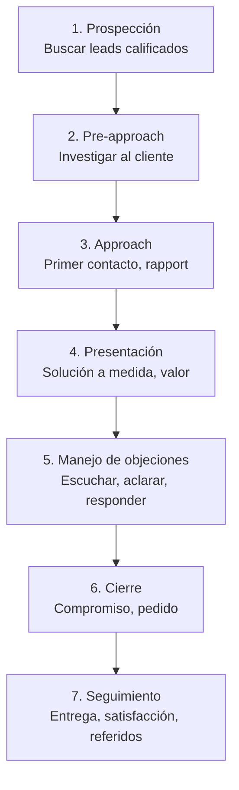

El principio rector: **la empresa debe vender como el cliente compra**. Desalineación = ciclos largos, *win rate* bajo, fricción. {a Apuntes de Gestión de Ventas · Unidad 2}

## Proceso de venta personal (7 etapas clásicas)


{d}

## Proceso de compra organizacional (B2B) y UTD

En B2B no hay «un comprador», hay una **Unidad de Toma de Decisiones (UTD)** / Centro de Compras: {a Apuntes de Gestión de Ventas · Unidad 2}

| Rol en la UTD | Quién es | Qué evalúa | Cómo influir |
|---|---|---|---|
| **Usuario** | Quien usará el producto | Facilidad, ergonomía, productividad | Demo hands-on, trial, casos de uso |
| **Influenciador** | Técnico, ingeniería, TI | Especificaciones, integración, seguridad | *White papers*, *specs*, PoC |
| **Comprador** | *Purchasing*, *procurement* | Precio, términos, condiciones, proveedores | Negociación, *total cost of ownership* |
| **Decididor** | Gerente, director, C-level | ROI, riesgo estratégico, *fit* cultural | *Business case*, referencias, ejecutivo-a-ejecutivo |
| **Guardián** | Recepción, asistentes, *gatekeepers* | Acceso, filtrado | Respeto, valor para el guardián | {a Apuntes de Gestión de Ventas · Unidad 2}

:::clave La UTD no es estática
Los roles cambian según la **situación de compra** (ver abajo). Un mismo jugador puede ser usuario en una compra y decisor en otra. Mapear la UTD *por oportunidad* es crítico. {d}
:::

## Demanda derivada

La demanda de un bien industrial **deriva de la demanda del bien final** que ayuda a producir. Ej.: la demanda de acero deriva de la demanda de autos. Implicaciones: {a Apuntes de Gestión de Ventas · Unidad 2}

- **Volatilidad**: pequeños cambios en demanda final → grandes oscilaciones en demanda derivada (*efecto bullwhip*).
- **Inelasticidad** a corto plazo: si baja precio del acero, no se compran más autos.
- **Compra en conjunto**: se compran insumos en proporciones fijas (acero + pintura + tornillos). {a Apuntes de Gestión de Ventas · Unidad 2}

## Situaciones de compra (Robinson, Faris & Wind)

| Situación | Descripción | Implicación para el vendedor |
|---|---|---|
| **Nueva tarea** (*new task*) | Primera vez que compran ese producto/servicio | Alto riesgo, mucha info, ciclo largo, *consultiva* pura |
| **Recompra directa** (*straight rebuy*) | Rutina, mismo proveedor, mismas condiciones | Facilitar reorden, automatizar, *loyalty* |
| **Recompra modificada** (*modified rebuy*) | Cambian specs, precio, proveedor o términos | Oportunidad de entrar/desplazar, demostrar valor diferencial | {a Apuntes de Gestión de Ventas · Unidad 2}

```clasificar
titulo: Clasifica la situación de compra
categorias: [Nueva tarea, Recompra directa, Recompra modificada]
items:
  - {x: Empresa compra CRM por primera vez, cat: 0, porque: Nueva tarea, alto riesgo, necesita evaluación completa}
  - {x: Reorden de papel para fotocopiadora al mismo proveedor, cat: 1, porque: Rutina, mismos términos, recompra directa}
  - {x: Cambian de proveedor de logística por problemas de SLA, cat: 2, porque: Recompra modificada, buscan mejor servicio}
  - {x: Compran servidor nuevo para migración a cloud, cat: 0, porque: Primera vez, specs técnicas nuevas, nueva tarea}
  - {x: Renuevan licencia de Office 365 anualmente, cat: 1, porque: Rutina, mismo proveedor, recompra directa}
o: d
```

## Adaptación al comprador (estilos de comportamiento)

Modelo DISC aplicado a ventas: {a Apuntes de Gestión de Ventas · Unidad 2}

| Estilo | Cómo compra | Cómo venderle |
|---|---|---|
| **Dominante (D)** | Rápido, decide solo, foco en resultado | Directo, ejecutivo, *bottom line*, opciones claras |
| **Influyente (I)** | Social, busca reconocimiento, emocional | Entusiasta, testimonios, reconocimiento público |
| **Estable (S)** | Cauteloso, consensuado, leal | Paciente, garantías, referencias, bajo riesgo |
| **Concienzudo (C)** | Analítico, datos, detalle, lento | *Specs*, datos, comparativas, prueba técnica | {a Apuntes de Gestión de Ventas · Unidad 2}

```asociar
titulo: Estilo DISC ↔ Enfoque de venta
pares:
  - [Dominante (D), Directo, ejecutivo, bottom line]
  - [Influyente (I), Entusiasta, testimonios, reconocimiento]
  - [Estable (S), Paciente, garantías, referencias]
  - [Concienzudo (C), Analítico, datos, especificaciones]
o: d
```

:::sintesis
- Principio: vender como el cliente compra (alineación compra-venta).
- B2B: UTD con 5 roles (usuario, influenciador, comprador, decisor, guardián).
- Demanda derivada: volátil, inelástica, en conjunto.
- 3 situaciones de compra: nueva tarea, recompra directa, recompra modificada.
- Adaptar estilo DISC: D=directo, I=entusiasta, S=paciente, C=analítico. {a Apuntes de Gestión de Ventas · Unidad 2}
:::