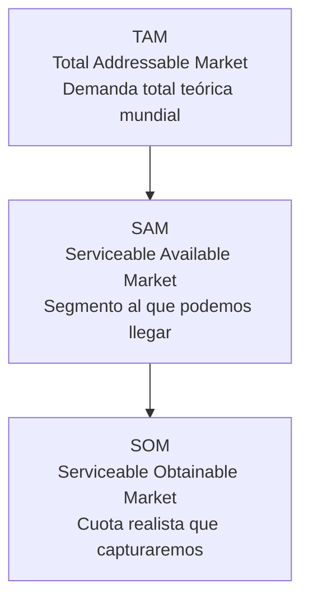
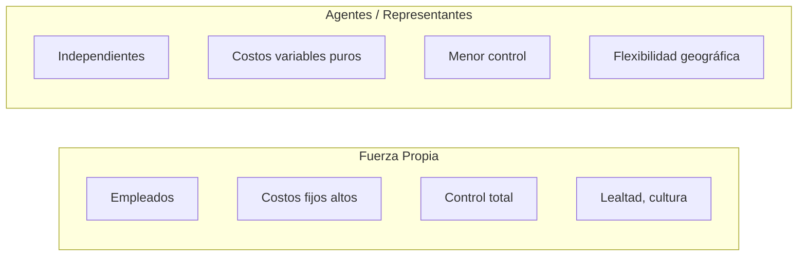

El gerente de ventas es el **arquitecto del motor comercial**: define a cuánto aspiramos (estimación), cómo lo repartimos (presupuesto/cuotas) y con qué estructura (fuerza propia vs. agentes). {a Apuntes de Gestión de Ventas · Unidad 3}

## Jerarquía de métricas de mercado


{d}

- **TAM**: Demanda total si no hubiera barreras (geográficas, regulatorias, tecnológicas).
- **SAM**: Porción del TAM que nuestro modelo de negocio *puede* servir (geografía, canales, regulación).
- **SOM**: Porción del SAM que *realísticamente* capturaremos (competencia, recursos, *go-to-market*). {a Apuntes de Gestión de Ventas · Unidad 3}

:::ejemplo SaaS B2B
TAM: $50B global de software de RRHH.
SAM: $8B en LatAm + España (idioma, zona horaria, leyes laborales compatibles).
SOM: $120M en 3 años (equipo actual, 2% del SAM, foco en PyMEs 50–500 empleados). {d}
:::

## Métodos de estimación de mercado

| Método | Cómo funciona | Cuándo usarlo | Ventaja / Riesgo |
|---|---|---|---|
| **Top-down** | TAM × % participación esperada | Mercados nuevos, datos macro disponibles | Rápido, pero optimista |
| **Bottom-up** | Suma de clientes potenciales × ticket promedio × tasa conversión | Datos de clientes/leads disponibles | Realista, pero lento |
| **Análogos** | Benchmark vs. competidor/comparable | Mercado similar maduro | Validador externo |
| **Regresión / Econométrico** | Variables macro (PIB, empleo, gasto TI) vs. ventas históricas | Serie histórica ≥ 5 años | Predictivo, pero asume estabilidad | {a Apuntes de Gestión de Ventas · Unidad 3}

:::clave Triangulación
**Nunca uses un solo método**. Haz top-down, bottom-up y análogos; si convergen ±15%, tienes confianza. Si divergen, investiga supuestos. {d}
:::

## Presupuesto de ventas: funciones y tipos

| Función | Qué hace |
|---|---|
| **Planificación** | Traduce objetivos en recursos (gente, $, tiempo). |
| **Coordinación** | Alinea marketing, producción, finanzas, logística. |
| **Control** | Base para *variance analysis* (real vs. presupuesto). |
| **Motivación** | Cuotas = metas medibles para la fuerza de ventas. | {a Apuntes de Gestión de Ventas · Unidad 3}

| Tipo de presupuesto | Característica |
|---|---|
| **Incremental** | Año anterior ± % (fácil, arrastra ineficiencias). |
| **Base cero (ZBB)** | Cada programa se justifica desde cero (riguros, lento). |
| **Basado en actividades (ABB)** | Costea actividades que generan ventas (preciso, complejo). |
| **Revolvente** | Se actualiza cada mes/trimestre añadiendo período (siempre 12 meses vista). | {a Apuntes de Gestión de Ventas · Unidad 3}

## Estructura de la fuerza de ventas


{d}

| Criterio | **Fuerza propia** | **Agentes / Comisionistas** |
|---|---|---|
| **Costo** | Fijo alto (sueldo + beneficios + gastos) | Variable puro (solo comisión) |
| **Control** | Total (horas, método, CRM, ética) | Limitado (resultado, no método) |
| **Punto de equilibrio (Vb)** | Alto (cubre fijos) | Bajo (solo variable) |
| **Ideal para** | Cuentas clave, venta compleja, estrategia | Zonas lejanas, bajo volumen, prueba de mercado | {a Apuntes de Gestión de Ventas · Unidad 3}

> **Regla del punto de indiferencia (Vb)**: si volumen esperado > Vb → fuerza propia; si < Vb → agentes. Vb = CF_fija_propria / (Comisión_agente − CVu_propria). {a Apuntes de Gestión de Ventas · Unidad 3}

```explorable
titulo: "Simulador: Fuerza propia vs. Agentes"
variante: pasos
nodos:
  - {id: base, titulo: Escenario base, resumen: "CF prop=$2M, CVu=$400k/vend, Com=15%", detalle: "Vb=5.000 u. Si Q>5k -> propia"}
  - {id: alta_com, titulo: "Comisión agente 20%", resumen: "Vb sube", detalle: "Más caro el agente, Vb=6.667 u"}
  - {id: baja_cf, titulo: "CF propia $1M", resumen: "Vb baja", detalle: "Propia más accesible, Vb=2.500 u"}
o: d
```

:::sintesis
- Métricas de mercado: TAM (total) → SAM (alcanzable) → SOM (capturable).
- Estimación: triangula top-down, bottom-up y análogos.
- Presupuesto: planifica, coordina, controla, motiva. Tipos: incremental, base cero, actividades, revolvente.
- Fuerza propia vs. agentes: fijos vs. variables, control vs. flexibilidad. Punto de indiferencia Vb decide. {a Apuntes de Gestión de Ventas · Unidad 3}
:::