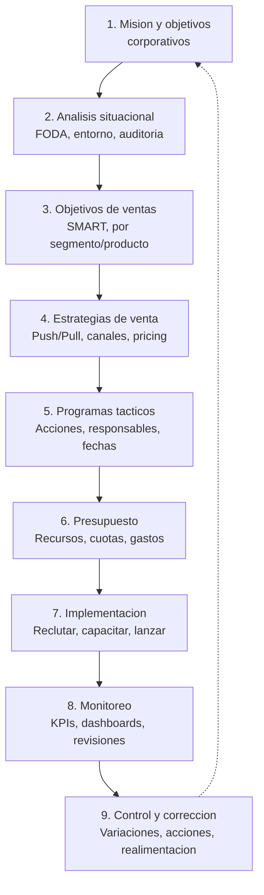
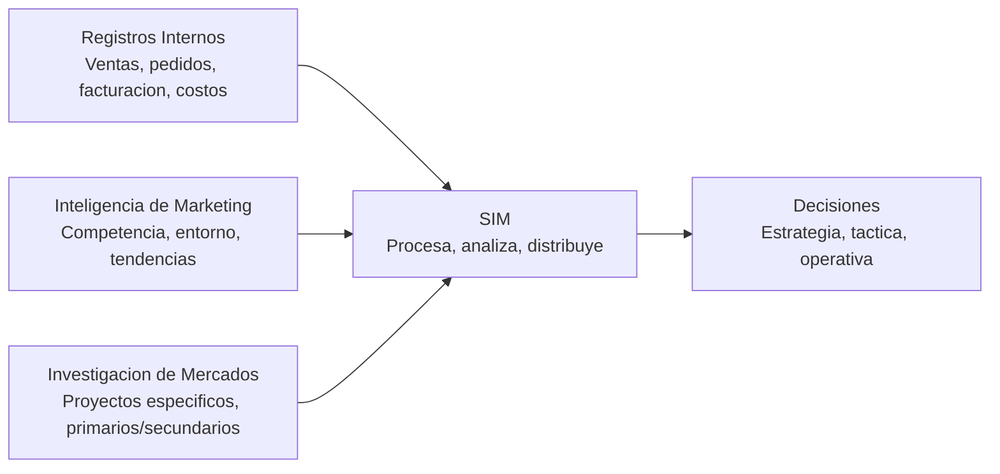
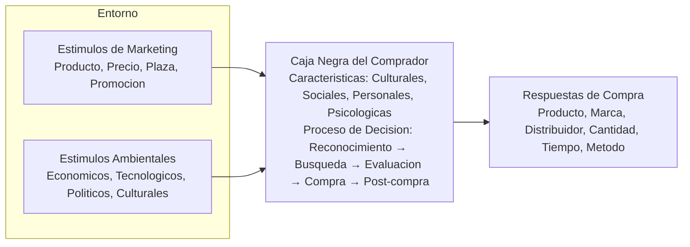

La planeación de ventas no es un evento anual: es un **proceso continuo** de 9 etapas que va de la misión a la acción correctiva. {a Apuntes de Gestión de Ventas · Unidad 4}

## Proceso de planeación de ventas (9 etapas)



## Potencial de mercado, potencial de ventas y pronóstico

| Concepto | Definición | Fórmula / Base |
|---|---|---|
| **Potencial de mercado (QMP)** | Demanda máxima teórica del mercado | TAM × penetración teórica |
| **Potencial de ventas (QVP)** | Lo que *nosotros* podríamos vender | QMP × SOM (cuota esperada) |
| **Pronóstico de ventas (QVF)** | Lo que *realmente* venderemos | QVP × probabilidad × ajustes | {a Apuntes de Gestión de Ventas · Unidad 4}

> **Pronóstico ≠ Objetivo**. El pronóstico es una *predicción* (lo que pasará); el objetivo es una *meta* (lo que queremos). Confundirlos lleva a cuotas irreales o sandbagging. {d}

## Métodos de pronóstico

| Categoría | Método | Cuándo |
|---|---|---|
| **Cualitativos** | *Jury of executive opinion*, *Delphi*, *Sales force composite* | Pocos datos históricos, mercado nuevo |
| **Series temporales** | Promedio móvil, suavizamiento exponencial, descomposición estacional | Histórico estable, ≥ 3 años |
| **Causales / Regresión** | Regresión simple/múltiple vs. variables macro (PIB, empleo, gasto TI) | Variables explicativas claras, datos ≥ 5 años |
| **Híbridos** | Combinan varios (promedio ponderado) | Mejor precisión, valida supuestos | {a Apuntes de Gestión de Ventas · Unidad 4}
```explorable
titulo: "Simulador de pronostico: metodo vs. precision"
variante: pasos
nodos:
  - {id: base, titulo: Datos 3 años, resumen: "Estacionalidad + tendencia", detalle: "Suavizamiento exponencial alpha=0.3 MAPE=8%"}
  - {id: reg, titulo: Regresion vs. PIB, resumen: "R²=0.87", detalle: "MAPE=6% pero asume relacion estable"}
  - {id: comp, titulo: Sales force composite, resumen: "Vendedores estiman", detalle: "Sesgo optimista +12%, corregir con historico"}
o: d
```

## Sistema de Información de Marketing (SIM)

El **SIM** recopila, analiza y distribuye información oportuna para la decisión comercial. Componentes: {a Apuntes de Gestión de Ventas · Unidad 4}



## Comportamiento del consumidor (Kotler): modelo estímulo-respuesta


:::clave El comprador B2B vs. B2C
B2B: más racionales, múltiples decisores (UTD), ciclo largo, specs técnicas, post-venta crítico.
B2C: más emocionales, decisor individual, ciclo corto, marca/precio, experiencia. {d}
:::

:::sintesis
- Planeación = 9 etapas cíclicas (misión → análisis → objetivos → estrategia → táctica → presupuesto → implementar → monitorear → corregir).
- QMP (potencial mercado) > QVP (potencial ventas) > QVF (pronóstico). Pronóstico ≠ objetivo.
- Pronóstico: cualitativo (pocos datos), series temporales (histórico), causal (variables macro), híbrido (mejor).
- SIM = registros internos + inteligencia marketing + investigación mercados → decisiones.
- Comprador: estímulos (4P + entorno) → caja negra (cultural, social, personal, psicológico) → decisión → respuesta. {a Apuntes de Gestión de Ventas · Unidad 4}
:::
