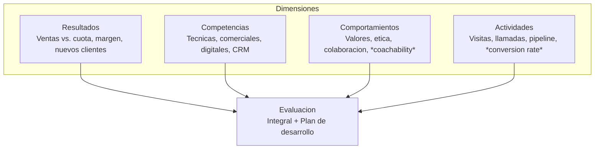

La **gestión de la fuerza de ventas** es el núcleo operativo: convierte la estrategia en resultados a través de personas. {a Apuntes de Gestión de Ventas · Unidad 5}

## Diseño y dimensionamiento (carga de trabajo)

```mermaid Dimensionamiento por carga de trabajo
flowchart TD
  A[Clientes actuales + potenciales] --> B[Frecuencia de visita deseada<br/>por segmento (A/B/C)]
  B --> C[Total visitas/ano requeridas]
  D[Tiempo promedio por visita<br/>(incluye viaje, admin)] --> E[Horas venta/ano por vendedor<br/>(ej. 1.000 hs netas)]
  C & E --> F[Vendedores necesarios<br/]= Visitas totales x hs/visita / hs/ano/vendedor]
  F --> G[Ajuste: rotacion, ramp-up,<br/>nuevos territorios, buffer 10-15%]
```

> **Error común**: usar solo «clientes ÷ vendedores» ignorando frecuencia, viaje y tiempo no venta. {d}

## Reclutamiento y selección

| Fase | Qué hacer | Herramientas validadas |
|---|---|---|
| **Perfil del puesto** | Competencias (técnicas, comerciales, actitudinales), experiencia, *fit* cultural | *Job analysis*, *competency framework* |
| **Reclutamiento** | Fuentes: referidos (mejor *retention*), LinkedIn, bolsas, *headhunters*, ferias | *Employer branding*, *employee referral program* |
| **Screening** | CV + *phone screen* (15 min): motivación, *fit*, requisitos mínimos | *Scorecard* estandarizado |
| **Entrevista** | **Comportamental (STAR)**: «Cuénteme una vez que...» | *Structured interview*, panel 2-3 |
| **Assessment** | *Role-play* de venta, test personalidad (DISC, Big Five), test cognitivo | *Simulation*, *psychometrics* |
| **Decisión** | Consenso panel + *reference check* (2-3 referencias) | *Hiring committee* | {a Apuntes de Gestión de Ventas · Unidad 5}

> **Regla**: contratar por **actitud y capacidad de aprendizaje** (enseñable), no solo experiencia pasada. {d}

## Capacitación: modelo Kirkpatrick (4 niveles)

```mermaid Modelo Kirkpatrick
flowchart TD
  N1[1. Reaccion<br/>¿Gusto? ¿Útil?] --> N2[2. Aprendizaje<br/>¿Adquirio conocimiento/habilidad?]
  N2 --> N3[3. Comportamiento<br/>¿Aplica en el trabajo?]
  N3 --> N4[4. Resultados<br/>¿Impacto negocio? (ventas, margen, retencion)]
```

| Nivel | Qué mide | Cómo medir | Cuándo |
|---|---|---|---|
| **1. Reacción** | Satisfacción, relevancia, *engagement* | Encuesta post-curso (NPS, Likert) | Inmediato |
| **2. Aprendizaje** | Conocimiento/habilidad adquirida | Test pre/post, *role-play* evaluado | Fin del curso |
| **3. Comportamiento** | Transferencia al puesto | *Ride-alongs*, *manager observation*, CRM (nuevas actividades) | 30-90 días |
| **4. Resultados** | Impacto en KPIs | Ventas, margen, *conversion rate*, *cycle time*, retención | 6-12 meses | {a Apuntes de Gestión de Ventas · Unidad 5}

> **Error**: medir solo nivel 1 (sonrisas) y asumir que hay ROI. El 70% de la capacitación falla en nivel 3 (no se aplica). {d}

## Territorios y cuotas

| Criterio territorio | Qué considerar |
|---|---|
| **Potencial de mercado** | QMP/QVP por zona |
| **Carga de trabajo** | Visitas × tiempo = equilibrio |
| **Compacidad geográfica** | Minimizar viaje, maximizar cara a cara |
| **Equidad** | Potencial similar por territorio (evita *quota gaming*) | {a Apuntes de Gestión de Ventas · Unidad 5}

| Tipo de cuota | Base | Ventaja / Riesgo |
|---|---|---|
| **Volumen (unidades/$)** | Histórico + potencial + objetivo | Simple, pero ignora *mix* y margen |
| **Margen / Utilidad** | CMg objetivo | Alinea con rentabilidad, más compleja |
| **Actividad** | Visitas, llamadas, propuestas, demos | Controla *input*, no garantiza *output* |
| **Combinada (híbrida)** | 60% volumen + 30% margen + 10% actividad | Balanceada, requiere *tracking* CRM | {a Apuntes de Gestión de Ventas · Unidad 5}

> **Equidad > igualdad**: cuotas ajustadas por potencial real del territorio, no «misma cuota para todos». {d}

## Motivación y compensación

```mermaid Plan de compensacion tipico
flowchart LR
  Fijo[Sueldo Fijo<br/>Seguridad, vida digna] --> Total[Compensacion Total]
  Var[Variable (Comisiones/Bonos)<br/>Incentivo, alineacion] --> Total
  Ben[Beneficios<br/>Auto, celular, salud, capacitacion] --> Total
```

| Esquema | Fórmula típica | Cuándo |
|---|---|---|
| **Sueldo + comisión lineal** | Fijo + % sobre ventas | Simple, venta transaccional |
| **Escalonado (tramos)** | % sube al superar hitos (ej. 5% < 100%, 7% 100-120%, 10% >120%) | Empeña *overachievement* |
| **Con *draw* (anticipo)** | Anticipo recuperable contra comisiones futuras | *Ramp-up* nuevos, estacionalidad |
| **Bonos por hitos** | $ fijo al alcanzar % de cuota, nuevo cliente, *cross-sell* | Conductas específicas |
| **Híbrido** | Fijo + comisión escalonada + bonos hitos | Lo mejor de ambos | {a Apuntes de Gestión de Ventas · Unidad 5}

> **Regla del 60/40**: en venta consultiva B2B, mix típico 60% fijo / 40% variable. En transaccional/retail, 50/50 o 40/60. {a Apuntes de Gestión de Ventas · Unidad 5}

## Evaluación del desempeño (multidimensional)



| Frecuencia | Qué | Quién |
|---|---|---|
| **Semanal** | *Pipeline review*, actividades, *next steps* | Gerente + vendedor |
| **Mensual** | Resultados vs. cuota, *pipeline health*, *coaching* | Gerente |
| **Trimestral** | Revisión 360° (pares, clientes, gerente), plan desarrollo | Gerente + RRHH |
| **Anual** | *Performance review* formal, compensación, carrera | Gerente + RRHH + Dirección | {a Apuntes de Gestión de Ventas · Unidad 5}

:::sintesis
- Dimensionamiento: carga de trabajo (visitas × tiempo ÷ horas netas) + buffer.
- Selección: entrevista comportamental (STAR) + *role-play* + assessment.
- Capacitación: Kirkpatrick 4 niveles (reacción → aprendizaje → comportamiento → resultados).
- Territorios: potencial + carga + compacidad. Cuotas: híbridas (volumen + margen + actividad).
- Compensación: mix 60/40 fijo/variable (B2B), escalonada para *overachievement*.
- Evaluación: 360° (resultados + competencias + comportamientos + actividades), ciclo semanal/mensual/trimestral/anual. {a Apuntes de Gestión de Ventas · Unidad 5}
:::
