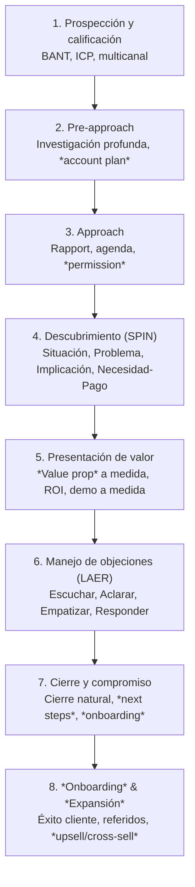

La **venta personal** es comunicación interpersonal directa para crear valor mutuo. En B2B consultiva, el vendedor es **facilitador de la decisión de compra**, no «cerrador». {a Apuntes de Gestión de Ventas · Unidad 6}

## Venta transaccional vs. consultiva (recordatorio)

| | Transaccional | Consultiva |
|---|---|---|
| **Mentalidad** | «Cerrar hoy» | «Ayudar a decidir bien» |
| **Preguntas** | Cerradas, de cierre | Abiertas, de descubrimiento (SPIN) |
| **Presentación** | *Features* genéricas | *Value proposition* a medida |
| **Objeciones** | Trucos para «superar» | Oportunidad de clarificar |
| **Cierre** | Técnicas de presión | Compromiso natural mutuo |
| **Post-venta** | «Gracias, hasta la próxima» | *Onboarding*, *success*, *expansion* | {a Apuntes de Gestión de Ventas · Unidad 6}

## Los 7 pasos de la venta consultiva (actualizados)


{d}

## 1. Prospección y calificación (BANT + ICP)

**ICP (Ideal Customer Profile)**: empresa que *más valor* extrae y *menos cuesta* adquirir/retener. Define: tamaño, industria, geografía, tech stack, dolores, *buying signals*. {a Apuntes de Gestión de Ventas · Unidad 6}

**BANT** (calificación mínima viable):
- **Budget**: ¿Tiene presupuesto aprobado o capacidad de generarlo?
- **Authority**: ¿Es decisor o influye en la UTD?
- **Need**: ¿Tiene dolor real que nuestra solución resuelve?
- **Timing**: ¿Cuándo decide? ¿Hay *compelling event*? {a Apuntes de Gestión de Ventas · Unidad 6}

> **Regla**: no invertir tiempo en oportunidades sin BANT mínimo. {d} {a Apuntes de Gestión de Ventas · Unidad 6}

```asociar
titulo: Calificación BANT ↔ Pregunta clave
pares:
  - [Budget, "¿Tienen presupuesto asignado o proceso para aprobarlo?"]
  - [Authority, "¿Quién más participa en la decisión?"]
  - [Need, "¿Qué problema resuelven hoy y qué les cuesta no resolverlo?"]
  - [Timing, "¿Cuándo quisieran tener la solución implementada?"]
o: d
```

## Prospección multicanal (cadencia)

| Canal | Uso | Métrica |
|---|---|---|
| **LinkedIn Social Selling** | *Connection* + valor (contenido, insight) | *Acceptance rate*, *reply rate* |
| **Email personalizado** | *Hyper-personalizado* (investigación + *hook*) | *Open rate* > 40%, *reply rate* > 10% |
| **Teléfono** | *Voicemail* + seguimiento email | *Connect rate*, *conversation rate* |
| **Referidos** | Pedir a clientes felices (NPS 9-10) | *Referral rate*, *conversion* 3-5× |
| **Eventos / Webinars** | *Thought leadership*, *lead magnet* | *Registrations*, *MQL→SQL* | {a Apuntes de Gestión de Ventas · Unidad 6}

## 2. Pre-approach: *Account plan* y *discovery research*

Investigar antes de contactar: 10-K/annual reports, noticias, *tech stack* (BuiltWith), organigrama (LinkedIn Sales Nav), *competitive intel*, *trigger events* (financiación, M&A, nuevo C-level, expansión). {a Apuntes de Gestión de Ventas · Unidad 6}

## 3. Approach: rapport + agenda + *permission*

> «Antes de empezar, ¿le parece si dedicamos 5 min a entender su situación actual y luego le muestro cómo podríamos ayudar? Si en algún momento no ve valor, paramos. ¿Le parece?» {a Apuntes de Gestión de Ventas · Unidad 6}

## 4. Descubrimiento: metodología SPIN

| Tipo | Pregunta ejemplo | Qué revela |
|---|---|---|
| **Situación** | «¿Cómo gestionan hoy el proceso de X?» | Contexto, *baseline* |
| **Problema** | «¿Qué dificultades tienen con el proceso actual?» | Dolores explícitos |
| **Implicación** | «Si no resuelven esto, ¿qué impacto tiene en costos/clientes/tiempo?» | **Magnitud del dolor** (clave para valor) |
| **Necesidad-Pago** | «Si tuvieran una solución que X, ¿qué valor le darían?» | **Valor percibido** = base del *business case* | {a Apuntes de Gestión de Ventas · Unidad 6}

> **Regla de oro SPIN**: 70% preguntas, 30% hablar. Las preguntas de *Implicación* y *Necesidad-Pago* diferencian al consultivo. {d} {a Apuntes de Gestión de Ventas · Unidad 6}

## 5. Presentación de valor: *Value Proposition* a medida

Estructura: **Contexto (su situación) → Dolor (SPIN) → Nuestra solución (capacidad clave) → Valor cuantificado (ROI, TCO, tiempo) → Prueba (caso similar, demo a medida) → Próximo paso**. {a Apuntes de Gestión de Ventas · Unidad 6}

> No «features», «beneficios para *su* negocio». Use *value calculator* si aplica. {d}

## 6. Manejo de objeciones: método LAER

| Paso | Qué hacer | Ejemplo |
|---|---|---|
| **Listen (Escuchar)** | Silencio activo, no interrumpir, tomar nota | — |
| **Acknowledge (Reconocer)** | Validar: «Entiendo, es una preocupación legítima…» | «Entiendo que el presupuesto es ajustado este trimestre.» |
| **Explore (Explorar)** | Preguntar para entender raíz: «¿Qué hace que...?» | «¿Es el monto total o el flujo de caja del trimestre?» |
| **Respond (Responder)** | Resolver con valor, no combatir | «Ofrecemos pago trimestral / *phased implementation* / ROI en 4 meses.» | {a Apuntes de Gestión de Ventas · Unidad 6}

> **Objeciones comunes**: Precio → *value justification* / *phasing*. «Ya tenemos proveedor» → «¿Qué les falta?» / *trial*. «No es prioridad» → *implicación* del no actuar. {d}

## 7. Cierre: compromiso natural (no trucos)

| Técnica | Cuándo | Ejemplo |
|---|---|---|
| **Cierre por resumen** | Al final de demo exitosa | «Hemos cubierto X, Y, Z. ¿Avanzamos con la piloto la próxima semana?» |
| **Cierre por alternativa** | Dos opciones viables | «¿Prefieren iniciar con 5 usuarios o 10?» |
| **Cierre por *assumptive*** | Señales fuertes de compra | «Les preparo el contrato para firmar el lunes, ¿ok?» |
| **Cierre por *urgency* real** | *Compelling event* real | «Para tenerlo listo antes de su auditoría de julio, debemos firmar esta semana.» |
| **Cierre por *takeaway*** | Dudan por precio | «Entiendo. Si el presupuesto no da, podemos empezar solo con el módulo core y crecer luego.» | {a Apuntes de Gestión de Ventas · Unidad 6}

> **Regla**: el cierre es la **consecuencia natural** del valor demostrado, no un truco final. {d} {a Apuntes de Gestión de Ventas · Unidad 6}

:::clave Caso: ciclo completo de prospección a cierre
Escenario: Vendedor SaaS B2B contacta a CTO de empresa 200 empleados. {a Apuntes de Gestión de Ventas · Unidad 6}

**Paso 1 - Primer paso tras identificar lead en LinkedIn:**
- Investigar (10-K, tech stack, noticias) y enviar mensaje personalizado pidiendo 15 min → **Correcto**: demuestra tarea hecha, abre conversación.
- Enviar demo genérica por email → Incorrecto: spam, baja respuesta, quema el lead.
- Llamar en frío sin investigar → Incorrecto: baja conexión, desperdicia tiempo. {a Apuntes de Gestión de Ventas · Unidad 6}

**Paso 2 - Objeción en descubrimiento: "estamos bien con nuestra herramienta actual"**
- Pregunta SPIN de Implicación: «¿Qué pasa si un incidente crítico no se detecta a tiempo con la herramienta actual?» → **Correcto**: revela costo de no actuar.
- «¿Qué les gusta de su herramienta actual?» → Pregunta de Situación, no profundiza.
- «¿Cuánto pagan por la herramienta actual?» → Pregunta de Presupuesto, prematura. {d}
:::

:::sintesis
- Venta consultiva = facilitador de decisión, no «cerrador».
- 7 pasos: prospección (BANT/ICP) → pre-approach → approach → descubrimiento (SPIN) → presentación valor → objeciones (LAER) → cierre natural.
- SPIN: Situación → Problema → **Implicación** (magnitud) → **Necesidad-Pago** (valor).
- Objeciones: LAER (Escuchar, Reconocer, Explorar, Responder).
- Cierre = consecuencia natural del valor, no truco. Técnicas: resumen, alternativa, *assumptive*, urgencia real, *takeaway*. {a Apuntes de Gestión de Ventas · Unidad 6}
:::