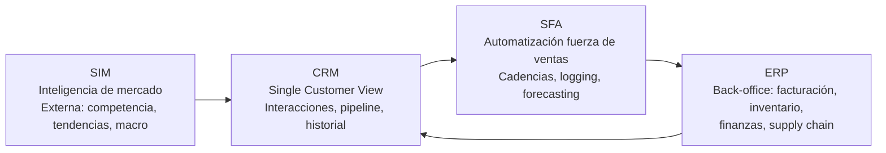

La tecnología no vende por sí sola, pero **el vendedor sin tecnología compite en desventaja**. El *stack* moderno (*RevTech* — *Revenue Technology*) integra datos, automatiza lo repetitivo y amplifica la capacidad de vender. {a Apuntes de Gestión de Ventas · Unidad 7}

## El ecosistema de datos comerciales


{d}

| Sistema | Foco | Datos clave | Usuario principal |
|---|---|---|---|
| **SIM** | Inteligencia estratégica | Mercado, competencia, tendencias, macro | Dirección, gerentes, *strategy* |
| **CRM** | Relación cliente (front-office) | Contactos, cuentas, oportunidades, actividades, historial | Vendedores, gerentes, *customer success* |
| **SFA** | Productividad vendedor | Cadencias, *email tracking*, *dialer*, *forecasting*, *pipeline mgmt* | Vendedores, *sales ops* |
| **ERP** | Ejecución y back-office | Órdenes, facturación, inventario, finanzas, *supply chain* | Finanzas, logística, *ops* | {a Apuntes de Gestión de Ventas · Unidad 7}

> **Integración es clave**: CRM ↔ ERP en tiempo real evita «vender lo que no hay stock» y «facturar mal». {d}

## CRM: el corazón operativo

| Capacidad | Qué hace | KPI habilitado |
|---|---|---|
| **Gestión de contactos/cuentas** | *Single customer view*: 360° | *Account penetration*, *share of wallet* |
| **Pipeline management** | Etapas, probabilidades, *weighted forecast* | *Pipeline coverage*, *win rate*, *cycle time* |
| **Activity logging** | Emails, llamadas, reuniones auto-log | *Activity rate*, *contact rate* |
| **Forecasting** | *Bottom-up* (vendedor) + *top-down* (gerente) + IA | *Forecast accuracy* |
| **Reporting / Dashboards** | *Real-time* KPIs por rol | *Sales velocity*, *conversion by stage* | {a Apuntes de Gestión de Ventas · Unidad 7}

> **Adopción CRM**: si el vendedor no ve valor personal (ahorro de tiempo, *next best action*), no lo usa. *Gamification*, *mobile-first*, *auto-logging* son críticos. {d}

## SFA: automatización que libera tiempo de venta

| Función | Qué automatiza | Ahorro típico |
|---|---|---|
| **Cadencias / Secuencias** | Emails + tareas + llamadas en flujo predefinido | 5-10 hs/semana |
| **Email tracking / *Engagement*** | *Open*, *click*, *reply* alerts | *Timing* de follow-up |
| **Dialer / *Click-to-call*** | Llamada 1-clic, grabación, transcripción | 30% más contactos/hora |
| **Calendar scheduling** | *Self-booking* links, zonas horarias | Elimina *ping-pong* de agenda |
| **Document generation** | Propuestas, contratos, *quotes* desde plantilla | 80% menos tiempo admin |
| **Forecasting IA** | *Predictive scoring*, *deal risk alerts* | *Forecast accuracy* +15-20% | {a Apuntes de Gestión de Ventas · Unidad 7}

## Marketing digital y e-commerce como canales de venta

| Canal | Rol en ventas | Integración con CRM |
|---|---|---|
| **Inbound / Content** | Atrae MQLs, educa, calienta | *Lead capture* → CRM (MQL) |
| **Paid Media (SEM/Social)** | Demanda activa, *retargeting* | *UTM* → *lead source* tracking |
| **E-commerce / Portal B2B** | *Self-service* para recompras, catálogo, *quote-to-cash* | Órdenes → ERP → CRM (historial) |
| **Marketplaces** | Alcance masivo, *fulfillment* | *Order sync* → CRM/ERP |
| **Social Selling** | *Personal branding*, *warm outreach* | *Social profiles* en contacto CRM | {a Apuntes de Gestión de Ventas · Unidad 7}

> **Omnicanalidad**: el cliente no distingue canales; el vendedor ve **una sola conversación** en el CRM. {d}

## Ventas 4.0 / 5.0: Big Data, IA y *Predictive Sales*

| Evolución | Foco | Tecnología clave |
|---|---|---|
| **Ventas 1.0** | Transaccional, cara a cara | Agenda papel, teléfono |
| **Ventas 2.0** | CRM, email, web | CRM on-premise, email masivo |
| **Ventas 3.0** | *Social selling*, *inbound*, *mobile* | CRM cloud, *social listening*, *marketing automation* |
| **Ventas 4.0** | **Data-driven**, *predictive*, *prescriptive* | **Big Data**, *ML scoring*, *next best action*, *conversation intelligence* |
| **Ventas 5.0** | **Human + AI hybrid**, *hyper-personalization*, *autonomous* | **GenAI** (*copilots*), *digital twins*, *autonomous agents* | {a Apuntes de Gestión de Ventas · Unidad 7}

## Aplicaciones de IA en ventas hoy

| Caso de uso | Qué hace | Valor |
|---|---|---|
| **Lead scoring predictivo** | ML sobre firmografía, tecnografía, *engagement*, *intent data* | Prioriza 20% leads que generan 80% *pipeline* |
| **Next Best Action (NBA)** | Recomienda *próxima acción* (llamar, enviar caso, invitar evento) | +15-25% *win rate* |
| **Forecasting IA** | *Time series* + *deal-level features* + *rep behavior* | *Forecast accuracy* 85-95% |
| *Conversation Intelligence* | Transcribe, analiza *talk ratio*, *topics*, *sentiment*, *competitors mentioned* | *Coaching* escalable, *competitive intel* automático |
| **GenAI *Copilots*** | Redacta emails, resume llamadas, prepara *pre-call plans*, *battlecards* | -30% tiempo admin, +calidad *follow-up* |
| *Price optimization* | *Elasticity modeling* + *win/loss* + *competitive pricing* | Maximiza *revenue* / *margin* | {a Apuntes de Gestión de Ventas · Unidad 7}

> **Riesgo**: *black box* sin supervisión humana → sesgos, alucinaciones, *over-reliance*. La IA **recomienda**, el humano **decide**. {d} {a Apuntes de Gestión de Ventas · Unidad 7}

```explorable
titulo: Stack tecnológico según madurez
variante: pasos
nodos:
  - {id: ini, titulo: Inicial (Startup), resumen: "CRM básico + Email + Planilla", detalle: "PipeDrive / HubSpot Free + Gmail + Sheets"}
  - {id: cre, titulo: Crecimiento, resumen: "CRM + SFA + Marketing Auto", detalle: "HubSpot/Salesforce + Outreach + Marketo"}
  - {id: mad, titulo: Madurez (Enterprise), resumen: "RevTech completo + IA", detalle: "SF/HubSpot + Gong/Chorus + Clari + GenAI Copilot"}
o: d
```

:::sintesis
- Ecosistema: SIM (inteligencia) → CRM (relación) → SFA (productividad) → ERP (ejecución). Integración = *single source of truth*.
- CRM: *single customer view*, pipeline, forecasting, dashboards. Adopción = valor percibido por vendedor.
- SFA: automatiza cadencias, logging, dialer, docs, forecasting IA. Libera 5-10 hs/semana.
- Canales digitales: inbound, paid, e-commerce, marketplaces, social → todos alimentan CRM.
- Ventas 4.0/5.0: Big Data + ML (lead scoring, NBA, forecasting, *conversation intelligence*, GenAI copilots). IA recomienda, humano decide. {a Apuntes de Gestión de Ventas · Unidad 7}
:::