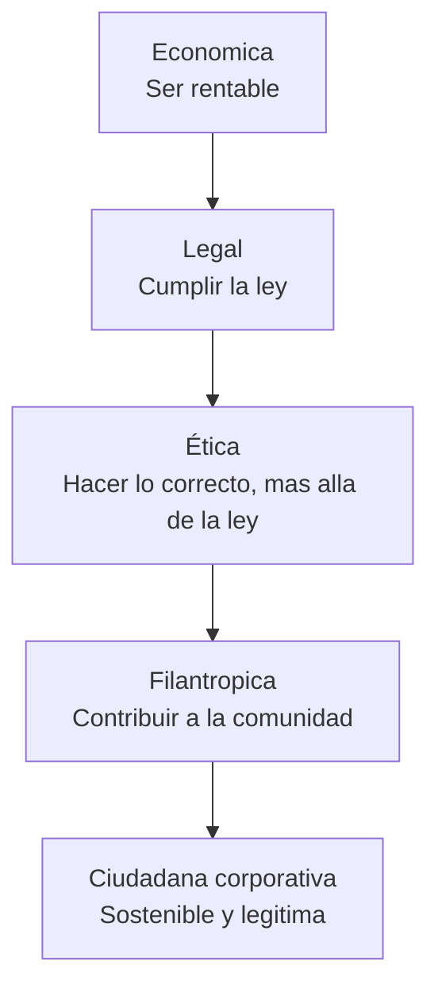
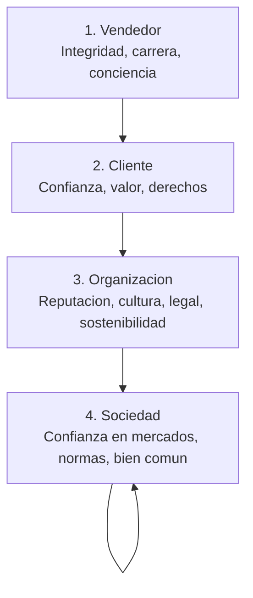

La ética no es un «extra» ni un costo: es **activo intangible** que reduce riesgo, atrae talento, fideliza clientes y sostiene el *license to operate*. {a Apuntes de Gestión de Ventas · Unidad 8}

## Responsabilidad Social Empresaria (RSE)

La RSE es el **compromiso voluntario** de la empresa con el desarrollo sostenible: integra preocupaciones sociales, ambientales y éticas en la estrategia y operaciones. {a Apuntes de Gestión de Ventas · Unidad 8}



| Dimensión | En ventas se traduce en... |
|---|---|
| **Económica** | Precios justos, margen sostenible, no *dumping* |
| **Legal** | Cumplir defensa del consumidor, protección de datos, competencia |
| **Ética** | No engañar, no presionar indebidamente, *fair dealing* |
| **Filantrópica** | *Pro bono* comercial, apoyo a ONGs, voluntariado corporativo | {a Apuntes de Gestión de Ventas · Unidad 8}

> **RSE ≠ Marketing social**. La RSE genuina se mide en **decisiones que sacrifican corto plazo por largo plazo** (ej. rechazar cliente tóxico, retirar producto defectuoso). {d}

## Desarrollo moral de Kohlberg aplicado a ventas

Lawrence Kohlberg describe **6 etapas en 3 niveles** de razonamiento moral. En ventas, el nivel del vendedor/gerente predice su comportamiento ante dilemas. {a Apuntes de Gestión de Ventas · Unidad 8}

```mermaid Niveles de Kohlberg en contexto ventas
flowchart TD
  subgraph Preconvencional[1. Preconvencional: Evitar castigo / Buscar recompensa]
    P1[Etapa 1: Obediencia y castigo<br/>"No miento para no ser despedido"]
    P2[Etapa 2: Intercambio instrumental<br/>"Miento si me conviene y no me pescan"]
  end
  subgraph Convencional[2. Convencional: Normas sociales / Ley y orden]
    C3[Etapa 3: Buen nino / Aprobacion<br/>"No miento porque mi equipo lo veria mal"]
    C4[Etapa 4: Ley y orden / Deber<br/>"No miento porque es ilegal y rompe el contrato"]
  end
  subgraph Postconvencional[3. Postconvencional: Principios universales]
    PO5[Etapa 5: Contrato social / Utilidad<br/>"No miento porque rompe la confianza social"]
    PO6[Etapa 6: Principios eticos universales<br/>"No miento porque la verdad es un deber incondicional"]
  end
```

> **En ventas**: la presión por cuota empuja al **nivel 1-2** (preconvencional). La cultura ética y el liderazgo deben elevar al **nivel 4-5** (convencional-post). {d}

## Círculos de Melé: stakeholders de la decisión ética

Antonio Melé propone analizar **4 círculos concéntricos** de afectados por la decisión comercial: {a Apuntes de Gestión de Ventas · Unidad 8}



> **Pregunta guía**: «¿Cómo afecta esta decisión a cada círculo?» Si daña a C2 o C4 por beneficiar a C1, es antiética. {d}

## Preocupaciones éticas en la gestión comercial

| Categoría | Ejemplos concretos | Señal de alerta (*red flag*) |
|---|---|---|
| **Engaño / Falsedad** | *Overpromising* specs, ocultar limitaciones, *bait-and-switch* | «Nuestro software hace X» (no lo hace) |
| **Presión indebida** | *Hard close* abusivo, *false urgency*, amenazar con retirar oferta | «Si no firma hoy, sube 50%» (mentira) |
| **Conflicto de interés** | Comisiones por vender producto inferior, *kickbacks* a compradores | Vendedor recomienda proveedor que le paga *kickback* |
| **Discriminación** | Trato distinto por género, edad, origen, no por potencial | No visitar cuentas en ciertos barrios |
| **Uso indebido de información** | Usar datos confidenciales del cliente para competir | Descargar base de contactos al irse |
| **Soborno / Corrupción** | Regalos excesivos, pagos a funcionarios, *facilitation payments* | «Para agilizar el trámite, un sobresueldo» | {a Apuntes de Gestión de Ventas · Unidad 8}

## Métodos de decisión ética (herramientas prácticas)

| Test | Pregunta clave | Cuándo usarlo |
|---|---|---|
| **Test de la publicidad** | «¿Me sentiría cómodo si esta decisión saliera en primera página del diario?» | Decisiones visibles, reputación |
| **Test de la abuela** | «¿Se lo explicaría a mi abuela y ella lo entendería como correcto?» | Decisiones complejas, *gut check* |
| ***Sunlight test*** (transparencia) | «¿Aceptaría que esta acción fuera conocida por todos los afectados?» | Decisiones con stakeholders múltiples |
| **Test de la regla de oro** | «¿Querría que me trataran así a mí?» | Trato a clientes, empleados |
| **Test de la universalidad (Kant)** | «¿Qué pasaría si todos hicieran esto?» | Normas, precedentes |
| **Análisis de stakeholders (Melé)** | «¿Cómo afecta a cada círculo?» | Decisiones con impacto amplio | {a Apuntes de Gestión de Ventas · Unidad 8}

> **Protocolo práctico ante dilema**: 1) Hechos → 2) Stakeholders (Melé) → 3) Aplicar 2-3 tests → 4) Decidir → 5) Documentar razonamiento → 6) Revisar a los 30 días. {d}

## Cultura ética: liderazgo, códigos, capacitación, *whistleblowing*

| Pilar | Qué incluye | Métrica |
|---|---|---|
| **Liderazgo ético (*tone at the top*)** | Gerentes modelan, premian ética, sancionan desviaciones | *Employee trust index*, *ethical climate survey* |
| **Código de conducta comercial** | Escrito, accesible, firmado anualmente, ejemplos de ventas | % firmado, % consultado |
| **Capacitación continua** | Casos reales, *role-play* de dilemas, actualización legal | Horas/año, % completado |
| **Canal de denuncia (*whistleblowing*)** | Confidencial, anónimo, sin represalias, respuesta < 48h | # reportes, % resueltos, *retaliation rate* = 0 |
| **Incentivos alineados** | Cuotas realistas, *clawback* por fraude, bonos por *compliance* | *Clawback* triggers, *ethical bonus* weight | {a Apuntes de Gestión de Ventas · Unidad 8}

> **Cultura de *speak up***: si el vendedor ve algo raro y no lo dice por miedo, el sistema falla. El canal de denuncia debe ser **de confianza, no de cumplimiento**. {d} {a Apuntes de Gestión de Ventas · Unidad 8}

```caso
titulo: "Dilema: cliente pide funcionalidad que no existe"
escenario: "Vendedor SaaS en demo. Cliente pregunta: ¿Puede integrarse con nuestro ERP legacy XYZ? La integración NO existe y está en roadmap para dentro de 12 meses."
pasos:
  - pregunta: "¿Qué responde el vendedor ético?"
    opciones:
      - {x: "Sí, se integra perfectamente (miente para cerrar)", ok: false, consecuencia: "Cliente compra, implementación falla, demanda, reputación destruida, churn."}
      - {x: "Aún no, está en roadmap Q3. Mientras, ofrecemos API + middleware temporal. ¿Le parece si lo pilotemos en un módulo no crítico?", ok: true, consecuencia: "Transparencia, gestiona expectativa, crea confianza, posible piloto pagado."}
      - {x: "No sé, averiguo y le aviso (evade)", ok: false, consecuencia: "Pierde credibilidad, cliente duda de expertise."}
o: d
```

:::sintesis
- RSE = Económica + Legal + Ética + Filantrópica. En ventas: precios justos, ley, no engaño, *pro bono*.
- Kohlberg: 3 niveles (pre/convencional/post). Presión de cuota empuja a nivel 1-2; cultura eleva a 4-5.
- Melé: 4 círculos (vendedor → cliente → org → sociedad). Decisión ética protege C2 y C4.
- Preocupaciones: engaño, presión, conflicto, discriminación, info, soborno.
- Tests: publicidad, abuela, *sunlight*, regla de oro, universalidad, Melé.
- Cultura: tono at the top, código firmado, capacitación casos, *whistleblowing* seguro, incentivos alineados. {a Apuntes de Gestión de Ventas · Unidad 8}
:::
