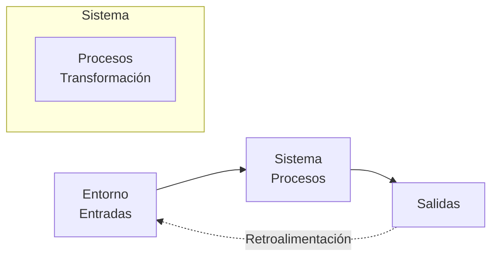
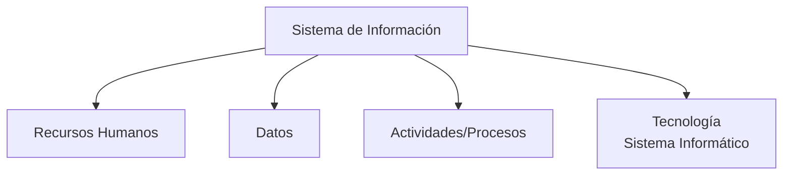

Un **sistema** es un conjunto de elementos interrelacionados que trabajan juntos para lograr un objetivo común. Todo sistema tiene **entradas**, **procesos**, **salidas** y **retroalimentación (feedback)**. {a Apuntes de Ingeniería de Software · Unidad 1}


`````

## Componentes de un sistema

| Componente | Descripción |
|---|---|
| **Entradas** | Recursos, datos, energía o información que ingresan al sistema desde el entorno. |
| **Procesos** | Actividades, operaciones o transformaciones que convierten entradas en salidas. |
| **Salidas** | Resultados, productos, servicios o información que el sistema genera. |
| **Retroalimentación** | Influencia mutua: las salidas afectan las entradas futuras (control). |
| **Entorno** | Contexto externo que provee entradas y recibe salidas. |
| **Límites** | Frontera que define qué está dentro y qué fuera del sistema. | {a Apuntes de Ingeniería de Software · Unidad 1}

## Subsistema

Un **subsistema** es un sistema que opera dentro de otro mayor; sus salidas son las entradas del sistema mayor. Permite descomponer la complejidad en partes manejables. {a Apuntes de Ingeniería de Software · Unidad 1}

## Sistema de información (SI) vs. Sistema informático

- **SI**: Conjunto de componentes interconectados que recogen, procesan, almacenan y difunden información para que una organización tome las mejores decisiones. Incluye personas, datos, procesos, tecnología. {a Apuntes de Ingeniería de Software · Unidad 1}
- **Sistema informático**: Solo la parte tecnológica (hardware + software) del SI. **El SI es más amplio**; el sistema informático es solo una parte. {a Apuntes de Ingeniería de Software · Unidad 1}


`````

:::sintesis
- Sistema = elementos interrelacionados con objetivo común (entradas → procesos → salidas + feedback).
- Subsistema = sistema dentro de otro sistema.
- SI = personas + datos + procesos + tecnología. Sistema informático = solo tecnología.
- El SI apoya la toma de decisiones organizacionales. {a Apuntes de Ingeniería de Software · Unidad 1}
:::
