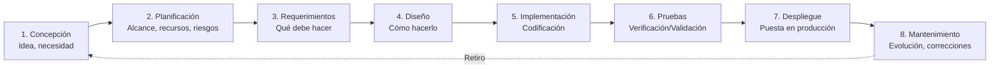

El **ciclo de vida del software** es el conjunto de fases que atraviesa el software desde su concepción hasta su retiro. {a Apuntes de Ingeniería de Software · Unidad 2}


``````

## Planificación (Fuzzy Front End)

Fase inicial de definición del proyecto, objetivos y alcance antes de comprometer recursos significativos. {a Apuntes de Ingeniería de Software · Unidad 2}

Actividades clave:
1. **Identificación de la necesidad**: ¿Qué problema resuelve? ¿Para quién?
2. **Definición del alcance**: Qué está dentro y qué fuera.
3. **Estimación preliminar**: Esfuerzo, costo, tiempo, personal.
4. **Análisis de riesgos preliminar**: Técnicos, de cronograma, de negocio.
5. **Definición del equipo**: Roles, responsabilidades, *staffing*.
6. **Plan de proyecto inicial**: *WBS* preliminar, hitos, *milestones*. {a Apuntes de Ingeniería de Software · Unidad 2}

> **Fuzzy Front End** = "Frente difuso": la zona nebulosa inicial donde la incertidumbre es máxima y las decisiones tienen mayor impacto. {d}

## Estudio de viabilidad

Antes de comprometer recursos, se evalúa si el proyecto es viable en tres dimensiones: {a Apuntes de Ingeniería de Software · Unidad 2}

| Tipo | Qué evalúa | Preguntas clave |
|---|---|---|
| **Técnica** | ¿La tecnología existe? ¿El equipo tiene las competencias? ¿Los riesgos técnicos son manejables? | ¿Existe la tech? ¿Tenemos skills? ¿Es escalable? |
| **Económica** | ¿Costos vs. beneficios? *ROI*, *NPV*, *payback*, *TCO*. | ¿Vale la pena? ¿*ROI* > umbral? |
| **Operacional** | ¿La organización puede usarlo? ¿Cambios culturales? ¿Entrenamiento? | ¿La gente lo usará? ¿Cambia procesos? | {a Apuntes de Ingeniería de Software · Unidad 2}

> **Regla**: si alguna viabilidad falla, el proyecto no debe continuar sin replanteo. {d}

:::sintesis
- Ciclo de vida: 8 fases desde concepción hasta retiro (cíclico).
- Planificación (Fuzzy Front End): define alcance, estima, analiza riesgos, arma equipo.
- Viabilidad: técnica (¿se puede?), económica (¿conviene?), operacional (¿se usará?). {a Apuntes de Ingeniería de Software · Unidad 2}
:::
