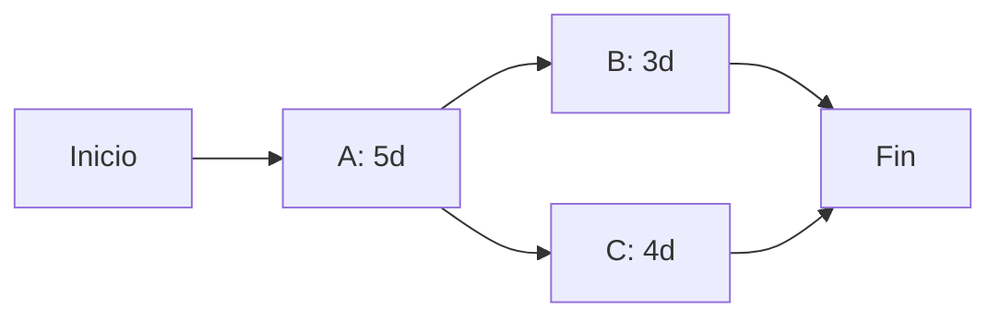

La planificación detallada requiere visualizar el cronograma, identificar dependencias y estimar el esfuerzo realista. {d}

## Red PERT y ruta crítica

**PERT** (Program Evaluation and Review Technique): red de actividades con dependencias, permite calcular la **ruta crítica** (secuencia más larga que determina la duración mínima del proyecto). {d}

**Ruta crítica**: secuencia de actividades sin holgura (*slack* = 0). Cualquier retraso en la ruta crítica retrasa el proyecto completo. {d}

**Holgura (*slack*)**: tiempo que una actividad puede retrasarse sin afectar la fecha de fin del proyecto.
- *Holgura total* = LF - EF (Late Finish - Early Finish)
- *Holgura libre* = ES siguiente - EF actual {d}

## Estimación de esfuerzo

| Técnica | Descripción | Cuándo usar |
|---|---|---|
| **Análoga** | Basada en proyectos similares históricos | Pocos datos, inicio |
| **Paramétrica** | Modelos matemáticos (LOC, *function points*, *COCOMO*) | Datos históricos confiables |
| **Puntos de historia / *Story points*** | Estimación relativa en *Scrum* (Fibonacci: 1,2,3,5,8,13...) | Ágil, *backlog* |
| ***Planning Poker*** | Consenso del equipo con cartas | *Sprint planning* |
| ***Wideband Delphi*** | Expertos anónimos, rondas iterativas | Alta incertidumbre, experto |
| **Bottom-up** | Sumar estimaciones de tareas individuales | WBS detallado | {d}

> **Regla**: nunca estimar solo. La estimación grupal (*Planning Poker*, *Delphi*) reduce sesgos y mejora precisión. {d}

:::sintesis
- Gantt: barras en tiempo, bueno para comunicación.
- PERT: red de dependencias, calcula ruta crítica (holgura = 0).
- Holgura = tiempo de retraso tolerable sin afectar fin del proyecto.
- Estimación: análoga, paramétrica, *story points*, *Planning Poker*, *Delphi*, *bottom-up*. Siempre en grupo. {d}
:::
