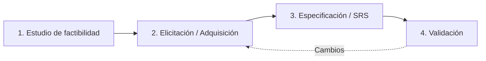

Los **requerimientos** son la especificación de qué debe implementarse. La **especificación deficiente** es la principal causa de fallos en proyectos. {d}

## Ingeniería de requerimientos (4 actividades)

1. **Estudio de factibilidad**: ¿Vale la pena? (técnica, económica, operacional).
2. **Elicitación / Adquisición**: Descubrir, analizar, documentar necesidades del usuario. Técnicas: entrevistas, talleres, observación, prototipos, análisis de documentación, *user stories*.
3. **Especificación (SRS)**: Documento formal con todos los requerimientos.
4. **Validación**: ¿Los requerimientos son correctos, completos, consistentes, trazables? Revisiones, prototipos, *test cases* derivados. {a Apuntes de Ingeniería de Software · Unidad 2}

## Tipos de requerimientos

| Tipo | Descripción | Ejemplos |
|---|---|---|
| **Funcionales** | Qué debe hacer el sistema (servicios, comportamientos) | "El sistema debe permitir login con email y password" |
| **No funcionales** | Restricciones de calidad (rendimiento, seguridad, usabilidad, disponibilidad) | "Respuesta < 2 seg", "Disponibilidad 99.9%" |
| **De dominio** | Derivan del área de aplicación (leyes, estándares, reglas de negocio) | "Cumplir GDPR", "Cálculo de IVA según AFIP" | {a Apuntes de Ingeniería de Software · Unidad 2}

## Características de un buen requerimiento (IEEE 830)

| Atributo | Qué significa |
|---|---|
| **Necesario** | El stakeholder realmente lo necesita |
| **Completo** | No faltan detalles para implementarlo |
| **Consistente** | No contradice a otros requerimientos |
| **Correcto** | Refleja la necesidad real del usuario |
| **Factible** | Se puede implementar con recursos disponibles |
| **Modificable** | Estructura que permite cambios |
| **Priorizado** | Tiene prioridad (MoSCoW: Must, Should, Could, Won't) |
| **Verificable** | Se puede probar objetivamente (test case) |
| **Rastreable** | Vinculado a origen (usuario, norma, stakeholder) |
| **Claro** | Una sola interpretación posible | {a Apuntes de Ingeniería de Software · Unidad 2}

## SRS (Software Requirements Specification)

Documento que describe **todos** los requerimientos del sistema. Es el contrato entre cliente y desarrollador. {a Apuntes de Ingeniería de Software · Unidad 2}

## Estructura típica (IEEE 830)

1. **Introducción**: Propósito, alcance, definiciones, referencias, visión general.
2. **Descripción general**: Perspectiva del producto, funciones, usuarios, restricciones, supuestos.
3. **Requerimientos funcionales**: Casos de uso, *user stories*, reglas de negocio.
4. **Requerimientos no funcionales**: Rendimiento, seguridad, usabilidad, disponibilidad, mantenibilidad.
5. **Requerimientos de interfaz**: Usuario, hardware, software, comunicación.
5. **Apéndices**: Glosario, matriz de trazabilidad, modelos (UML). {a Apuntes de Ingeniería de Software · Unidad 2}

:::sintesis
- Ingeniería de requerimientos = 4 actividades: factibilidad → elicitación → especificación (SRS) → validación.
- Tipos: funcionales (qué hace), no funcionales (calidad), de dominio (contexto).
- Buen requerimiento: necesario, completo, consistente, correcto, factible, modificable, priorizado, verificable, rastreable, claro.
- SRS = contrato cliente-desarrollador; estructura IEEE 830. {a Apuntes de Ingeniería de Software · Unidad 2}
:::
