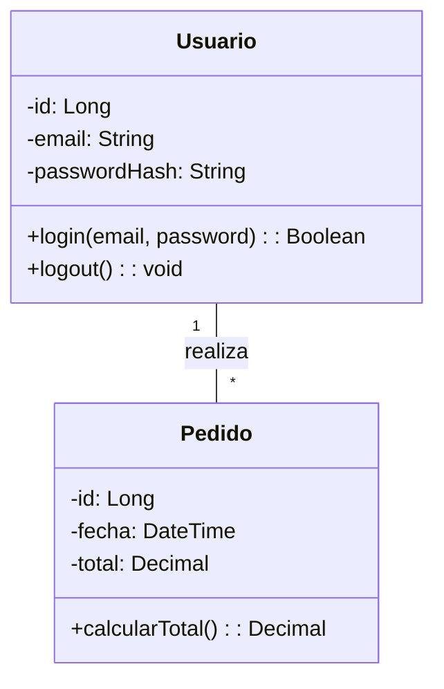
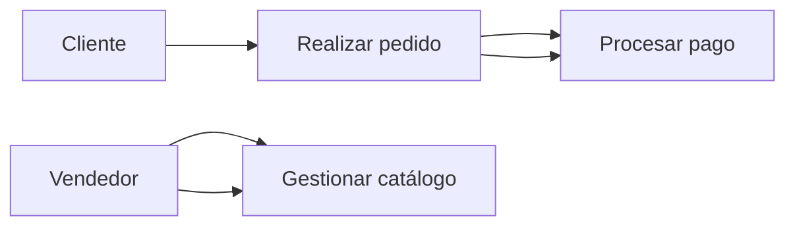

El **diseño de software** define la arquitectura y los detalles del sistema. Es la fase donde se decide *cómo* se construirá lo especificado en los requerimientos. {a Apuntes de Ingeniería de Software · Unidad 3}

## Arquitectura vs. Diseño detallado

| Nivel | Qué define | Ejemplos |
|---|---|---|
| **Arquitectura (macro)** | Estructura global: componentes, conectores, estilos, patrones, decisiones transversales | *Microservicios*, *layered*, *event-driven*, *hexagonal* |
| **Diseño detallado (micro)** | Algoritmos, estructuras de datos, interfaces, bases de datos, APIs, clases | Pseudocódigo, esquemas DB, contratos API, diagramas de clases | {a Apuntes de Ingeniería de Software · Unidad 3}

> **Regla**: la arquitectura fija las restricciones globales; el diseño detallado las implementa. Cambios en arquitectura son costosos; en detalle, menos. {d}

## Estilos y patrones de arquitectura

| Estilo / Patrón | Descripción | Cuándo usar |
|---|---|---|
| **Capas (*Layered*)** | Separación en capas (presentación, negocio, datos) | Apps empresariales clásicas |
| **Cliente-Servidor** | Cliente pide, servidor responde | Web tradicional |
| **Microservicios** | Servicios pequeños, independientes, autónomos | Sistemas grandes, equipos autónomos, escalabilidad |
| **Orientado a eventos (*Event-driven*)** | Comunicación asíncrona via eventos/mensajes | Sistemas reactivos, *real-time*, *IoT* |
| **Hexagonal / *Ports & Adapters*** | Núcleo de dominio aislado, adaptadores en bordes | Testabilidad, desacoplamiento, DDD |
| **Tubería-Filtro (*Pipe-Filter*)** | Procesamiento en cadena de transformaciones | Procesamiento de datos, *ETL*, compiladores | {a Apuntes de Ingeniería de Software · Unidad 3}

## Paradigmas de programación

| Paradigma | Foco | Lenguajes típicos |
|---|---|---|
| **Imperativo** | Secuencia de instrucciones (cómo) | C, Python, Java |
| **Declarativo** | Qué se quiere, no cómo | SQL, Prolog, HTML |
| **Orientado a objetos (OO)** | Objetos con datos + comportamiento | Java, C++, C#, Python |
| **Funcional** | Funciones puras, inmutabilidad | Haskell, F#, Elixir, JS (parcial) |
| **Lógico** | Hechos y reglas, inferencia | Prolog |
| **Reactivo** | Flujos de datos asíncronos | RxJS, Reactor, Akka | {a Apuntes de Ingeniería de Software · Unidad 3}

## Modelado UML

UML (Unified Modeling Language) = lenguaje estándar para visualizar, especificar y documentar sistemas. {a Apuntes de Ingeniería de Software · Unidad 3}

## Diagrama de clases (estructural)

Muestra la estructura estática: clases, atributos, métodos, relaciones (asociación, herencia, agregación, composición, dependencia). {a Apuntes de Ingeniería de Software · Unidad 3}

## Diagrama de casos de uso (funcional)

Muestra la interacción entre **actores** (usuarios, sistemas externos) y el sistema mediante **casos de uso** (metas del usuario). {a Apuntes de Ingeniería de Software · Unidad 3}

:::sintesis
- Arquitectura = estructura global (estilos: capas, microservicios, eventos, hexagonal).
- Diseño detallado = algoritmos, datos, interfaces, clases.
- Paradigmas: imperativo, declarativo, OO, funcional, lógico, reactivo.
- UML: diagramas de clases (estructura) y casos de uso (comportamiento). {a Apuntes de Ingeniería de Software · Unidad 3}
:::
