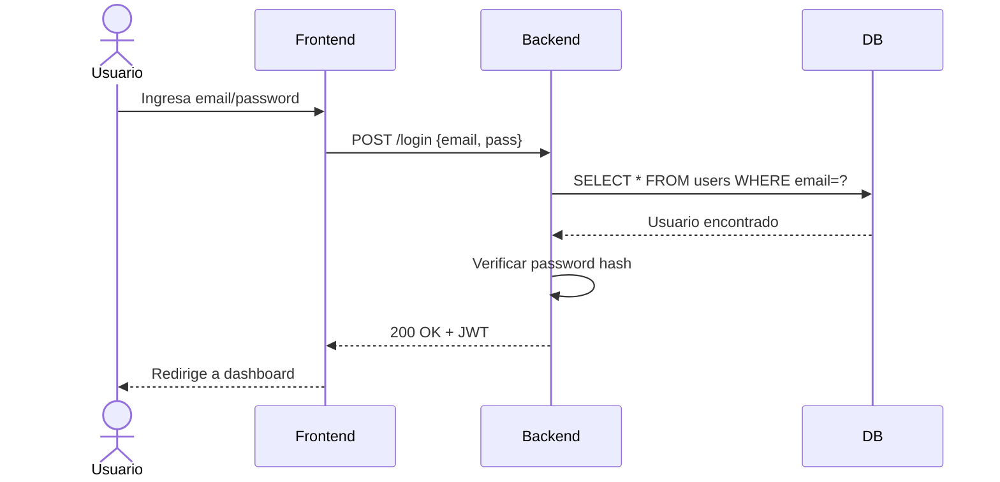
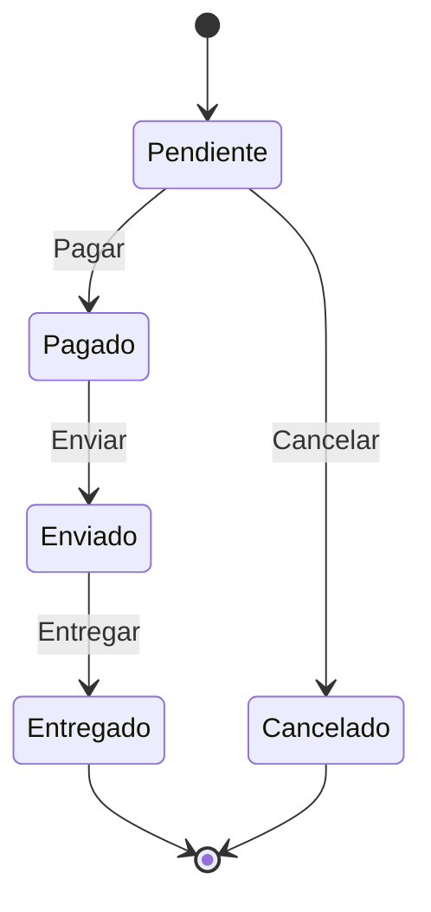
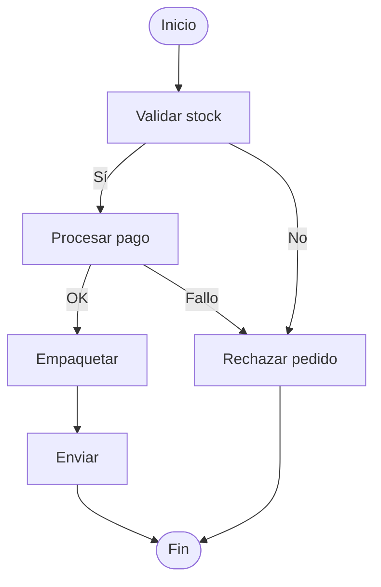
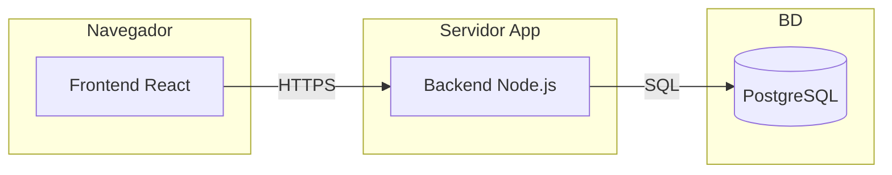

Además de clases y casos de uso, UML ofrece diagramas para modelar **comportamiento dinámico** y **despliegue físico**. {a Apuntes de Ingeniería de Software · Unidad 3}

## Diagrama de secuencia

Modela la interacción temporal entre objetos: quién envía qué mensaje a quién y en qué orden. {a Apuntes de Ingeniería de Software · Unidad 3}

{d}

Elementos clave: **actores**, **objetos/participantes**, **líneas de vida**, **mensajes** (síncronos, asíncronos, retorno), **fragmentos combinados** (*alt*, *opt*, *loop*, *par*). {a Apuntes de Ingeniería de Software · Unidad 3}

## Diagrama de máquina de estados

Modela los **estados** que puede tener un objeto y las **transiciones** entre ellos disparadas por **eventos**. {a Apuntes de Ingeniería de Software · Unidad 3}

{d}

Útil para objetos con ciclo de vida complejo: pedidos, sesiones, workflows, protocolos. {a Apuntes de Ingeniería de Software · Unidad 3}

## Diagrama de actividad

Modela **flujos de trabajo** y **procesos de negocio**: secuencias, decisiones, paralelismo, sincronización. Similar a flowchart pero con semántica UML. {a Apuntes de Ingeniería de Software · Unidad 3}

{d}

Diferencia con flowchart: semántica UML (tokens, *fork/join*, *decision/merge*, *swimlanes*). {a Apuntes de Ingeniería de Software · Unidad 3}

## Diagrama de despliegue

Muestra la **topología física**: nodos (servidores, dispositivos), artefactos (ejecutables, contenedores, BD), conexiones de red. {a Apuntes de Ingeniería de Software · Unidad 3}

{d}

## Patrones de diseño (GoF)

Patrones probados para resolver problemas recurrentes de diseño. 23 patrones clásicos en 3 categorías: {a Apuntes de Ingeniería de Software · Unidad 3}

| Categoría | Propósito | Patrones clave |
|---|---|---|
| **Creacionales** | Cómo crear objetos | *Singleton*, *Factory Method*, *Abstract Factory*, *Builder*, *Prototype* |
| **Estructurales** | Cómo componer objetos/clases | *Adapter*, *Decorator*, *Facade*, *Proxy*, *Composite* |
| **De comportamiento** | Cómo interactúan objetos | *Observer*, *Strategy*, *Command*, *Template Method*, *State* | {a Apuntes de Ingeniería de Software · Unidad 3}

> **Regla**: usar patrones para resolver problemas concretos, no "por si acaso". *KISS* y *YAGNI* primero. {d}

:::sintesis
- Secuencia: interacción temporal (mensajes, fragmentos *alt/opt/loop*).
- Estado: ciclos de vida de objetos (estados, transiciones, eventos).
- Actividad: flujos de trabajo (decisiones, paralelismo, *swimlanes*).
- Despliegue: topología física (nodos, artefactos, red).
- Patrones GoF: 23 patrones en 3 categorías (creacionales, estructurales, comportamiento). {a Apuntes de Ingeniería de Software · Unidad 3}
:::
