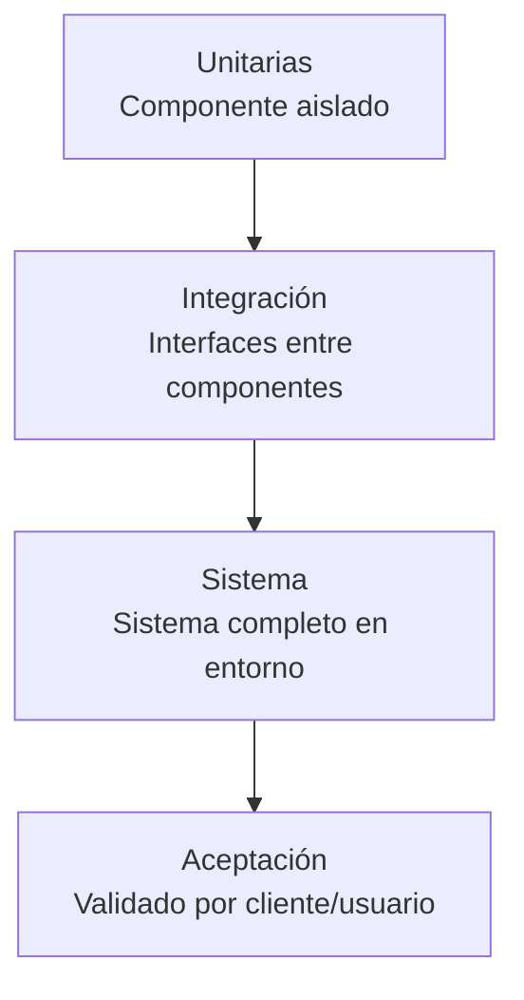

Las **pruebas (Testing)** detectan y corrigen errores originados en fases anteriores, antes de que lleguen al usuario final. Parten del principio de que *errar es humano*. {a Apuntes de Ingeniería de Software · Unidad 4}

## Verificación vs. Validación

| Concepto | Pregunta | Foco |
|---|---|---|
| **Verificación** | "¿Construimos el producto **correctamente**?" | Cumple la especificación / diseño |
| **Validación** | "¿Construimos el producto **correcto**?" | Satisface la necesidad real del usuario | {a Apuntes de Ingeniería de Software · Unidad 4}

> **Verificación** = *building the product right* (cumple especs). **Validación** = *building the right product* (resuelve necesidad). {d}

## Niveles de prueba

| Nivel | Qué prueba | Quién | Cuándo |
|---|---|---|---|
| **Unidad (Unit Testing)** | Cada componente/módulo aislado | Desarrollador | Durante codificación |
| **Integración (Integration)** | Interfaces entre componentes ensamblados | Desarrollador / QA | Post-unidad |
| **Sistema (System Testing)** | Sistema completo en entorno operativo | QA | Pre-despliegue |
| **Aceptación (Acceptance)** | Validado por cliente/usuario | Cliente / Usuario | Pre-producción | {a Apuntes de Ingeniería de Software · Unidad 4}

## Tipos de prueba por caja

| Tipo | Conocimiento del código | Foco |
|---|---|---|
| **Caja Blanca (White-box)** | Visibilidad total: código, estructura, flujo control/datos | Lógica interna, caminos, cobertura |
| **Caja Negra (Black-box)** | Caja opaca: solo entradas/salidas, sin ver código | Funcionalidad, requisitos, usabilidad |
| **Caja Gris (Gray-box)** | Híbrido: perspectiva de caja negra con conocimiento parcial interno | Integración, API, seguridad | {a Apuntes de Ingeniería de Software · Unidad 4}

## Técnicas de diseño de casos

## Partición de equivalencia
Agrupar entradas que se espera produzcan el mismo comportamiento. Probar **un valor por partición**. {a Apuntes de Ingeniería de Software · Unidad 4}

Ejemplo: campo edad (1-120 válido).
- Particiones: <1 (inválido), 1-120 (válido), >120 (inválido).
- Casos: 0, 25, 150. {a Apuntes de Ingeniería de Software · Unidad 4}

## Análisis de valores límite (Boundary Value Analysis)
La mayoría de errores se concentran en los **bordes** de las condiciones (ej.: usar `<` en lugar de `<=`). Probar: mínimo, máximo, justo por encima, justo por debajo. {a Apuntes de Ingeniería de Software · Unidad 4}

Ejemplo: edad 1-120 → probar 0, 1, 120, 121. {a Apuntes de Ingeniería de Software · Unidad 4}

## Cobertura de código
Medir qué porcentaje del código se ejecuta durante las pruebas. Métricas: *statement coverage*, *branch coverage*, *path coverage*. {a Apuntes de Ingeniería de Software · Unidad 4}

## Pruebas Alfa y Beta
- **Alfa**: versiones tempranas a usuarios internos de la organización.
- **Beta**: liberación a subconjunto de usuarios externos representativos, en sus entornos reales, antes del lanzamiento masivo. {a Apuntes de Ingeniería de Software · Unidad 4}

:::sintesis
- Verificación = "¿lo construimos bien?" (cumple specs). Validación = "¿construimos lo correcto?" (satisface necesidad).
- 4 niveles: Unidad → Integración → Sistema → Aceptación.
- Caja blanca (código visible), negra (caja opaca), gris (híbrida).
- Técnicas: partición de equivalencia, valores límite, cobertura.
- Alfa (internos) → Beta (externos) → Lanzamiento. {a Apuntes de Ingeniería de Software · Unidad 4}
:::
