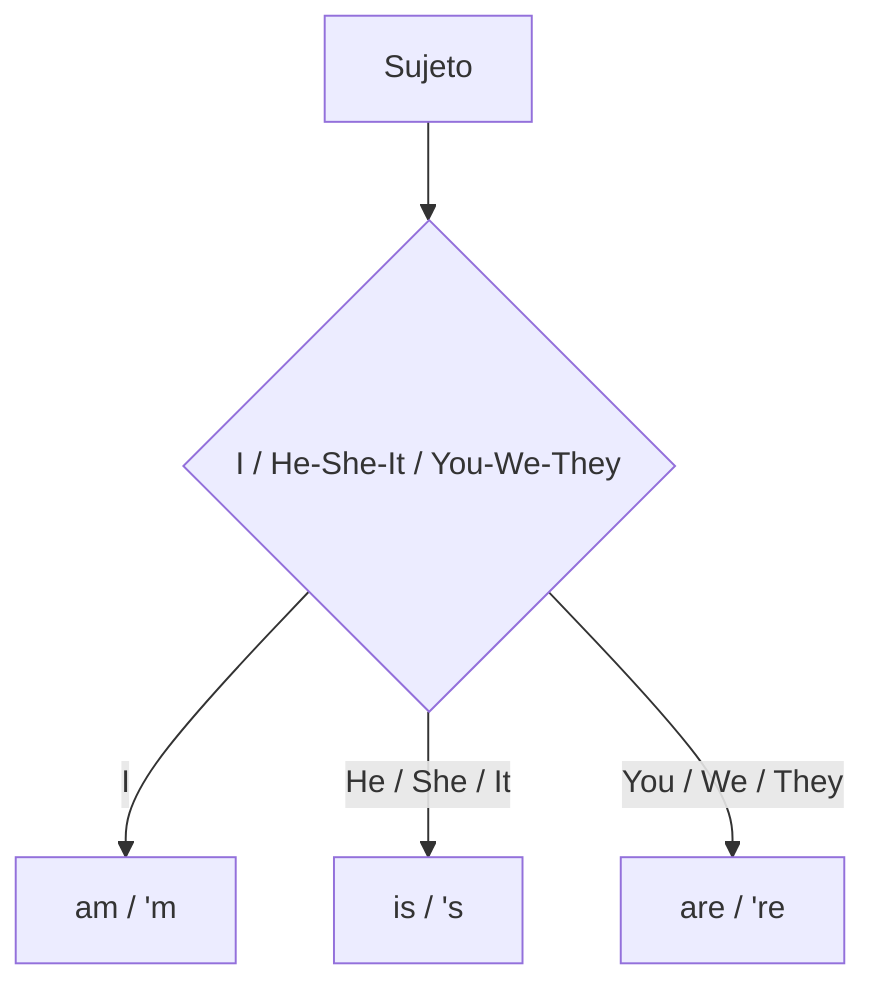

El verbo **to be** equivale a «ser» o «estar» en español. Es la base para identificar, describir y ubicar personas, objetos y lugares. {a Apuntes de Inglés I · Tema 1}

## Formas según el sujeto

^ Formas del verbo to be
| Sujeto | Forma larga | Forma corta |
|---|---|---|
| I | am | 'm |
| He / She / It | is | 's |
| You / We / They | are | 're | {a Apuntes de Inglés I · Tema 1}


{d}

```explorable
titulo: Conjugación de to be
variante: pasos
nodos:
  - {id: i, titulo: "I", resumen: "am / I'm", detalle: "Primera persona del singular."}
  - {id: he, titulo: "He / She / It", resumen: "is / 's", detalle: "Tercera persona del singular."}
  - {id: you, titulo: "You / We / They", resumen: "are / 're", detalle: "Segunda persona y plurales."}
o: d
```

## Usos específicos

- **Identificación**: nombrar personas u objetos. Ej.: *She is Lorena.*
- **Origen**: be + from + país. Ej.: *I am from the USA.*
- **Profesiones**: *Martin is a lawyer.*
- **Edad**: *They are 20 years old.*
- **Ubicación de objetos**: *The Eiffel Tower is in Paris.*
- **Precios**: *The camera is 200$.* {a Apuntes de Inglés I · Tema 1}

## Estructura negativa

Sujeto + **am not / isn't / aren't**. {a Apuntes de Inglés I · Tema 1}

- I **am not**...
- He / She / It **isn't**...
- You / We / They **aren't**... {a Apuntes de Inglés I · Unidad 1}

:::clave Ojo con "am not"
No existe la contracción *amn't*. La negativa de *I am* es siempre **I am not** o **I'm not**. {d}
:::

## Estructura interrogativa (Yes/No)

**Verbo be + Sujeto + Complemento?** {a Apuntes de Inglés I · Tema 1}

- *Are you a student?*
- Respuestas: **Yes, I am.** / **No, I am not.** {a Apuntes de Inglés I · Unidad 1}

```asociar
titulo: Unir sujeto con su forma de to be
pares:
  - [I, am]
  - [He, is]
  - [They, are]
  - [She, is]
  - [We, are]
  - [It, is]
o: d
```

## Contracciones

**Afirmativas**: I'm, he's, she's, it's, we're, you're, they're.
**Negativas**: isn't, aren't, **am not** (no se contrae, pero *I'm not* es la forma corta de *I am not*). {a Apuntes de Inglés I · Tema 1}

:::ampliacion Pronunciación de 's
La contracción *'s* suena /z/ después de vocal o sonora (*he's* /hiːz/), y /s/ después de sorda (*it's* /ɪts/). {a Apuntes de Inglés I · Tema 1}
:::

```clasificar
titulo: ¿Es forma correcta de to be?
categorias: [Correcta, Incorrecta]
items:
  - {x: "I'm", cat: 0, porque: "Contracción válida de I am."}
  - {x: "He're", cat: 1, porque: "He usa is, no are."}
  - {x: "They're", cat: 0, porque: "Contracción válida de they are."}
  - {x: "I amn't", cat: 1, porque: "No existe amn't; es I am not / I'm not."}
  - {x: "She's", cat: 0, porque: "Contracción válida de she is."}
  - {x: "We isn't", cat: 1, porque: "We usa aren't, no isn't."}
o: d
```

:::sintesis
- To be = ser o estar.
- I am, he/she/it is, you/we/they are.
- Negativa: am not, isn't, aren't.
- Interrogativa: verbo + sujeto + complemento.
- Contracciones: I'm, he's, she's, it's, we're, you're, they're / isn't, aren't. {a Apuntes de Inglés I · Unidad 1}
:::
