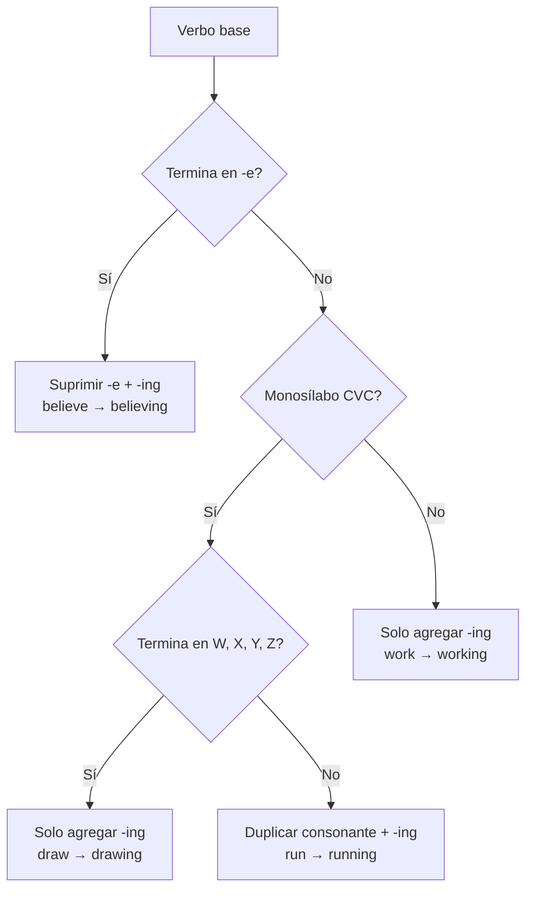

El presente continuo expresa **acciones en progreso en el momento de hablar**.
Expresiones de tiempo típicas: **now, right now, at the moment, at present, currently**. {a Apuntes de Inglés I · Tema 3}

```mermaid Estructura del presente continuo
flowchart TD
    A[Sujeto] --> B[to be (am/is/are)]
    B --> C[Verbo + -ing]
    C --> D[Acción en progreso]
```
{d}

## Estructura

- **Afirmativa**: Subject + **to be** + **verb-ing**. (*I am working / I'm working.*)
- **Negativa**: Subject + **to be** + **not** + **verb-ing**. (*I am not working / I'm not working.*)
- **Interrogativa**: **to be** + **Subject** + **verb-ing?** (*Am I working?*) {a Apuntes de Inglés I · Tema 3}

```explorable
titulo: Formas de to be en presente continuo
variante: pasos
nodos:
  - {id: am, titulo: "I", resumen: "am / 'm", detalle: "I am working / I'm working"}
  - {id: is, titulo: "He / She / It", resumen: "is / 's", detalle: "He is working / He's working"}
  - {id: are, titulo: "You / We / They", resumen: "are / 're", detalle: "They are working / They're working"}
o: d
```

## Reglas de -ing

- La terminación **-ing** solo se aplica a **verbos**.
- **Verbo terminado en -e**: se suprime la **e** y se agrega **-ing**. Ej.: *believe → believing*.
- **Verbos monosílabicos CVC** (consonante-vocal-consonante): se **duplica la última consonante**. Ej.: *jog → jogging, run → running, swim → swimming*.
- **Excepción CVC**: **no** se duplica si termina en **W, X, Y o Z**. Ej.: *draw → drawing, fix → fixing, play → playing*. {a Apuntes de Inglés I · Tema 3}


{d}

```clasificar
titulo: Clasificá según la regla de -ing
categorias: [Suprimir -e, Duplicar CVC, Solo agregar -ing, Excepción WXYZ]
items:
  - {x: "write → writing", cat: 0, porque: "Termina en -e: write → writing."}
  - {x: "run → running", cat: 1, porque: "Monosílabo CVC (r-u-n): duplica n."}
  - {x: "work → working", cat: 2, porque: "No es CVC ni termina en -e: solo -ing."}
  - {x: "play → playing", cat: 3, porque: "Termina en Y (excepción WXYZ): no duplica."}
  - {x: "swim → swimming", cat: 1, porque: "Monosílabo CVC (s-w-i-m): duplica m."}
  - {x: "dance → dancing", cat: 0, porque: "Termina en -e: dance → dancing."}
o: d
```

## Presente continuo vs. presente simple

| Aspecto | Presente simple | Presente continuo |
|---|---|---|
| **Uso** | Rutinas, hábitos, verdades generales | Acciones en progreso ahora |
| **Palabras clave** | always, sometimes, never, every day, on Mondays | now, right now, at the moment, at present |
| **Ejemplo** | *I study English every day.* | *I am studying English right now.* | {a Apuntes de Inglés I · Tema 3}

:::clave Verbos de estado (stative verbs)
Algunos verbos **no** suelen usarse en continuo: *know, understand, like, love, hate, want, need, believe, have (posesión), be*. Se usan en simple: *I know him* (no *I am knowing him*). {d}
:::

```asociar
titulo: Unir oración con su tiempo verbal
pares:
  - ["She works at a bank", "Presente simple (rutina)"]
  - ["She is working now", "Presente continuo (ahora)"]
  - ["They play tennis on Sundays", "Presente simple (hábito)"]
  - ["They are playing tennis", "Presente continuo (en este momento)"]
  - ["I understand the lesson", "Presente simple (estado)"]
  - ["I am understanding...", "Incorrecto: understand no va en continuo"]
o: d
```

:::sintesis
- Afirmativa: to be + verbo-ing.
- Negativa: to be + not + verbo-ing.
- Interrogativa: to be + sujeto + verbo-ing.
- Reglas de -ing: suprimir -e, duplicar CVC, excepción W/X/Y/Z.
- Continuo = ahora; Simple = rutina/hábito.
- Verbos de estado no van en continuo. {a Apuntes de Inglés I · Unidad 2}
:::
