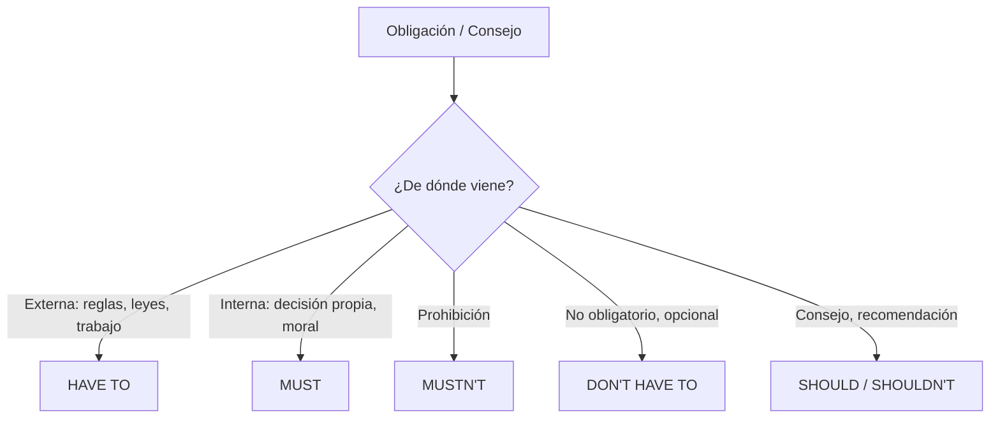

{d}

## HAVE TO / DON'T HAVE TO (obligación general, reglas externas)

- **Uso**: reglas en el trabajo, la universidad, las leyes; obligación impuesta **externamente**.
- **Estructura**: subject + **have to / has to** + infinitivo. {a Apuntes de Inglés I · Tema 4}
  - I / You / We / They → **have to**
  - She / He / It → **has to**
- **DON'T HAVE TO**: **no hay obligación**, es **opcional** (podés hacerlo si querés).
- **Preguntas**: *Do I have to buy new supplies?* {a Apuntes de Inglés I · Tema 4}

:::clave Have to en pasado y futuro
**Had to** (pasado), **will have to** (futuro). *Must* no tiene forma de pasado ni futuro; para obligación pasada se usa *had to*. {d}
:::

## MUST / MUSTN'T (obligación personal + prohibición)

- **MUST**: obligación que el hablante **mismo impone** (personal / moral). Misma forma para **todos los sujetos** (no cambia).
- **MUSTN'T**: algo está **prohibido**, **no hacerlo**.
- **MUST vs HAVE TO**: HAVE TO = obligación general/externa; MUST = obligación personal/interna.
- **MUSTN'T vs DON'T HAVE TO**: *mustn't go* = **prohibido**; *don't have to go* = **no necesario** (opcional). {a Apuntes de Inglés I · Tema 4}

:::ojo Mustn't vs Don't have to
**Mustn't** = no tenés permiso / está prohibido.
**Don't have to** = no es necesario, pero podés hacerlo si querés.
*You mustn't smoke here* = Está prohibido fumar.
*You don't have to come early* = No es necesario venir temprano (pero podés). {d}
:::

## SHOULD / SHOULDN'T (consejos y recomendaciones)

- **Uso**: dar consejo o expresar lo que se cree **correcto** hacer.
- **Estructura**: subject + **should / shouldn't** + infinitivo (igual para **todos los sujetos**). {a Apuntes de Inglés I · Tema 4}

^ Resumen de modales
| Modal | Significado | Ejemplo |
|---|---|---|
| have to | obligación externa / general, necesario | I have to wear a uniform. |
| don't have to | no obligatorio, opcional | You don't have to come. |
| must | obligación personal / interna, necesario | I must study more. |
| mustn't | prohibición, no permitido | You mustn't smoke here. |
| should | consejo / recomendación | You should see a doctor. |
| shouldn't | consejo negativo | You shouldn't eat so fast. | {a Apuntes de Inglés I · Tema 4}

```explorable
titulo: Cuándo usar cada modal
variante: capas
nodos:
  - {id: ht, titulo: "Have to", resumen: "Obligación externa", detalle: "Reglas, leyes, jefe: I have to wear a tie at work."}
  - {id: dht, titulo: "Don't have to", resumen: "Opcional", detalle: "No es necesario: You don't have to pay, it's free."}
  - {id: must, titulo: "Must", resumen: "Obligación personal", detalle: "Decisión propia: I must exercise more."}
  - {id: mustn, titulo: "Mustn't", resumen: "Prohibición", detalle: "No permitido: You mustn't use your phone."}
  - {id: should, titulo: "Should", resumen: "Consejo", detalle: "Recomendación: You should sleep 8 hours."}
  - {id: shouldnt, titulo: "Shouldn't", resumen: "Consejo negativo", detalle: "No recomendado: You shouldn't text while driving."}
o: d
```

```asociar
titulo: Unir situación con el modal correcto
pares:
  - ["Es ley: usar cinturón de seguridad", "have to"]
  - ["Mi médico dice: hacé ejercicio", "should"]
  - ["Yo decido: debo estudiar más", "must"]
  - ["Está prohibido: no fumar acá", "mustn't"]
  - ["No es obligatorio: venir temprano", "don't have to"]
  - ["No es buena idea: comer tanto azúcar", "shouldn't"]
o: d
```

```clasificar
titulo: ¿Obligación externa, personal, prohibición, opcional o consejo?
categorias: [Obligación externa (have to), Obligación personal (must), Prohibición (mustn't), Opcional (don't have to), Consejo (should/shouldn't)]
items:
  - {x: "You have to stop at a red light.", cat: 0, porque: "Regla de tránsito = obligación externa."}
  - {x: "I must finish this report today.", cat: 1, porque: "Meta personal = obligación interna."}
  - {x: "You mustn't enter this area.", cat: 2, porque: "Prohibido entrar."}
  - {x: "You don't have to bring lunch.", cat: 3, porque: "Es opcional, hay comida ahí."}
  - {x: "You should drink more water.", cat: 4, porque: "Recomendación de salud."}
  - {x: "We have to wear uniforms.", cat: 0, porque: "Regla de la empresa/escuela."}
o: d
```

```caso
titulo: Un día en la oficina
escenario: Llegás a tu nuevo trabajo y te explican las reglas.
pasos:
  - pregunta: "Tu jefe dice: 'Todos los empleados ______ usar identificación.'"
    opciones:
      - {x: "have to", ok: true, consecuencia: "Correcto: es una regla de la empresa (obligación externa)."}
      - {x: "must", ok: false, consecuencia: "Must es obligación personal; acá es una regla externa."}
      - {x: "should", ok: false, consecuencia: "Should es consejo, no obligación."}
  - pregunta: "Un compañero te aconseja: 'Vos ______ llegar temprano el primer día.'"
    opciones:
      - {x: "should", ok: true, consecuencia: "Correcto: es una recomendación."}
      - {x: "must", ok: false, consecuencia: "No es obligación personal tuya."}
      - {x: "have to", ok: false, consecuencia: "No es una regla escrita (aunque sea buena idea)."}
  - pregunta: "Hay un cartel: 'No ______ usar el celular en reuniones.'"
    opciones:
      - {x: "must", ok: false, consecuencia: "Mustn't es para prohibiciones; must solo es obligación."}
      - {x: "mustn't", ok: true, consecuencia: "Correcto: mustn't = prohibición."}
      - {x: "don't have to", ok: false, consecuencia: "Don't have to = opcional, no prohibido."}
o: d
```

:::sintesis
- Have to: obligación externa/general (reglas, leyes).
- Must: obligación personal; mustn't: prohibición.
- Don't have to: opcional (no = mustn't).
- Should: consejo o recomendación.
- Must no tiene pasado (se usa had to) ni futuro (will have to). {a Apuntes de Inglés I · Unidad 2}
:::
