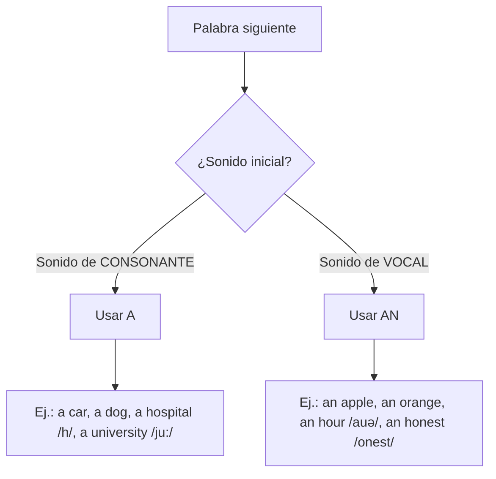
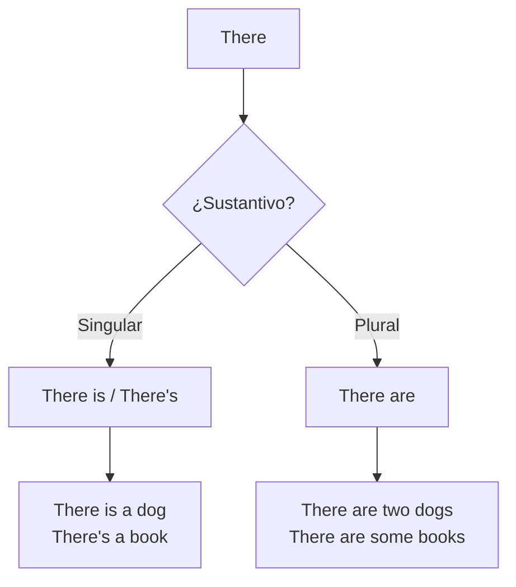

Los artículos indefinidos **a** y **an** se usan en **singular** para hablar de algo **no específico**.
La elección depende del **sonido** con el que inicia la palabra siguiente, **no necesariamente de la letra escrita**. {a Apuntes de Inglés I · Tema 5}


{d}

- **A**: cuando la siguiente palabra comienza con **sonido de consonante**.
- **AN**: cuando comienza con **sonido de vocal**. {a Apuntes de Inglés I · Tema 5}

Ejemplos: *a car* (sonido consonante), *an apple* (sonido vocal), *a dog*, *a hospital* (la H suena como J /h/), *an orange*, *an hour* (la H es **muda**, suena vocal), *a university* (suena /ju:/, consonante), *an honest person* (H muda). {a Apuntes de Inglés I · Tema 5}

```explorable
titulo: Excepciones por sonido
variante: capas
nodos:
  - {id: hmuda, titulo: "H muda → an", resumen: "hour, honest, honor", detalle: "La H no suena: an hour /aʊə/, an honest /ɒnɪst/"}
  - {id: hsonora, titulo: "H sonora → a", resumen: "hospital, hotel, house", detalle: "La H suena /h/: a hospital /hɒspɪtl/"}
  - {id: uconso, titulo: "U = /ju:/ → a", resumen: "university, uniform, user", detalle: "Suena 'yu' (consonante): a university /ju:nɪˈvɜ:sɪti/"}
  - {id: uvocal, titulo: "U = /ʌ/ → an", resumen: "umbrella, uncle, under", detalle: "Suena vocal: an umbrella /ʌmˈbrelə/"}
o: d
```

## There is / There are («hay»)

- **THERE IS**: se utiliza para **singular** (una sola cosa).
- **THERE ARE**: se utiliza para **plural** (dos o más cosas). {a Apuntes de Inglés I · Tema 5}


{d}

## Forma afirmativa

- Hay un perro → **There is a dog.** / **There's a dog.**
- Hay dos perros → **There are two dogs.** {a Apuntes de Inglés I · Tema 5}

## Forma negativa

- No hay un perro → **There is not a dog.** / **There isn't a dog.**
- No hay perros → **There are not any dogs.** / **There aren't any dogs.** {a Apuntes de Inglés I · Tema 5}

:::clave Any en negativas y preguntas
En negativas e interrogativas con plural (o incontables), se usa **any**: *There aren't any books*, *Are there any apples?*. En afirmativas plural: *There are some books*. {d}
:::

## Forma interrogativa

Se mueve el verbo **to be** al principio de la oración. {a Apuntes de Inglés I · Tema 5}

- ¿Hay un perro? → **Is there a dog?**
- ¿Hay dos perros? → **Are there two dogs?**
- ¿Hay algún libro? → **Are there any books?** {a Apuntes de Inglés I · Unidad 2}

```asociar
titulo: Unir oración con su forma correcta
pares:
  - ["Hay un gato", "There is a cat / There's a cat"]
  - ["Hay tres gatos", "There are three cats"]
  - ["No hay un gato", "There isn't a cat / There is not a cat"]
  - ["No hay gatos", "There aren't any cats"]
  - ["¿Hay un gato?", "Is there a cat?"]
  - ["¿Hay gatos?", "Are there any cats?"]
o: d
```

```clasificar
titulo: ¿A o an?
categorias: [A (sonido consonante), AN (sonido vocal)]
items:
  - {x: "a house", cat: 0, porque: "H suena /h/ (consonante)."}
  - {x: "an hour", cat: 1, porque: "H muda, suena vocal /aʊ/."}
  - {x: "a university", cat: 0, porque: "Suena /ju:/ (consonante y)."}
  - {x: "an umbrella", cat: 1, porque: "Suena vocal /ʌ/."}
  - {x: "a European", cat: 0, porque: "Suena /ju:/ (consonante)."}
  - {x: "an honest man", cat: 1, porque: "H muda, suena vocal /ɒ/."}
o: d
```

:::sintesis
- A/An: depende del **sonido** inicial (consonante → a, vocal → an).
- Excepciones: H muda (an hour), U = /ju:/ (a university).
- There is: singular; There are: plural.
- Negativa: there isn't / there aren't any.
- Interrogativa: Is there...? / Are there...? (con any en plural). {a Apuntes de Inglés I · Unidad 2}
:::
