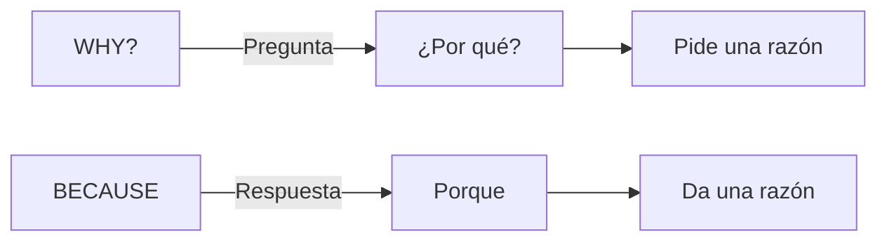

## Diferencia entre WHY y BECAUSE


{d}

- **WHY?**: **¿Por qué?** Se usa para **preguntar** o **pedir una razón**.
- **BECAUSE**: **Porque**. Se usa para **responder**, **dar una razón** o **argumentación**. {a Apuntes de Inglés I · Tema 6}

Ejemplo: *Why are you studying English?* — *Because I want to travel.* {a Apuntes de Inglés I · Tema 6}

## Uso de BECAUSE (regla de especificación)

Al responder con **BECAUSE**, es **fundamental especificar el sujeto** de la oración en inglés.
Ej.: *Why not?* — *Because **the board** is white.* (No: *Because is white*) {a Apuntes de Inglés I · Tema 6}

:::clave Subject obligatorio
En español podemos decir «Porque sí» o «Porque es blanco» (sujeto implícito). En inglés **siempre** debe haber sujeto explícito tras *because*: *Because it is white.* {d}
:::

```explorable
titulo: Estructura Why - Because
variante: pasos
nodos:
  - {id: q, titulo: "Pregunta", resumen: "Why + to be + sujeto...?", detalle: "Why are you late?"}
  - {id: a, titulo: "Respuesta", resumen: "Because + sujeto + verbo...", detalle: "Because the bus was late."}
o: d
```

## Uso de WHO (quién / quiénes)

- **WHO + IS**: **Quién** (una sola persona).
- **WHO + ARE**: **Quiénes** (varias personas). {a Apuntes de Inglés I · Tema 6}

Ejemplos: *Who **is** painting the house?* / *Who **are** watching a movie?* {a Apuntes de Inglés I · Tema 6}

:::ojo Who con to be
El número (singular/plural) lo determina el verbo **to be** que acompaña a *who*, no la palabra *who* en sí. {d}
:::

```asociar
titulo: Unir pregunta con su respuesta
pares:
  - ["Why are you happy?", "Because I passed the exam."]
  - ["Why is she crying?", "Because she lost her keys."]
  - ["Who is calling?", "My brother is calling."]
  - ["Who are they?", "They are my friends."]
  - ["Why not?", "Because it is raining."]
  - ["Who is at the door?", "The postman is at the door."]
o: d
```

```clasificar
titulo: ¿Why, Because o Who?
categorias: [WHY (pregunta razón), BECAUSE (da razón), WHO (pregunta persona)]
items:
  - {x: "____ are you laughing?", cat: 0, porque: "Pide razón → Why."}
  - {x: "____ is that man?", cat: 2, porque: "Pide persona → Who."}
  - {x: "____ I am tired.", cat: 1, porque: "Da razón → Because."}
  - {x: "____ they here?", cat: 0, porque: "Pide razón → Why (implícito: Why are they here?)."}
  - {x: "____ is your teacher?", cat: 2, porque: "Pide persona → Who."}
  - {x: "____ the sky is blue.", cat: 1, porque: "Da razón → Because."}
o: d
```

```caso
titulo: Conversación en clase
escenario: El profesor pregunta por qué faltó un alumno.
pasos:
  - pregunta: "Profesor: 'Why ______ absent yesterday?'"
    opciones:
      - {x: "were you", ok: true, consecuencia: "Correcto: Why + were (to be pasado) + you."}
      - {x: "was you", ok: false, consecuencia: "You usa were, no was."}
      - {x: "did you", ok: false, consecuencia: "Con to be no se usa did."}
  - pregunta: "Alumno: 'Because I ______ sick.'"
    opciones:
      - {x: "was", ok: true, consecuencia: "Correcto: sujeto I + was (to be pasado)."}
      - {x: "were", ok: false, consecuencia: "I usa was, no were."}
      - {x: "am", ok: false, consecuencia: "El contexto es pasado (yesterday)."}
o: d
```

:::sintesis
- Why = ¿por qué? (pregunta); because = porque (respuesta).
- Con because, el **sujeto es obligatorio**.
- Who + is = quién (singular); who + are = quiénes (plural).
- Who lleva to be según número: is (singular), are (plural). {a Apuntes de Inglés I · Unidad 3}
:::
