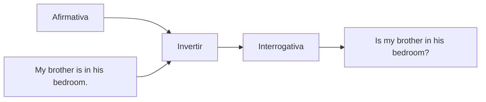

## Verbo to be en forma interrogativa

Para hacer una pregunta con **to be**, se **mueve el verbo** (am, is, are) al **principio** de la oración. Solo se usa el signo de interrogación al final. {a Apuntes de Inglés I · Tema 7}


{d}

**Transformación**:
*My brother is in his bedroom.* → **Is my brother in his bedroom?** {a Apuntes de Inglés I · Tema 7}

**Respuestas**:
*Is my brother in the kitchen?* → **No, he is in his bedroom.** {a Apuntes de Inglés I · Tema 7}

```explorable
titulo: Preguntas con to be - ejemplos
variante: pasos
nodos:
  - {id: ex1, titulo: "Afirmativa → Interrogativa", resumen: "She is happy → Is she happy?", detalle: "Sujeto + is → Is + sujeto"}
  - {id: ex2, titulo: "Con are", resumen: "They are ready → Are they ready?", detalle: "Sujeto + are → Are + sujeto"}
  - {id: ex3, titulo: "Con am", resumen: "I am late → Am I late?", detalle: "Sujeto + am → Am + sujeto"}
  - {id: resp, titulo: "Respuestas cortas", resumen: "Yes, she is. / No, she isn't.", detalle: "Yes, sujeto + verbo. / No, sujeto + verbo + not."}
o: d
```

## Adjetivos posesivos: HIS y HER

- **HIS**: posesión **masculina** (su/sus de **él**).
- **HER**: posesión **femenina** (su/sus de **ella**). {a Apuntes de Inglés I · Tema 7}

| Poseedor | Adjetivo posesivo | Ejemplo |
|---|---|---|
| He (él) | **his** | *He is **his** father* (el papá de **él**) |
| She (ella) | **her** | *He is **her** father* (el papá de **ella**) |
| He (él) | **his** | *My brother is in **his** bedroom* | {a Apuntes de Inglés I · Tema 7}

:::clave His/Her según el poseedor
En español «su» no distingue género. En inglés **his/her** dependen del **poseedor** (quien tiene), no del objeto poseído.
*His book* = el libro de él. *Her book* = el libro de ella. {d}
:::

:::ojo His vs He's / Her vs She's
**his** / **her** = posesivos (adjetivos).
**he's** = *he is* / *he has* (contracción verbo).
**she's** = *she is* / *she has* (contracción verbo).
*He's my brother* (él es mi hermano) vs *His brother* (el hermano de él). {d}
:::

```asociar
titulo: Unir poseedor con su adjetivo posesivo
pares:
  - [He (él), his]
  - [She (ella), her]
  - [My father (mi papá), his]
  - [My mother (mi mamá), her]
  - [The boy (el chico), his]
  - [The girl (la chica), her]
o: d
```

```clasificar
titulo: ¿His o Her?
categorias: [HIS (poseedor masculino), HER (poseedor femenino)]
items:
  - {x: "John → _____ car", cat: 0, porque: "John es hombre → his."}
  - {x: "Mary → _____ book", cat: 1, porque: "Mary es mujer → her."}
  - {x: "The teacher (male) → _____ class", cat: 0, porque: "Poseedor masculino → his."}
  - {x: "The teacher (female) → _____ class", cat: 1, porque: "Poseedora femenina → her."}
  - {x: "My uncle → _____ house", cat: 0, porque: "Uncle = tío (hombre) → his."}
  - {x: "My aunt → _____ house", cat: 1, porque: "Aunt = tía (mujer) → her."}
o: d
```

```caso
titulo: La familia de Alex
escenario: Alex presenta a su familia. Completá con his o her.
pasos:
  - pregunta: "This is my father. _____ name is Robert."
    opciones:
      - {x: "His", ok: true, consecuencia: "Correcto: father (padre) es masculino → his."}
      - {x: "Her", ok: false, consecuencia: "Father es masculino, no femenino."}
      - {x: "He's", ok: false, consecuencia: "He's = He is, no es posesivo."}
  - pregunta: "This is my mother. _____ name is Susan."
    opciones:
      - {x: "Her", ok: true, consecuencia: "Correcto: mother (madre) es femenino → her."}
      - {x: "His", ok: false, consecuencia: "Mother es femenino."}
      - {x: "She's", ok: false, consecuencia: "She's = She is, no es posesivo."}
  - pregunta: "My brother has a dog. _____ dog is brown."
    opciones:
      - {x: "His", ok: true, consecuencia: "Correcto: brother (hermano) es masculino → his."}
      - {x: "Her", ok: false, consecuencia: "Brother es masculino."}
      - {x: "He's", ok: false, consecuencia: "He's es verbo, no posesivo."}
o: d
```

:::sintesis
- Pregunta con to be: **verbo + sujeto + complemento** (invertir orden).
- **His** = posesión masculina (de él); **Her** = posesión femenina (de ella).
- Según el **poseedor**, no el objeto.
- Respuestas cortas: *Yes, he is.* / *No, he isn't.* / *No, he is not.*
- No confundir *his/her* (posesivos) con *he's/she's* (verbo contraído). {a Apuntes de Inglés I · Unidad 3}
:::
