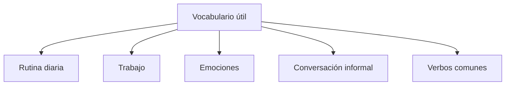

Los apuntes incluyen listados de vocabulario de **rutina diaria**, **trabajo**, **emociones** y **conversación informal**, con **verbos comunes**. Estos listados se encuentran en el material de estudio (RemNote) y no se reproducen aquí en detalle. {a Apuntes de Inglés I · Tema 8}


{d}

## Categorías de vocabulario

### 1. Rutina diaria
Acciones habituales con expresiones de tiempo:
- *wake up, get up, brush teeth, have breakfast, go to work/school, have lunch, finish work, go home, have dinner, go to bed*
- Expresiones: *at 7:00, in the morning, at noon, in the afternoon, at night, before/after* {a Apuntes de Inglés I · Tema 8}

### 2. Trabajo
- *job, career, colleague, boss, meeting, deadline, project, salary, interview, resume/CV, part-time, full-time, shift, overtime* {a Apuntes de Inglés I · Tema 8}

### 3. Emociones
- Positivas: *happy, excited, proud, relaxed, confident, grateful*
- Negativas: *sad, angry, frustrated, stressed, anxious, disappointed, bored, tired* {a Apuntes de Inglés I · Tema 8}

### 4. Conversación informal (chunks)
- Saludos: *Hi! How's it going? What's up? Long time no see.*
- Despedidas: *See you later. Take care. Catch you later. Have a good one.*
- Reacciones: *Really? No way! That's awesome! I can't believe it. Sounds good.* {a Apuntes de Inglés I · Tema 8}

### 5. Verbos comunes de acción
- *do, make, take, get, give, go, come, see, know, think, want, need, like, love, hate, use, find, tell, ask, work, study, play, read, write, speak, listen, watch, eat, drink, sleep, wake, buy, sell, pay, cost* {a Apuntes de Inglés I · Tema 8}

```explorable
titulo: Verbos clave por categoría
variante: capas
nodos:
  - {id: rutina, titulo: "Rutina", resumen: "wake up, get up, have breakfast...", detalle: "Acciones diarias en orden cronológico."}
  - {id: trabajo, titulo: "Trabajo", resumen: "meeting, deadline, colleague...", detalle: "Entorno laboral y profesional."}
  - {id: emociones, titulo: "Emociones", resumen: "happy, sad, stressed, excited...", detalle: "Estados de ánimo positivos y negativos."}
  - {id: chunks, titulo: "Chunks conversacionales", resumen: "How's it going? No way! Sounds good...", detalle: "Expresiones fijas para hablar natural."}
  - {id: verbos, titulo: "Verbos top 20", resumen: "do, make, get, take, go, come...", detalle: "Los verbos más frecuentes en inglés."}
o: d
```

```clasificar
titulo: Clasificá cada palabra en su categoría
categorias: [Rutina diaria, Trabajo, Emociones, Conversación informal, Verbos comunes]
items:
  - {x: "wake up", cat: 0, porque: "Acción de rutina matutina."}
  - {x: "deadline", cat: 1, porque: "Término laboral (fecha límite)."}
  - {x: "frustrated", cat: 2, porque: "Emoción negativa."}
  - {x: "What's up?", cat: 3, porque: "Saludo informal (chunk)."}
  - {x: "make", cat: 4, porque: "Verbo de alta frecuencia."}
  - {x: "go to bed", cat: 0, porque: "Acción de rutina nocturna."}
  - {x: "colleague", cat: 1, porque: "Compañero de trabajo."}
  - {x: "grateful", cat: 2, porque: "Emoción positiva."}
  - {x: "Take care", cat: 3, porque: "Despedida informal (chunk)."}
  - {x: "get", cat: 4, porque: "Verbo comodín muy frecuente."}
o: d
```

:::sintesis
- El vocabulario se organiza por categorías: rutina, trabajo, emociones, conversación y verbos comunes.
- Los listados detallados están en el material de estudio original (RemNote).
- Los "chunks" (frases hechas) ayudan a sonar más natural. {a Apuntes de Inglés I · Unidad 4}
:::
