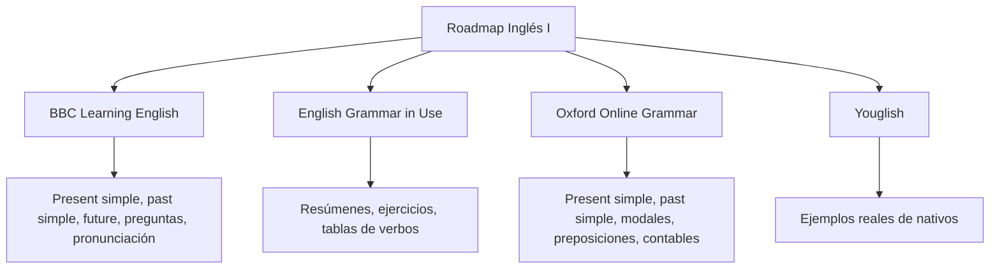

Los apuntes incluyen **expresiones para hablar de manera natural** (hablar sobre mi día, sobre trabajo, con humor, expresiones nativas simples) y un **roadmap de estudio sugerido**. {a Apuntes de Inglés I · Tema 9}


{d}

## Expresiones nativas (chunks) por situación

### Hablar sobre mi día
- *I wake up at 7.*
- *I have a quick breakfast.*
- *I catch the bus at 8.*
- *Work was busy today.*
- *I'm exhausted / I'm knackered.* (muy cansado, coloquial) {a Apuntes de Inglés I · Tema 9}

### Hablar sobre trabajo
- *I have a meeting at 10.*
- *The deadline is tomorrow.*
- *I'm swamped.* (muy ocupado, coloquial)
- *Let's touch base later.* (hablemos después)
- *It's a deal.* (trato hecho) {a Apuntes de Inglés I · Tema 9}

### Con humor / reacciones
- *No way!* (¡No puede ser!)
- *You're kidding!* (¡Estás de broma!)
- *That's hilarious!* (¡Es desternillante!)
- *I'm dying!* (me muero de risa) {a Apuntes de Inglés I · Tema 9}

### Expresiones nativas simples
- *It depends.* (Depende.)
- *I mean...* (O sea... / Quiero decir...)
- *Actually...* (En realidad... / De hecho...)
- *Anyway...* (De todos modos... / En fin...)
- *To be honest...* (Para ser sincero...) {a Apuntes de Inglés I · Tema 9}

## Roadmap de estudio sugerido

Fuentes recomendadas para seguir practicando: {a Apuntes de Inglés I · Tema 9}

- **BBC Learning English**: *present simple, past simple, "going to" future, "will" vs "going to", present continuous, cómo formar preguntas, pronunciación.*
- **English Grammar in Use**: *resúmenes, ejercicios básicos, tablas de verbos.*
- **Oxford Online Grammar**: *present simple, past simple, verbos modales, preposiciones de tiempo, contables e incontables.*
- **Youglish**: *ejemplos reales usados por nativos.* {a Apuntes de Inglés I · Unidad 4}

```explorable
titulo: Fuentes de estudio recomendadas
variante: capas
nodos:
  - {id: bbc, titulo: "BBC Learning English", resumen: "Gramática + pronunciación", detalle: "Present simple, past simple, future, preguntas, pronunciation."}
  - {id: egi, titulo: "English Grammar in Use", resumen: "Ejercicios y referencia", detalle: "Summaries, basic exercises, verb tables."}
  - {id: oxford, titulo: "Oxford Online Grammar", resumen: "Gramática estructurada", detalle: "Present/past simple, modals, time prepositions, countable/uncountable."}
  - {id: youglish, titulo: "Youglish", resumen: "Uso real por nativos", detalle: "Buscá cualquier palabra/frase y escuchá ejemplos reales."}
o: d
```

```asociar
titulo: Unir fuente con su fuerte
pares:
  - [BBC Learning English, "Pronunciación y preguntas"]
  - [English Grammar in Use, "Ejercicios y tablas de verbos"]
  - [Oxford Online Grammar, "Modales y preposiciones"]
  - [Youglish, "Ejemplos reales de nativos"]
o: d
```

```clasificar
titulo: ¿Qué recurso usarías para...?
categorias: [BBC Learning English, English Grammar in Use, Oxford Online Grammar, Youglish]
items:
  - {x: "Practicar pronunciación de 'th'", cat: 0, porque: "BBC tiene sección dedicada a pronunciation."}
  - {x: "Hacer ejercicios de past simple", cat: 1, porque: "English Grammar in Use tiene ejercicios graduados."}
  - {x: "Entender diferencia will vs going to", cat: 2, porque: "Oxford explica modales y futuros claramente."}
  - {x: "Oír cómo usan 'actually' los nativos", cat: 3, porque: "Youglish muestra videos reales con subtítulos."}
  - {x: "Repasar tablas de verbos irregulares", cat: 1, porque: "English Grammar in Use incluye verb tables."}
  - {x: "Aprender preposiciones de tiempo", cat: 2, porque: "Oxford cubre prepositions of time en detalle."}
o: d
```

:::sintesis
- Las frases listas (chunks) ayudan a hablar de manera natural sin traducir palabra por palabra.
- El roadmap sugiere fuentes como BBC Learning English, English Grammar in Use, Oxford Online Grammar y Youglish.
- BBC = pronunciación + preguntas; English Grammar in Use = ejercicios; Oxford = gramática estructurada; Youglish = uso real. {a Apuntes de Inglés I · Unidad 4}
:::
