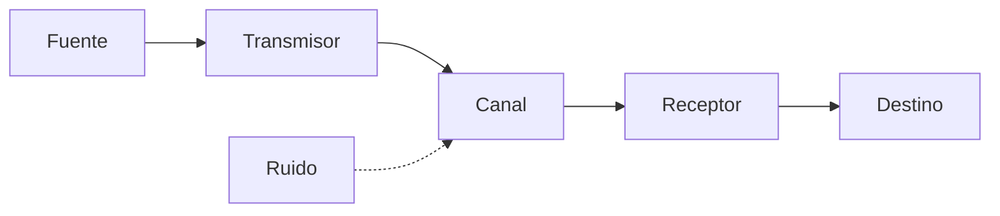

## Conceptos fundamentales

- **Dato**: representación de un hecho o valor, sin procesar ni contexto. Ejemplo: el número `25` por sí solo. {a Apuntes de Introducción a las comunicaciones · Unidad 1}
- **Información**: datos procesados, organizados y presentados en un contexto que les da significado y utilidad para la toma de decisiones. Ejemplo: «La temperatura es 25 °C». {a Apuntes de Introducción a las comunicaciones · Unidad 1}
- **Símbodo**: unidad mínima de información con significado propio dentro de un sistema de comunicación. En sistemas digitales, el bit es el símbodo elemental. {a Apuntes de Introducción a las comunicaciones · Unidad 1}

:::clave Jerarquía dato → información → conocimiento
El dato es la materia prima; la información surge al procesar datos con contexto; el conocimiento integra información con experiencia y reglas para actuar. {d}
:::

## Teoría de la Información (Shannon)

Claude Shannon (1948) fundó la teoría matemática de la comunicación. Su marco cuantifica la **información** como reducción de incertidumbre y define la **capacidad de un canal** como el máximo ritmo de transmisión fiable. {a Apuntes de Introducción a las comunicaciones · Unidad 1}

- **Entropía (H)**: mide la incertidumbre promedio o cantidad de información de una fuente. Fórmula: `H = -Σ p(x) log₂ p(x)`. Unidad: bits/símbolo. {a Apuntes de Introducción a las comunicaciones · Unidad 1}
- **Redundancia**: parte de la información que no aporta novedad; permite detectar/corregir errores. {a Apuntes de Introducción a las comunicaciones · Unidad 1}
- **Capacidad del canal (C)**: `C = B log₂(1 + S/N)` (teorema de Shannon-Hartley), donde B = ancho de banda, S/N = relación señal/ruido. {a Apuntes de Introducción a las comunicaciones · Unidad 1}

## Sistema de comunicación de Shannon


{d}

:::clave Ruido y capacidad
El ruido en el canal limita la tasa de transmisión sin errores. La codificación de canal (corrección de errores) permite acercarse al límite teórico de Shannon. {d}
:::

## Señales analógicas y digitales

| Característica | Señal analógica | Señal digital |
|---|---|---|
| Tiempo | Continuo | Discreto (muestreo) |
| Amplitud | Continua | Discreta (cuantificación) |
| Representación | Onda continua | Secuencia de bits |
| Ruido | Se degrada acumulativamente | Regenerable sin pérdida (hasta umbral) |
| Ancho de banda | Requiere más para misma info | Más eficiente con compresión |
| Ejemplos | Voz humana, radio AM/FM | Ethernet, Wi-Fi, fibra óptica | {a Apuntes de Introducción a las comunicaciones · Unidad 1}

:::comparar Analógica vs. Digital
### Analógica
- Continua en tiempo y amplitud
- Susceptible a ruido y distorsión
- Procesamiento por circuitos analógicos
- Dificultad para multiplexar y cifrar

### Digital
- Discreta (muestras + cuantificación)
- Inmune al ruido hasta umbral
- Procesamiento por lógica digital / software
- Fácil multiplexación, cifrado, compresión
```
{d}
:::

## Sistemas de numeración y códigos

- **Decimal (base 10)**: uso humano cotidiano.
- **Binario (base 2)**: base de la computación; dígitos 0 y 1 (bits).
- **Octal (base 8)**: agrupación de 3 bits; uso histórico.
- **Hexadecimal (base 16)**: agrupación de 4 bits; 0-9 y A-F; estándar para representar bytes. {a Apuntes de Introducción a las comunicaciones · Unidad 1}

**Conversiones**: binario ↔ decimal (potencias de 2), binario ↔ hex (grupos de 4), binario ↔ octal (grupos de 3). {a Apuntes de Introducción a las comunicaciones · Unidad 1}

**Códigos binarios comunes**: {a Apuntes de Introducción a las comunicaciones · Unidad 1}

- **BCD (Binary Coded Decimal)**: cada dígito decimal en 4 bits.
- **ASCII (7 bits)**: 128 caracteres (control + imprimibles).
- **Extended ASCII / ISO-8859-1 / UTF-8**: extensiones para alfabetos internacionales.
- **Código Gray**: solo un bit cambia entre valores consecutivos; útil en encoders. {a Apuntes de Introducción a las comunicaciones · Unidad 1}

## Técnicas de codificación de línea

Para transmitir bits por un medio físico: **NRZ**, **NRZI**, **Manchester**, **Diferencial Manchester**, **4B/5B**, **8b/10b**. Cada una maneja sincronismo, componente DC y eficiencia espectral de forma distinta. {a Apuntes de Introducción a las comunicaciones · Unidad 1}

```explorable
titulo: Codificaciones de línea
variante: pasos
nodos:
  - {id: nrz, titulo: NRZ, resumen: Nivel alto/bajo = 1/0., detalle: Simple pero sin sincronismo intrínseco; componente DC.}
  - {id: nrzi, titulo: NRZI, resumen: Transición = 1, sin transición = 0., detalle: Usado en USB; mejor sincronismo que NRZ.}
  - {id: manchester, titulo: Manchester, resumen: Transición en medio del bit., detalle: Autorreloj; usado en Ethernet 10BASE-T.}
  - {id: diffman, titulo: Manchester diferencial, resumen: Transición al inicio = 1., detalle: Mejor inmunidad a inversión de polaridad.}
  - {id: cuatrob5b, titulo: 4B/5B, resumen: 4 bits datos → 5 bits línea., detalle: Elimina secuencias largas de ceros; usado en Fast Ethernet.}
  - {id: ochob10b, titulo: 8b/10b, resumen: 8 bits → 10 bits con balance DC., detalle: Usado en PCIe, SATA, Gigabit Ethernet.}
o: d
```

## Modulación digital

Para enviar señales digitales por canales analógicos (radio, teléfono): **ASK** (amplitud), **FSK** (frecuencia), **PSK** (fase), **QAM** (amplitud + fase). {a Apuntes de Introducción a las comunicaciones · Unidad 1}

:::sintesis
- Dato = valor sin contexto; Información = dato con significado; Símbodo = unidad mínima significativa.
- Shannon cuantifica información (entropía) y capacidad de canal (C = B log₂(1+S/N)).
- Señal analógica: continua; digital: discreta (muestreo + cuantificación). La digital regenera y permite cifrado/compresión.
- Sistemas: binario (base 2), hexadecimal (base 16). Códigos: ASCII, UTF-8, BCD, Gray.
- Codificación de línea (NRZ, Manchester, 4B/5B, 8b/10b) y modulación (ASK, FSK, PSK, QAM) adaptan bits al medio. {a Apuntes de Introducción a las comunicaciones · Unidad 1}
:::