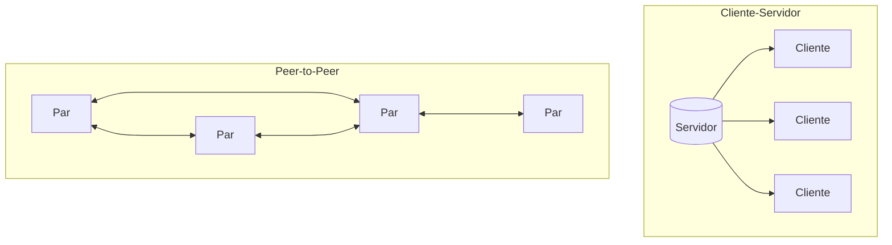
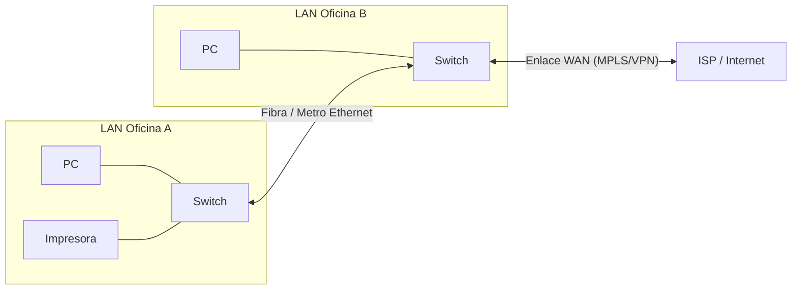

## Definición y usos de las redes de datos

Una **red de datos** es un conjunto de dispositivos interconectados (computadoras, servidores, impresoras, IoT, etc.) que comparten recursos e información mediante un medio de transmisión y protocolos comunes. {a Apuntes de Introducción a las comunicaciones · Unidad 2}

**Usos principales**:
- Compartir archivos y almacenamiento (NAS, servidores de archivos).
- Compartir periféricos (impresoras, escáneres).
- Acceso a Internet (gateway, proxy, NAT).
- Comunicación interpersonal (correo, mensajería, videoconferencia).
- Aplicaciones distribuidas (bases de datos, ERP, CRM, cloud).
- Gestión centralizada (actualizaciones, políticas, backups, monitoreo). {a Apuntes de Introducción a las comunicaciones · Unidad 2}

:::clave Red ≠ Internet
Una red de datos puede ser privada e aislada (intranet). Internet es una red de redes públicas interconectadas. {d}
:::

## Arquitectura cliente-servidor

Modelo en el que los **clientes** (dispositivos de usuario) solicitan servicios a un **servidor** central que los provee. El servidor gestiona recursos, autenticación, datos y lógica de negocio. {a Apuntes de Introducción a las comunicaciones · Unidad 2}

| Rol | Características |
|---|---|
| **Cliente** | Inicia la petición (request), interfaz de usuario, poca lógica de negocio, efímero. |
| **Servidor** | Escucha peticiones (listen), procesa y responde, alta disponibilidad, almacenamiento persistente, multi-hilo/proceso. {a Apuntes de Introducción a las comunicaciones · Unidad 2}

**Ventajas**: control centralizado, seguridad, escalabilidad vertical, backup único, administración simple.  
**Desventajas**: punto único de fallo (SPOF), cuello de botella en el servidor, costo de hardware dedicado. {a Apuntes de Introducción a las comunicaciones · Unidad 2}

## Arquitectura Peer-to-Peer (P2P)

Todos los nodos (pares) son **iguales**: cada uno actúa como cliente y servidor a la vez. No hay servidor central; los recursos se distribuyen entre los participantes. {a Apuntes de Introducción a las comunicaciones · Unidad 2}

**Tipos de P2P**:
- **Puro**: todos los nodos iguales, sin coordinador central (ej. Gnutella, BitTorrent DHT).
- **Híbrido**: nodos iguales pero con servidores de índice/rastreo (trackers) para descubrimiento (ej. BitTorrent clásico, Napster original). {a Apuntes de Introducción a las comunicaciones · Unidad 2}

**Ventajas**: tolerancia a fallos, escalabilidad horizontal, bajo costo de infraestructura, anonimato relativo.  
**Desventajas**: difícil gestión de seguridad/calidad, consumo de ancho de banda simétrico, complejidad de búsqueda, problemas legales (copyright). {a Apuntes de Introducción a las comunicaciones · Unidad 2}


{d}

## Sistemas operativos según rol

- **Servidor**: Windows Server, Linux (Ubuntu Server, RHEL, Debian), FreeBSD. Optimizados para servicios de red, multiusuario, estabilidad, seguridad, gestión remota. {a Apuntes de Introducción a las comunicaciones · Unidad 2}
- **Cliente**: Windows 10/11, macOS, Linux Desktop, ChromeOS. Optimizados para interacción usuario, GUI, compatibilidad de aplicaciones. {a Apuntes de Introducción a las comunicaciones · Unidad 2}

## Tipos de servidores comunes

| Tipo | Función | Protocolos típicos |
|---|---|---|
| Archivos | Almacenamiento compartido | SMB/CIFS, NFS, AFP |
| Web | Aplicaciones y sitios HTTP/HTTPS | HTTP/1.1, HTTP/2, HTTP/3 (QUIC) |
| Correo | Envío/recepción de email | SMTP, IMAP, POP3 |
| Base de datos | Gestión de datos estructurados | SQL (PostgreSQL, MySQL, SQL Server), NoSQL |
| DNS | Resolución de nombres | DNS (UDP/TCP 53) |
| DHCP | Asignación automática de IP | DHCP (UDP 67/68) |
| Autenticación | Identidad y acceso | LDAP, Kerberos, RADIUS, SAML/OIDC |
| Proxy / Caché | Filtrado, aceleración, anonimato | HTTP/HTTPS proxy, SOCKS |
| Virtualización / Contenedores | Infraestructura como servicio | VMware, Hyper-V, K8s, Docker Swarm {a Apuntes de Introducción a las comunicaciones · Unidad 2}

## Clasificación de redes — Por tamaño / alcance geográfico

- **LAN (Local Area Network)**: alcance limitado (edificio, campus), alta velocidad (1 Gbps–100 Gbps), propiedad privada, baja latencia. Tecnologías: Ethernet, Wi-Fi. {a Apuntes de Introducción a las comunicaciones · Unidad 2}
- **MAN (Metropolitan Area Network)**: ciudad o área metropolitana (5–50 km), interconecta LANs. Tecnologías: Metro Ethernet, fibra óptica, WiMAX. {a Apuntes de Introducción a las comunicaciones · Unidad 2}
- **WAN (Wide Area Network)**: alcance amplio (país, continente, global), interconecta LANs/MANs mediante enlaces de proveedores (ISPs). Tecnologías: MPLS, fibra de larga distancia, satélite, 4G/5G, Internet VPN. {a Apuntes de Introducción a las comunicaciones · Unidad 2}


{d}

## Clasificación — Por administración de recursos

- **P2P (Peer-to-Peer)**: todos los nodos son iguales; cada usuario administra sus recursos compartidos. Típico en redes domésticas pequeñas o grupos de trabajo. {a Apuntes de Introducción a las comunicaciones · Unidad 2}
- **Basada en servidor (Cliente-Servidor)**: un servidor central (o clúster) gestiona recursos, usuarios, seguridad y políticas. Estándar en organizaciones medianas/grandes. {a Apuntes de Introducción a las comunicaciones · Unidad 2}

## Comparación P2P vs. Basada en servidor

| Aspecto | P2P | Basada en servidor |
|---|---|---|
| Administración | Descentralizada (cada usuario) | Centralizada (IT) |
| Escalabilidad | Horizontal (fácil agregar nodos) | Vertical + clústeres |
| Seguridad | Difícil de auditar/controlar | Fácil (políticas centralizadas) |
| Costo inicial | Bajo (hardware existente) | Alto (servidores dedicados) |
| Tolerancia a fallos | Alta (sin SPOF) | Media (SPOF salvo HA) |
| Caso de uso | Hogar, grupos pequeños, compartir archivos | Empresas, centros de datos, cloud | {a Apuntes de Introducción a las comunicaciones · Unidad 2}

```clasificar
titulo: Clasificá cada escenario
categorias: [P2P, Cliente-Servidor]
items:
  - {x: "Tres laptops comparten archivos en una casa sin servidor dedicado", cat: 0, porque: "No hay servidor central; cada nodo comparte sus recursos."}
  - {x: "Una empresa con 200 empleados usa Active Directory y servidores de archivos", cat: 1, porque: "Administración centralizada de usuarios y recursos."}
  - {x: "BitTorrent descarga piezas de múltiples pares simultáneamente", cat: 0, porque: "Arquitectura P2P pura/híbrida sin servidor de contenido."}
  - {x: "Un navegador accede a una aplicación web en la nube", cat: 1, porque: "Cliente (navegador) pide servicio a servidor (app web)."}
  - {x: "Una red Wi-Fi doméstica donde la impresora está conectada a la PC principal", cat: 0, porque: "La PC actúa como servidor de impresión improvisado; no hay servidor dedicado."}
o: d
```

:::sintesis
- Red de datos = dispositivos interconectados compartiendo recursos (archivos, impresión, Internet, apps).
- Cliente-servidor: centralizado, escalable verticalmente, administración y seguridad controladas.
- P2P: descentralizado, tolerante a fallos, escalable horizontalmente, difícil de gestionar.
- Por alcance: LAN (local), MAN (metropolitana), WAN (amplia/Internet).
- Por administración: P2P (iguales) vs. basada en servidor (centralizada). {a Apuntes de Introducción a las comunicaciones · Unidad 2}
:::