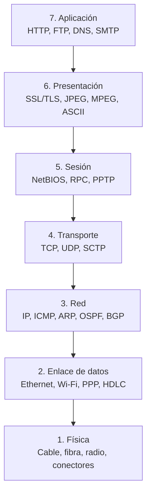
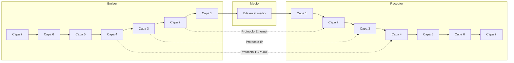

## Introducción

El modelo **OSI (Open Systems Interconnection)** de la ISO (1984) es un modelo de referencia de **7 capas** que estandariza las funciones de comunicación en redes. Aunque no se implementa directamente (TCP/IP es el usado en Internet), sigue siendo la base conceptual para diseñar, enseñar y diagnosticar redes. {a Apuntes de Introducción a las comunicaciones · Unidad 3}

:::clave Modelo de referencia vs. pila de protocolos
OSI define **qué** hace cada capa (funciones), no **cómo** (protocolos concretos). TCP/IP implementa una pila real de 4 capas que se mapea aproximadamente a OSI. {d}
:::

## Las siete capas del modelo OSI (de arriba hacia abajo)


{d}

| Capa | Nombre | PDU | Función principal | Protocolos / Estándares | Dispositivos |
|---|---|---|---|---|---|
| **7** | **Aplicación** | Datos | Interfaz usuario/red; servicios de red a aplicaciones | HTTP, HTTPS, FTP, SFTP, DNS, SMTP, POP3, IMAP, SNMP, DHCP, SSH, Telnet | — (software) |
| **6** | **Presentación** | Datos | Traducción, cifrado, compresión, formato | SSL/TLS, ASCII/UTF-8, JPEG, PNG, MPEG, MIDI, MIME | — (software) |
| **5** | **Sesión** | Datos | Establecimiento, mantenimiento, terminación de sesiones; sincronización | NetBIOS, RPC, PPTP, L2TP, SOCKS, SIP | — (software) |
| **4** | **Transporte** | **Segmento** (TCP) / **Datagrama** (UDP) | Extremo a extremo: segmentación, control de flujo, confiabilidad, multiplexación por puertos | **TCP** (confiable, orientado a conexión), **UDP** (no confiable, sin conexión), SCTP, QUIC | — (software) |
| **3** | **Red** | **Paquete** / Datagrama | Direccionamiento lógico (IP), enrutamiento, fragmentación, QoS | **IPv4**, **IPv6**, ICMP, ICMPv6, ARP, OSPF, BGP, IS-IS, RIP | **Router**, Capa 3 Switch, Firewall L3 |
| **2** | **Enlace de datos** | **Trama** (Frame) | Acceso al medio (MAC), detección/corrección de errores, enmarcado, control de flujo hop-a-hop | **Ethernet (802.3)**, **Wi-Fi (802.11)**, PPP, HDLC, Frame Relay, MAC, LLC | **Switch**, Bridge, NIC, AP (punto de acceso) |
| **1** | **Física** | **Bit** | Transmisión de bits crudos por el medio: señal, conectores, voltajes, tasas, topología | RS-232, V.35, **Ethernet PHY (10/100/1000BASE-T, 10GBASE-R)**, **Wi-Fi PHY (802.11a/b/g/n/ac/ax)**, Fibra (1000BASE-SX/LX, 10GBASE-SR/LR), DSL, DOCSIS | **Hub**, Repetidor, Conversor de medios, Patch panel, Cableado | {a Apuntes de Introducción a las comunicaciones · Unidad 3}

## Encapsulamiento y PDU (Unidad de Datos de Protocolo)

El **encapsulamiento** es el proceso de agregar **encabezados** (y *trailers* en capa 2) a los datos al **descender** por las capas del emisor. En el receptor, el **desencapsulamiento** quita las cabeceras al **ascender**. {a Apuntes de Introducción a las comunicaciones · Unidad 3}

```
Datos App (Capa 7-5)
    ↓ + Cabecera Capa 4 (puerto origen/destino, seq, ack, flags)
Segmento TCP / Datagrama UDP (Capa 4)
    ↓ + Cabecera Capa 3 (IP origen/destino, TTL, protocolo)
Paquete IP (Capa 3)
    ↓ + Cabecera Capa 2 (MAC origen/destino, tipo) + Trailer (FCS)
Trama Ethernet / Wi-Fi (Capa 2)
    ↓ Codificación de línea / modulación
Bits en el medio (Capa 1)
``` {d}

**Nombres de la PDU por capa**:
- Capa 4: **Segmento** (TCP) / **Datagrama** (UDP)
- Capa 3: **Paquete** / Datagrama IP
- Capa 2: **Trama** (Frame)
- Capa 1: **Bit** {a Apuntes de Introducción a las comunicaciones · Unidad 3}

## Comunicación entre capas (pares lógicos)

Cada capa en el emisor se comunica con su **par (peer)** en el receptor mediante su propio **protocolo de capa**, usando los servicios de la capa inferior. Las capas no "saltan": capa N usa servicios de capa N-1. {a Apuntes de Introducción a las comunicaciones · Unidad 3}


{d}

## Dispositivos por capa (resumen práctico)

| Capa | Dispositivo típico | Función en esa capa |
|---|---|---|
| 1 Física | Hub, Repetidor, Conversor de medios | Regenera señal física; no filtra ni direcciona |
| 2 Enlace | Switch, Bridge, NIC, Access Point | Reenvía/trama según MAC; aprende tabla MAC; dominio de colisión por puerto |
| 3 Red | Router, Capa 3 Switch, Firewall L3 | Enruta paquetes según IP; separa dominios de broadcast |
| 4+ Transporte+ | Balanceador de carga L4/L7, Proxy, WAF | Decide según puerto/IP/app; terminación TLS, inspección payload | {a Apuntes de Introducción a las comunicaciones · Unidad 3}

:::clave Switch ≠ Router
Switch (Capa 2): decide por **MAC**, une segmentos en **una misma red** (dominio de broadcast único).
Router (Capa 3): decide por **IP**, une **redes distintas**, rompe dominio de broadcast. {d}
:::

```explorable
titulo: Funciones por capa OSI
variante: capas
nodos:
  - {id: l7, titulo: "7. Aplicación", resumen: "Servicios a apps de usuario", detalle: "HTTP, DNS, SMTP, FTP, SNMP, DHCP. Puerto: aplicación."}
  - {id: l6, titulo: "6. Presentación", resumen: "Formato, cifrado, compresión", detalle: "TLS/SSL, JPEG, UTF-8, MIME."}
  - {id: l5, titulo: "5. Sesión", resumen: "Control de diálogo y sincronía", detalle: "RPC, NetBIOS, SIP, PPTP."}
  - {id: l4, titulo: "4. Transporte", resumen: "Extremo a extremo: puertos, fiabilidad, flujo", detalle: "TCP (confiable), UDP (rápido). PDU: segmento/datagrama."}
  - {id: l3, titulo: "3. Red", resumen: "Direccionamiento lógico y enrutamiento", detalle: "IP, ICMP, ARP, OSPF, BGP. PDU: paquete. Dispositivo: router."}
  - {id: l2, titulo: "2. Enlace", resumen: "Acceso al medio, tramas, MAC, error", detalle: "Ethernet, Wi-Fi, PPP. PDU: trama. Dispositivo: switch."}
  - {id: l1, titulo: "1. Física", resumen: "Bits por el medio", detalle: "Cable, fibra, radio, conectores. PDU: bit. Dispositivo: hub/repetidor."}
o: d
```

```asociar
titulo: Uní cada concepto con su capa OSI
pares:
  - [Direccionamiento IP, Capa 3 - Red]
  - [Direccionamiento MAC, Capa 2 - Enlace]
  - [Puertos TCP/UDP, Capa 4 - Transporte]
  - [Cifrado SSL/TLS, Capa 6 - Presentación]
  - [HTTP / FTP / DNS, Capa 7 - Aplicación]
  - [Bits en el cable, Capa 1 - Física]
  - [Tramas Ethernet, Capa 2 - Enlace]
  - [Segmentos TCP, Capa 4 - Transporte]
  - [Enrutamiento OSPF/BGP, Capa 3 - Red]
  - [Sincronización de sesión, Capa 5 - Sesión]
o: d
```

:::sintesis
- OSI: 7 capas (Aplicación, Presentación, Sesión, Transporte, Red, Enlace, Física).
- Encapsulamiento: cabeceras al descender (App → bits); desencapsulamiento al ascender.
- PDU: Datos (5-7), Segmento/Datagrama (4), Paquete (3), Trama (2), Bit (1).
- Capa 4 (Transporte): extremo a extremo, puertos, TCP/UDP.
- Capa 3 (Red): IP, enrutamiento, router.
- Capa 2 (Enlace): MAC, tramas, switch.
- Capa 1 (Física): bits, cable/fibra/radio, hub/repetidor. {a Apuntes de Introducción a las comunicaciones · Unidad 3}
:::