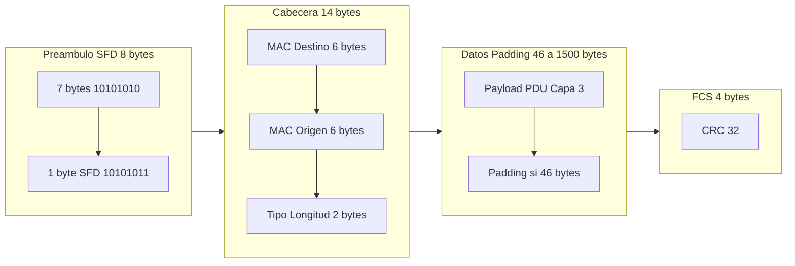
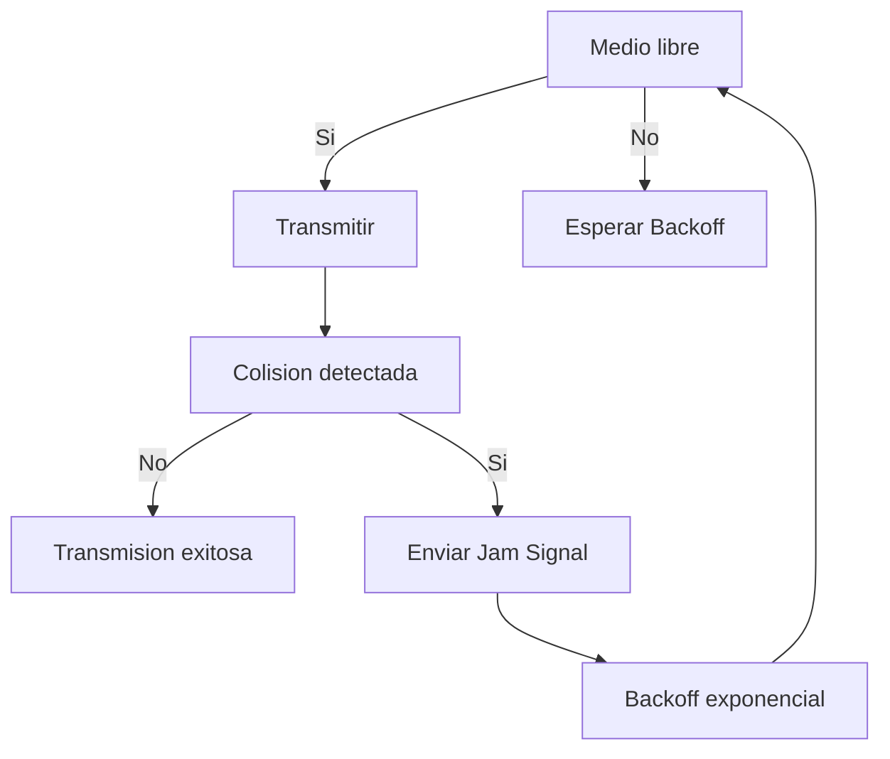
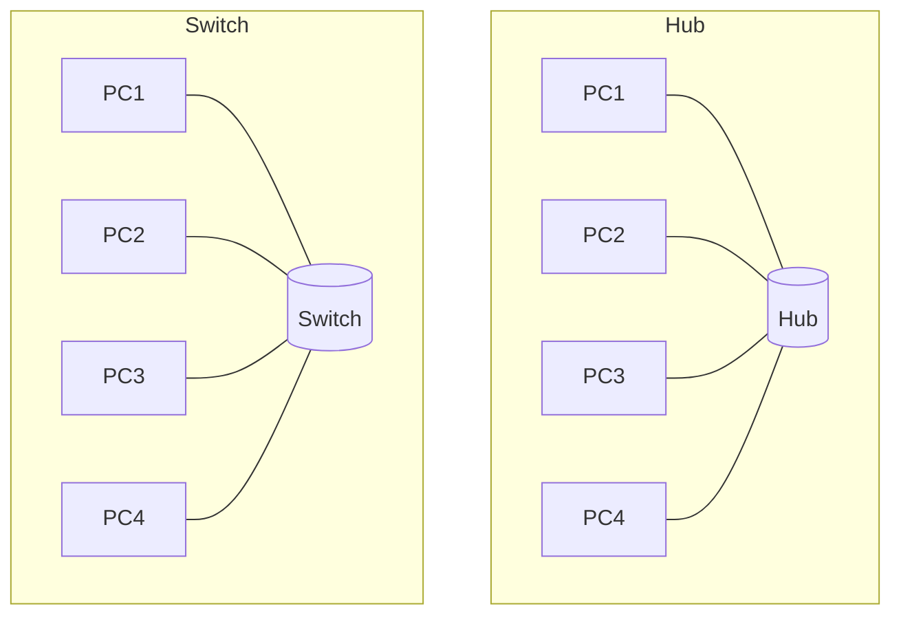

## Estándar Ethernet (IEEE 802.3)

**Ethernet** es la familia de estándares **IEEE 802.3** que define la **capa física** y la **subcapa MAC** de la capa de enlace para redes de área local. Es la tecnología LAN dominante por su bajo costo, simplicidad y escalabilidad. {a Apuntes de Introducción a las comunicaciones · Unidad 4}

**Evolución histórica**:
- **10 Mbps**: 10BASE5 (coaxial grueso), 10BASE2 (coaxial delgado), 10BASE-T (par trenzado Cat 3).
- **100 Mbps (Fast Ethernet)**: 100BASE-TX (Cat 5, par trenzado), 100BASE-FX (fibra).
- **1 Gbps (Gigabit Ethernet)**: 1000BASE-T (Cat 5e, 4 pares), 1000BASE-SX/LX (fibra).
- **10 Gbps**: 10GBASE-T (Cat 6a), 10GBASE-SR/LR/ER (fibra).
- **25/40/100/200/400/800 Gbps**: centros de datos, spine-leaf, fibra y cobre (DAC, AOC). {a Apuntes de Introducción a las comunicaciones · Unidad 4}

## Formato de la trama Ethernet (IEEE 802.3)


{d}

| Campo | Tamaño | Descripción |
|---|---|---|
| **Preámbulo** | 7 bytes | Sincronización de reloj (patrón 10101010). |
| **SFD (Start Frame Delimiter)** | 1 byte | `10101011` marca inicio de trama. |
| **MAC Destino** | 6 bytes | Dirección física del receptor (unicast, multicast, broadcast `FF:FF:FF:FF:FF:FF`). |
| **MAC Origen** | 6 bytes | Dirección física del emisor (siempre unicast). |
| **Tipo / Longitud** | 2 bytes | **Ethernet II**: `> 0x0600` = tipo de protocolo (0x0800 = IPv4, 0x86DD = IPv6, 0x0806 = ARP). **IEEE 802.3**: `≤ 1500` = longitud de datos. |
| **Datos (Payload)** | 46–1500 bytes | PDU de capa 3 (paquete IP). Mínimo 46 bytes para garantizar detección de colisiones (slot time). |
| **Padding** | 0–46 bytes | Relleno de ceros si payload < 46 bytes. |
| **FCS (Frame Check Sequence)** | 4 bytes | **CRC-32** para detección de errores; calculado sobre Destino + Origen + Tipo + Datos + Padding. | {a Apuntes de Introducción a las comunicaciones · Unidad 4}

:::clave MTU y Jumbo Frames
**MTU (Maximum Transmission Unit)** estándar = 1500 bytes (payload IP). **Jumbo Frames** (hasta 9000 bytes) reducen overhead en redes de almacenamiento/servidores (requiere soporte en todos los dispositivos del camino). {d}
:::

## Control de acceso al medio: CSMA/CD

**CSMA/CD** (Carrier Sense Multiple Access with Collision Detection) = *Escucha de portadora, acceso múltiple, detección de colisión*. {a Apuntes de Introducción a las comunicaciones · Unidad 4}

**Algoritmo**:
1. **Escucha** (Carrier Sense): ¿el medio está libre?
2. **Transmite** si libre; si ocupado, espera (backoff).
3. **Detecta colisión** mientras transmite (señal distorsionada).
4. **Jam signal**: envía patrón de 32 bits para notificar a todos.
5. **Backoff exponencial binario**: espera tiempo aleatorio `k × slot_time`, donde `k ∈ [0, 2ⁿ-1]`, `n` = número de reintentos (máx. 10, luego 16 intentos totales). {a Apuntes de Introducción a las comunicaciones · Unidad 4}

**Slot time** = 512 bits-tiempo = 51,2 µs en 10 Mbps = **512 bytes** en el cable (longitud máxima de segmento para detectar colisión a tiempo). Define el **diámetro de colisión** máximo de la red. {a Apuntes de Introducción a las comunicaciones · Unidad 4}

:::clave CSMA/CD en redes modernas
En **redes conmutadas (switches)** con enlaces **full-duplex** (punto a punto dedicado), **no hay colisiones** y **CSMA/CD se desactiva**. El estándar 802.3x define control de flujo PAUSE para full-duplex. CSMA/CD solo persiste en hubs (obsoletos) y medios compartidos (Wi-Fi usa CSMA/CA, no CD). {d}
:::


{d}

## Métodos de acceso al medio (comparación)

| Método | Medio | Detección | Uso típico |
|---|---|---|---|
| **CSMA/CD** | Compartido (bus, hub) | Colisión (CD) | Ethernet 10/100 half-duplex (histórico) |
| **CSMA/CA** | Compartido inalámbrico | Evitación (CA, ACK/RTS/CTS) | Wi-Fi (802.11) |
| **Token Passing** | Anillo/bus | Token determinístico | Token Ring (802.5), FDDI (histórico) |
| **Polling** | Centralizado | Maestro interroga | Mainframes, algunos industriales |
| **Full-duplex switched** | Punto a punto dedicado | Ninguna (sin colisiones) | Ethernet moderno (switches), fibra | {a Apuntes de Introducción a las comunicaciones · Unidad 4}

## Dispositivos de interconexión LAN

| Dispositivo | Capa OSI | Función | Dominio de colisión | Dominio de broadcast |
|---|---|---|---|---|
| **Hub (Concentrador)** | 1 (Física) | Repite bits a todos los puertos | **Uno solo** (compartido) | Uno solo |
| **Switch (Conmutador)** | 2 (Enlace) | Reenvía tramas según MAC; aprende tabla MAC | **Uno por puerto** (full-duplex) | Uno solo (salvo VLANs) |
| **Bridge (Puente)** | 2 (Enlace) | Une dos segmentos; filtra por MAC | Separa en dos | Uno solo |
| **Router** | 3 (Red) | Enruta paquetes IP entre redes | Separa (cada interfaz) | **Separa** (cada interfaz) | {a Apuntes de Introducción a las comunicaciones · Unidad 4}


{d}

## Topologías lógicas vs. físicas

- **Física**: disposición real del cableado y dispositivos (estrella, bus, anillo, malla).
- **Lógica**: cómo fluyen los datos y cómo se accede al medio (bus lógico en Ethernet clásico, estrella lógica en switched Ethernet). {a Apuntes de Introducción a las comunicaciones · Unidad 4}

**Ethernet clásico (coaxial/hub)**: topología física **bus** o **estrella**, topología lógica **bus** (CSMA/CD).
**Ethernet conmutado (switch)**: topología física **estrella**, topología lógica **estrella** (punto a punto full-duplex). {a Apuntes de Introducción a las comunicaciones · Unidad 4}

## Direccionamiento MAC (Media Access Control)

- **Dirección MAC (EUI-48)**: identificador único global de 48 bits (6 bytes) asignado al fabricante (OUI = primeros 24 bits) + número de serie (últimos 24 bits). Formato: `AA:BB:CC:DD:EE:FF` o `AA-BB-CC-DD-EE-FF`. {a Apuntes de Introducción a las comunicaciones · Unidad 4}
- **Tipos de dirección**: {d}
  - **Unicast**: un destino (bit I/G = 0 en primer byte).
  - **Multicast**: grupo (bit I/G = 1; ej. `01:00:5E:xx:xx:xx` para IPv4 multicast).
  - **Broadcast**: todos (`FF:FF:FF:FF:FF:FF`).
  - **Global (UAA)**: asignada por IEEE (bit U/L = 0).
  - **Local (LAA)**: asignada por administrador/software (bit U/L = 1; ej. MAC aleatoria en Wi-Fi, MAC de VMs). {a Apuntes de Introducción a las comunicaciones · Unidad 4}

**Tabla MAC (CAM table) del switch**: aprende `MAC origen → puerto` al recibir tramas; envejece entradas (aging time ~300 s). Si desconoce MAC destino → **flood** (reenvía a todos los puertos salvo el de entrada). {a Apuntes de Introducción a las comunicaciones · Unidad 4}

## Velocidades Ethernet y medios

| Estándar | Velocidad | Medio | Alcance típico | Codificación |
|---|---|---|---|---|
| 10BASE-T | 10 Mbps | Cat 3 UTP (2 pares) | 100 m | Manchester |
| 100BASE-TX | 100 Mbps | Cat 5 UTP (2 pares) | 100 m | 4B/5B + MLT-3 |
| 1000BASE-T | 1 Gbps | Cat 5e UTP (4 pares) | 100 m | 8b/10b (PAM-5) |
| 2.5GBASE-T | 2.5 Gbps | Cat 5e/6 | 100 m | 64b/65b (PAM-16) |
| 5GBASE-T | 5 Gbps | Cat 6 | 100 m | 64b/65b (PAM-16) |
| 10GBASE-T | 10 Gbps | Cat 6a | 100 m | 64b/65b (PAM-16) |
| 1000BASE-SX | 1 Gbps | Fibra MM (850 nm) | 220–550 m | 8b/10b |
| 1000BASE-LX | 1 Gbps | Fibra SM (1310 nm) | 5–10 km | 8b/10b |
| 10GBASE-SR | 10 Gbps | Fibra MM (850 nm) | 30–400 m | 64b/66b |
| 10GBASE-LR | 10 Gbps | Fibra SM (1310 nm) | 10 km | 64b/66b | {a Apuntes de Introducción a las comunicaciones · Unidad 4}

## VLAN (Virtual LAN) — introducción

**VLAN (IEEE 802.1Q)**: particiona un switch físico en **múltiples dominios de broadcast** lógicos. Etiqueta (tag) de 4 bytes insertada en la trama (TPID `0x8100` + TCI: PCP 3 bits + DEI 1 bit + **VID 12 bits** = 4094 VLANs). {a Apuntes de Introducción a las comunicaciones · Unidad 4}

- **Access port**: pertenece a una VLAN; tráfico sin tag hacia el host.
- **Trunk port**: lleva tráfico de múltiples VLANs con tag 802.1Q (salvo *native VLAN* sin tag).
- **VLAN nativa**: tráfico sin tag en trunk (por defecto VLAN 1; cambiar por seguridad). {a Apuntes de Introducción a las comunicaciones · Unidad 4}

```explorable
titulo: Estándares Ethernet por velocidad
variante: pasos
nodos:
  - {id: e10, titulo: 10 Mbps, resumen: 10BASE-T (Cat 3), detalle: Manchester, half-duplex, CSMA/CD.}
  - {id: e100, titulo: 100 Mbps, resumen: 100BASE-TX (Cat 5), detalle: 4B/5B + MLT-3, full-duplex opcional.}
  - {id: e1g, titulo: 1 Gbps, resumen: 1000BASE-T (Cat 5e), detalle: 4 pares, PAM-5, 8b/10b, full-duplex.}
  - {id: e2g5, titulo: 2.5 Gbps, resumen: 2.5GBASE-T (Cat 5e/6), detalle: PAM-16, 64b/65b, para Wi-Fi 6 AP.}
  - {id: e5g, titulo: 5 Gbps, resumen: 5GBASE-T (Cat 6), detalle: PAM-16, 64b/65b.}
  - {id: e10g, titulo: 10 Gbps, resumen: 10GBASE-T (Cat 6a), detalle: PAM-16, 64b/65b, centros de datos.}
  - {id: e100g, titulo: 100+ Gbps, resumen: 100/200/400/800 Gbps, detalle: Fibra, PAM-4, centros de datos, spine-leaf.}
o: d
```

```clasificar
titulo: Clasificá cada dispositivo por su capa OSI y efecto en dominios
categorias: [Capa 1 - No separa dominios, Capa 2 - Separa colisión, Capa 3 - Separa broadcast y colisión]
items:
  - {x: Hub, cat: 0, porque: Repite bits; un solo dominio de colisión y broadcast.}
  - {x: Switch, cat: 1, porque: Una tabla MAC por puerto; cada puerto es dominio de colisión separado; broadcast único (salvo VLAN).}
  - {x: Router, cat: 2, porque: Enruta por IP; cada interfaz rompe dominio de broadcast y colisión.}
  - {x: Bridge, cat: 1, porque: Filtra por MAC; separa dominios de colisión en dos segmentos.}
  - {x: Repetidor, cat: 0, porque: Solo regenera señal física; no filtra.}
  - {x: Access Point (Wi-Fi), cat: 1, porque: Capa 2 (802.11); medio compartido (CSMA/CA), dominio de colisión lógico único por BSS.}
o: d
```

:::sintesis
- Ethernet (IEEE 802.3): estándar LAN dominante; tramas con MAC origen/destino, tipo/longitud, FCS (CRC-32).
- CSMA/CD: escucha, transmite, detecta colisión, backoff exponencial. **Desactivado en full-duplex switched**.
- Dispositivos: Hub (L1, compartido), Switch (L2, MAC, un dominio colisión/puerto), Router (L3, IP, rompe broadcast).
- MAC: 48 bits (OUI + serie); unicast/multicast/broadcast; global (UAA) vs local (LAA).
- VLAN (802.1Q): tag 4 bytes (VID 12 bits) → dominios de broadcast lógicos en un switch físico.
- Velocidades: 10M → 800G; UTP (Cat 3→6a) y fibra (MM/SM); codificaciones: Manchester → 4B/5B → 8b/10b → 64b/65b/66b. {a Apuntes de Introducción a las comunicaciones · Unidad 4}
:::