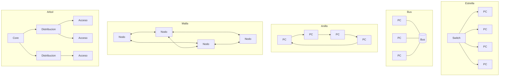
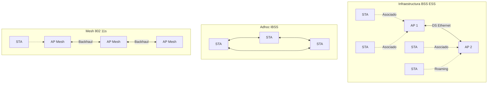

## Topologías de red LAN

La **topología física** es el cableado real; la **topología lógica** es cómo fluyen los datos y cómo se accede al medio. {a Apuntes de Introducción a las comunicaciones · Unidad 5}


{d}

| Topología | Descripción | Ventajas | Desventajas | Uso típico |
|---|---|---|---|---|
| **Estrella** | Nodos conectados a dispositivo central (switch/hub) | Fácil añadir/quitar nodos; fallo de un enlace no afecta al resto; cableado simple | Punto único de fallo (dispositivo central); más cable | **Estándar actual** (Ethernet switched, Wi-Fi infraestructura) |
| **Bus** | Todos los nodos en un medio compartido (coaxial) | Poco cable; simple | Un corte rompe toda la red; colisiones; difícil diagnóstico | Histórico (10BASE2/5, Token Bus) |
| **Anillo** | Nodos en círculo; token passing | Acceso determinístico; sin colisiones | Un corte rompe el anillo (salvo doble anillo); difícil añadir nodos | Histórico (Token Ring, FDDI), Metro Ethernet (anillo resiliente) |
| **Malla** | Cada nodo conectado a varios/muchos otros | Máxima redundancia; rutas múltiples | Mucho cable; complejidad de enrutamiento; costo alto | Backbones, WAN, redes inalámbricas mesh, data center (leaf-spine parcial) |
| **Árbol / Extended Star** | Jerarquía: Core → Distribución → Acceso | Escalable; jerárquico; aislamiento de fallos | Complejidad de diseño; depende de enlaces uplink | **Diseño LAN empresarial estándar** (modelo de 3 capas Cisco) | {a Apuntes de Introducción a las comunicaciones · Unidad 5}

:::clave Topología lógica ≠ física
Ethernet clásico (hub/coaxial): física estrella/bus, **lógica bus** (CSMA/CD).
Ethernet switched: física estrella, **lógica estrella** (punto a punto full-duplex).
Wi-Fi infraestructura: física estrella (AP central), **lógica estrella** (CSMA/CA).
Wi-Fi ad-hoc: física malla, **lógica malla/bus** (CSMA/CA). {d}
:::

## Cableado estructurado (TIA/EIA-568 / ISO/IEC 11801)

Sistema de cableado **organizado, estandarizado y escalable** para soportar múltiples servicios (voz, datos, video) y generaciones de tecnología. {a Apuntes de Introducción a las comunicaciones · Unidad 5}

**Seis subsistemas** (modelo TIA-568-D):
1. **Entrada de instalaciones (Entrance Facility)**: punto de entrada de proveedores externos (ISP, telco).
2. **Cuarto de equipos (Equipment Room)**: equipo central (servidores, core switches, PBX).
3. **Cableado backbone (Backbone Cabling)**: enlaces verticales entre cuartos (fibra multimodo/monomodo, Cat 6a/7 UTP).
4. **Cuarto de telecomunicaciones (Telecommunications Room / IDF)**: switches de acceso, patch panels, por piso/ala.
5. **Cableado horizontal (Horizontal Cabling)**: desde TR/IDF a tomas de área de trabajo (máx. 90 m cable + 10 m patch cords = 100 m). **Cat 5e/6/6a UTP/STP** o fibra.
6. **Área de trabajo (Work Area)**: tomas de pared, cables de parcheo (patch cords) a dispositivos. {a Apuntes de Introducción a las comunicaciones · Unidad 5}

**Categorías de par trenzado (UTP/STP/FTP)**: {d}

| Categoría | Ancho de banda | Velocidad máx. (estándar) | Aplicación típica |
|---|---|---|---|
| Cat 3 | 16 MHz | 10 Mbps (10BASE-T) | Telefonía, legado |
| Cat 5 | 100 MHz | 100 Mbps (100BASE-TX) | Legado |
| **Cat 5e** | 100 MHz | **1 Gbps (1000BASE-T)** | Mínimo recomendado actual |
| **Cat 6** | 250 MHz | **1 Gbps / 2.5 Gbps (hasta 55 m)** | Estándar actual oficinas |
| **Cat 6a** | 500 MHz | **10 Gbps (10GBASE-T, 100 m)** | Data center, backbone horizontal |
| Cat 7 / 7a | 600 / 1000 MHz | 10 Gbps / 40 Gbps (corto) | Blindado (S/FTP), Europa |
| Cat 8 / 8.1 / 8.2 | 2000 MHz | 25/40 Gbps (30 m) | Data center (servidor-switch) | {a Apuntes de Introducción a las comunicaciones · Unidad 5}

**Fibra óptica**:
- **Multimodo (MMF)**: núcleo 50/62.5 µm; LED/VCSEL 850/1300 nm; alcance corto (≤ 550 m para 10G). Tipos: OM1 (legado), OM2, OM3, OM4, OM5 (SWDM).
- **Monomodo (SMF)**: núcleo 9 µm; láser 1310/1550 nm; alcance largo (10–100+ km). Tipos: OS1 (indoor), OS2 (outdoor). {a Apuntes de Introducción a las comunicaciones · Unidad 5}

**Conectores comunes**: RJ-45 (UTP), LC (fibra dúplex, estándar actual), SC (fibra dúplex, legado), MPO/MTP (fibra multifibra 12/24 hilos, 40G/100G+). {a Apuntes de Introducción a las comunicaciones · Unidad 5}

## Dispositivos de conexión (resumen por capa)

| Dispositivo | Capa OSI | Función |
|---|---|---|
| **Hub / Repetidor** | 1 | Regenera señal; dominio colisión compartido |
| **Switch / Bridge** | 2 | Reenvía por MAC; tabla MAC; un dominio colisión por puerto |
| **Router / Capa 3 Switch** | 3 | Enruta por IP; rompe dominio broadcast |
| **Access Point (AP)** | 1+2 | Capa 1: radio 802.11; Capa 2: 802.11 MAC, bridge a Ethernet |
| **Conversor de medios** | 1 | Convierte medio (UTP ↔ Fibra, coaxial ↔ UTP) |
| **Patch Panel** | 1 | Terminación pasiva de cableado horizontal/backbone | {a Apuntes de Introducción a las comunicaciones · Unidad 5}

## Estándares inalámbricos IEEE 802.11 (Wi-Fi)

La familia **802.11** define PHY y MAC para WLAN. La **Wi-Fi Alliance** certifica interoperabilidad y nombra generaciones (Wi-Fi 4/5/6/6E/7). {a Apuntes de Introducción a las comunicaciones · Unidad 5}

| Estándar (Generación Wi-Fi) | Año | Bandas | Ancho canal | Modulación máx. | MIMO | Velocidad teórica máx. | Características clave |
|---|---|---|---|---|---|---|---|
| **802.11b** (Wi-Fi 1*) | 1999 | 2.4 GHz | 20 MHz | DSSS/CCK | SISO | 11 Mbps | Legado |
| **802.11a** (Wi-Fi 2*) | 1999 | 5 GHz | 20 MHz | OFDM (64-QAM) | SISO | 54 Mbps | Primer 5 GHz |
| **802.11g** (Wi-Fi 3*) | 2003 | 2.4 GHz | 20 MHz | OFDM | SISO | 54 Mbps | Compatible con b |
| **802.11n** (**Wi-Fi 4**) | 2009 | 2.4 / 5 GHz | 20/40 MHz | OFDM (64-QAM) | **MIMO 4×4** | 600 Mbps | Primer MIMO, frame aggregation |
| **802.11ac** (**Wi-Fi 5**) | 2013 | 5 GHz | 20/40/80/160 MHz | OFDM (256-QAM) | **MU-MIMO DL 8×8** | 6.9 Gbps | Solo 5 GHz, MU-MIMO downlink |
| **802.11ax** (**Wi-Fi 6 / 6E**) | 2019/2020 | 2.4 / 5 / **6 GHz** | 20/40/80/160 MHz | **OFDMA** (1024-QAM) | **UL/DL MU-MIMO 8×8** | 9.6 Gbps | **OFDMA**, BSS Coloring, TWT, 6 GHz (6E) |
| **802.11be** (**Wi-Fi 7**) | 2024 | 2.4 / 5 / 6 GHz | **320 MHz** | **4096-QAM** | **MLO (Multi-Link)**, 16×16 | 46 Gbps | **MLO**, MLO, preamble puncturing, 320 MHz | {a Apuntes de Introducción a las comunicaciones · Unidad 5}

**Tecnologías clave Wi-Fi 6/6E/7**:
- **OFDMA**: divide canal en *Resource Units* (RUs) para usuarios simultáneos (eficiencia en tráfico denso).
- **MU-MIMO** (Multi-User MIMO): DL (Wi-Fi 5/6) y UL (Wi-Fi 6+); múltiples usuarios a la vez.
- **BSS Coloring**: reduce interferencia co-canal (OBSS) marcando tramas con "color" de BSS.
- **TWT** (Target Wake Time): ahorro energía IoT/móviles; negocia cuándo despertar.
- **6 GHz (Wi-Fi 6E/7)**: 1200 MHz nuevos (5.925–7.125 GHz), canales 160/320 MHz sin legado.
- **MLO** (Multi-Link Operation, Wi-Fi 7): agregación de enlaces en 2.4/5/6 GHz simultáneos (throughput, latencia, fiabilidad). {a Apuntes de Introducción a las comunicaciones · Unidad 5}

## Topologías inalámbricas

| Modo | Topología | Descripción |
|---|---|---|
| **Infraestructura (BSS / ESS)** | Estrella lógica | **AP (Access Point)** central; clientes (STAs) se asocian al AP. **BSS** = 1 AP + clientes. **ESS** = múltiples APs con mismo SSID, conectados por DS (Distribution System, usualmente Ethernet cableado). Roaming entre APs. |
| **Ad-hoc (IBSS)** | Malla / Peer-to-peer | Sin AP; estaciones se comunican directamente. **IBSS** (Independent BSS). Limitado: sin roaming, sin distribución, alcance reducido. |
| **Wi-Fi Direct / P2P** | P2P / Grupo | Dispositivos negocian un *Group Owner* (funciona como AP ligero) para conexión directa (impresión, pantalla, compartir archivos). |
| **Mesh (802.11s / EasyMesh)** | Malla multinivel | APs se interconectan inalámbricamente (backhaul mesh) para extender cobertura sin cablear cada AP. | {a Apuntes de Introducción a las comunicaciones · Unidad 5}


{d}

```explorable
titulo: Evolución Wi-Fi (802.11)
variante: pasos
nodos:
  - {id: w4, titulo: Wi-Fi 4 (802.11n), resumen: MIMO 4×4, 40 MHz, 600 Mbps, detalle: Primer MIMO; frame aggregation; 2.4 y 5 GHz.}
  - {id: w5, titulo: Wi-Fi 5 (802.11ac), resumen: Solo 5 GHz, 160 MHz, 256-QAM, MU-MIMO DL, detalle: Hasta 6.9 Gbps; 8×8 MU-MIMO downlink.}
  - {id: w6, titulo: Wi-Fi 6 / 6E (802.11ax), resumen: OFDMA, 1024-QAM, MU-MIMO UL/DL, 6 GHz, detalle: Eficiencia en denso; BSS Coloring; TWT; 9.6 Gbps.}
  - {id: w7, titulo: Wi-Fi 7 (802.11be), resumen: 320 MHz, 4096-QAM, MLO, 16×16, detalle: Multi-Link Operation (2.4+5+6 GHz simultáneo); 46 Gbps; latencia ultra-baja.}
o: d
```

```asociar
titulo: Uní cada tecnología Wi-Fi con su innovación clave
pares:
  - [802.11n (Wi-Fi 4), MIMO (Multiple Input Multiple Output)]
  - [802.11ac (Wi-Fi 5), MU-MIMO Downlink + 256-QAM + 160 MHz]
  - [802.11ax (Wi-Fi 6/6E), OFDMA + 1024-QAM + BSS Coloring + TWT + 6 GHz]
  - [802.11be (Wi-Fi 7), MLO (Multi-Link Operation) + 4096-QAM + 320 MHz]
  - [802.11b/g, DSSS/CCK / OFDM legacy (2.4 GHz only)]
o: d
```

:::sintesis
- Topologías físicas: estrella (estándar), bus, anillo, malla, árbol. Lógica ≠ física.
- Cableado estructurado (TIA-568): 6 subsistemas; horizontal máx. 100 m (90+10). Categorías: Cat 5e (1G), Cat 6 (1G/2.5G), Cat 6a (10G), Cat 8 (25/40G). Fibra: MM (corto) vs SM (largo).
- Dispositivos: Hub (L1), Switch (L2), Router (L3), AP (L1+2), Conversor medios (L1).
- Wi-Fi (802.11): generaciones Wi-Fi 4 (n) → 5 (ac) → 6/6E (ax) → 7 (be). Claves: MIMO → MU-MIMO → OFDMA → MLO.
- Topologías Wi-Fi: Infraestructura (BSS/ESS con AP), Ad-hoc (IBSS), Wi-Fi Direct, Mesh (802.11s). {a Apuntes de Introducción a las comunicaciones · Unidad 5}
:::