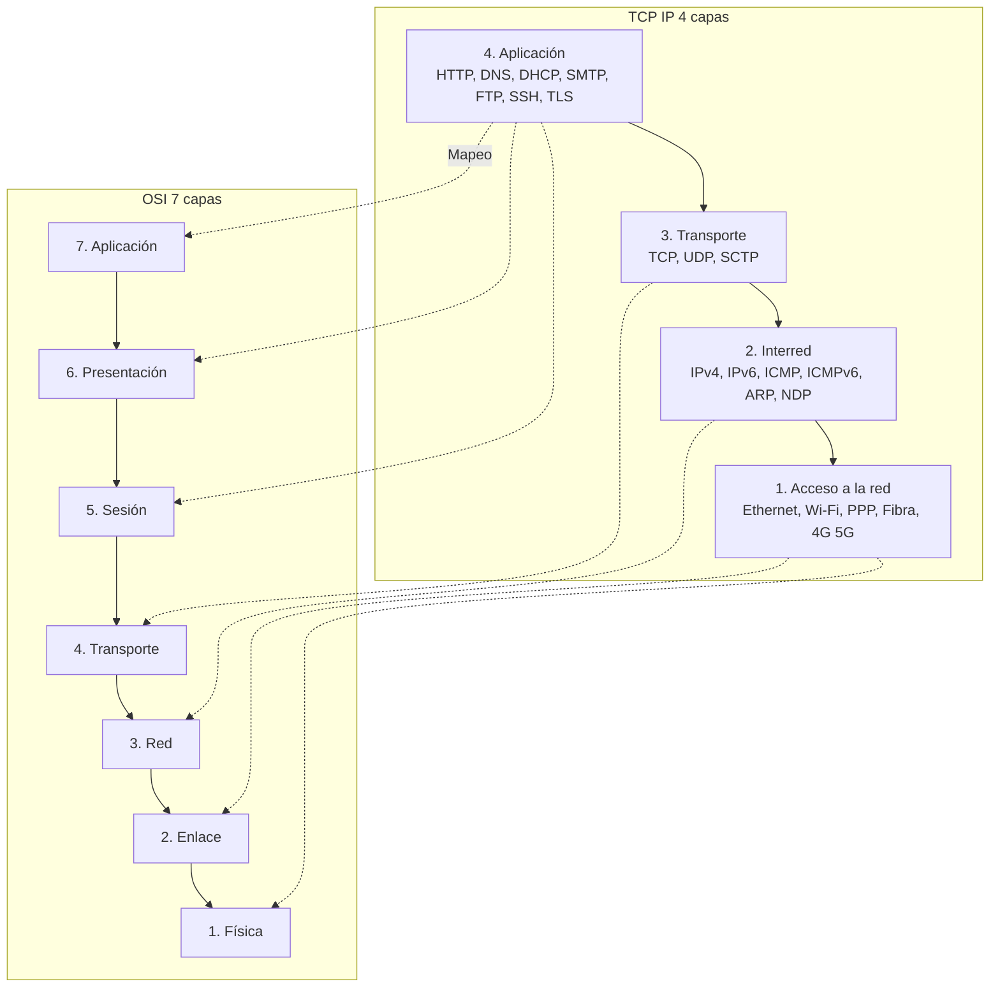
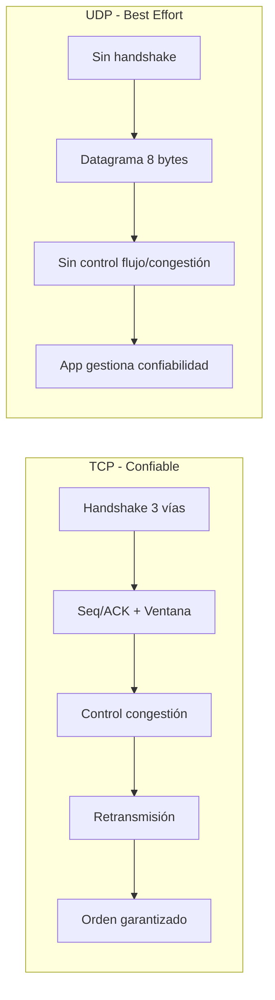
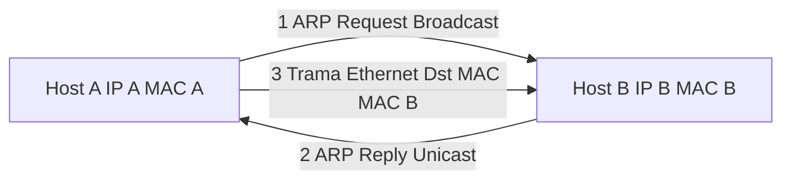

## Introducción

El **modelo TCP/IP** (DoD, años 70-80) es la **arquitectura de protocolos real de Internet**. Tiene **4 capas** y se basa en los protocolos **TCP** (Transmission Control Protocol) e **IP** (Internet Protocol). A diferencia de OSI (modelo de referencia), TCP/IP es una **pila de protocolos implementada**. {a Apuntes de Introducción a las comunicaciones · Unidad 6}


{d}

## Las cuatro capas del modelo TCP/IP

| Capa | Nombre TCP/IP | Equivalente OSI | Protocolos principales | Función |
|---|---|---|---|---|
| **4** | **Aplicación** | 5-7 (Sesión, Presentación, Aplicación) | **HTTP/HTTPS**, **DNS**, **DHCP**, **SMTP/IMAP/POP3**, FTP/SFTP, SSH, TLS/SSL, SNMP, NTP, SIP, RTP, QUIC | Servicios al usuario; formato, cifrado, sesión integrados |
| **3** | **Transporte** | 4 (Transporte) | **TCP**, **UDP**, SCTP, DCCP, QUIC (sobre UDP) | Extremo a extremo: puertos, segmentación, fiabilidad (TCP), multiplexación |
| **2** | **Interred / Internet** | 3 (Red) | **IPv4**, **IPv6**, **ICMP/ICMPv6**, **ARP** (v4) / **NDP** (v6), IGMP, MLD, Routing (OSPF, BGP, RIP) | Direccionamiento lógico, enrutamiento, fragmentación, diagnóstico |
| **1** | **Acceso a la red / Enlace** | 1-2 (Física, Enlace) | **Ethernet (802.3)**, **Wi-Fi (802.11)**, PPP, HDLC, Fibra, DOCSIS, 4G/5G, ARP (v4) | Acceso al medio físico, tramas, MAC, señal | {a Apuntes de Introducción a las comunicaciones · Unidad 6}

:::clave Capa "Acceso a la red" = Física + Enlace
TCP/IP no separa física de enlace; trata la tecnología de acceso (Ethernet, Wi-Fi, etc.) como una caja negra que entrega paquetes IP al siguiente salto. {d}
:::

## Protocolo IP (Internet Protocol)

**IP** es el protocolo de la **capa de interred**: direcciona y enruta **paquetes** (datagramas) entre redes. **Sin conexión** (connectionless), **best-effort** (no garantiza entrega, orden ni duplicados). {a Apuntes de Introducción a las comunicaciones · Unidad 6}

### IPv4 (RFC 791, 1981) {d}

- **Dirección de 32 bits** (4 octetos): notación decimal punto `192.168.1.10`.
- **Espacio**: ~4.3 mil millones (agotado en IANA 2011).
- **Cabecera mínima 20 bytes** (versión, IHL, DSCP/ECN, longitud total, ID, flags, fragment offset, TTL, protocolo, checksum, IP origen, IP destino, opciones). {a Apuntes de Introducción a las comunicaciones · Unidad 6}

**Clases históricas** (classful, obsoletas):
- **A**: `0.0.0.0–127.255.255.255` (/8) — redes grandes.
- **B**: `128.0.0.0–191.255.255.255` (/16) — redes medias.
- **C**: `192.0.0.0–223.255.255.255` (/24) — redes pequeñas.
- **D**: `224.0.0.0–239.255.255.255` — **Multicast**.
- **E**: `240.0.0.0–255.255.255.255` — **Experimental**. {a Apuntes de Introducción a las comunicaciones · Unidad 6}

**Rangos privados (RFC 1918)** — no enrutables en Internet público:
- `10.0.0.0/8` (10.0.0.0 – 10.255.255.255)
- `172.16.0.0/12` (172.16.0.0 – 172.31.255.255)
- `192.168.0.0/16` (192.168.0.0 – 192.168.255.255) {a Apuntes de Introducción a las comunicaciones · Unidad 6}

**Direcciones especiales**:
- `127.0.0.0/8` — **Loopback** (localhost = `127.0.0.1`).
- `169.254.0.0/16` — **Link-local (APIPA)** autoasignada si falla DHCP.
- `0.0.0.0/0` — **Ruta por defecto** (default route).
- `255.255.255.255` — **Broadcast limitado** (local). {a Apuntes de Introducción a las comunicaciones · Unidad 6}

### IPv6 (RFC 8200, 1998) {d}

- **Dirección de 128 bits** (16 bytes): notación hexadecimal `2001:0db8:85a3:0000:0000:8a2e:0370:7334` → compresión `2001:db8:85a3::8a2e:370:7334`.
- **Espacio**: 2¹²⁸ ≈ 3.4×10³⁸ direcciones.
- **Cabecera fija 40 bytes** (versión, clase de tráfico, etiqueta de flujo, longitud payload, próximo encabezado, límite de saltos, IP origen, IP destino). **Sin checksum** (delegado a capas 2 y 4). **Sin fragmentación en ruta** (solo origen, con PMTUD). {a Apuntes de Introducción a las comunicaciones · Unidad 6}

**Tipos de dirección IPv6**:
- **Unicast global** (`2000::/3`) — enrutable en Internet (equivale a IPv4 pública).
- **Unicast link-local** (`fe80::/10`) — solo enlace local (auto-config, NDP).
- **Unicast unique local (ULA)** (`fc00::/7`) — privado, no enrutable en Internet (equivale a RFC 1918).
- **Multicast** (`ff00::/8`) — grupo (sustituye broadcast; IPv6 **no tiene broadcast**).
- **Anycast** — mismo IP en múltiples nodos; enruta al más cercano (DNS raíz, CDN). {a Apuntes de Introducción a las comunicaciones · Unidad 6}

**Transición IPv4 → IPv6**: Dual Stack (ambos paralelos), Tunneling (6to4, 6in4, GRE, MAP-E), Traducción (NAT64/DNS64, 464XLAT). {a Apuntes de Introducción a las comunicaciones · Unidad 6}

## Subnetting y CIDR (Classless Inter-Domain Routing)

**CIDR** (RFC 4632) elimina clases fijas: **prefijo de red** de longitud variable `/n` (bits de red). Notación: `192.168.1.0/24`. {a Apuntes de Introducción a las comunicaciones · Unidad 6}

**Máscara de subred** (IPv4): bits de red = 1, bits de host = 0. `/24` = `255.255.255.0`. **Wildcard** (inversa): `0.0.0.255` (usado en ACLs). {a Apuntes de Introducción a las comunicaciones · Unidad 6}

**Fórmulas clave**:
- **Hosts utilizables** = `2^(32-prefijo) - 2` (resta red + broadcast). En IPv6 no se restan (no hay broadcast; `/64` = 2⁶⁴ hosts).
- **Número de subredes** al tomar `k` bits de host: `2^k`.
- **Tamaño de bloque** (salto): `2^(32-nuevo_prefijo)`. {a Apuntes de Introducción a las comunicaciones · Unidad 6}

**Ejemplo**: `192.168.1.0/24` → dividir en 4 subredes (`/26`, 2 bits prestados):
- `192.168.1.0/26` (0–63, hosts 1–62, broadcast 63)
- `192.168.1.64/26` (64–127, hosts 65–126, broadcast 127)
- `192.168.1.128/26` (128–191, hosts 129–190, broadcast 191)
- `192.168.1.192/26` (192–255, hosts 193–254, broadcast 255) {a Apuntes de Introducción a las comunicaciones · Unidad 6}

**VLSM (Variable Length Subnet Mask)**: subredes de distinto tamaño según necesidad (ej. `/30` para enlaces punto a punto, `/24` para LAN, `/26` para DMZ). **Agregación de rutas (supernetting / route summarization)**: `192.168.0.0/24` + `192.168.1.0/24` → `192.168.0.0/23`. {a Apuntes de Introducción a las comunicaciones · Unidad 6}

```explorable
titulo: Calculadora de subnetting (ejemplos)
variante: pasos
nodos:
  - {id: ex1, titulo: /24 → 4 subredes /26, resumen: 192.168.1.0/24, detalle: Prestar 2 bits → 4 subredes, 62 hosts cada una. Bloque 64.}
  - {id: ex2, titulo: /16 → 8 subredes /19, resumen: 172.16.0.0/16, detalle: Prestar 3 bits → 8 subredes, 8190 hosts c/u. Bloque 8192.}
  - {id: ex3, titulo: Punto a punto /30, resumen: 10.0.0.0/30, detalle: 2 hosts utilizables (routers). IPv6 usa /127 (RFC 6164) o /64.}
  - {id: ex4, titulo: VLSM mixto, resumen: 192.168.0.0/22, detalle: LAN /24 (254), DMZ /26 (62), WAN /30 (2), Mgmt /28 (14).}
o: d
```

## Protocolos de transporte (Capa 4)

### TCP (Transmission Control Protocol) — RFC 793, 9293 {d}

**Confiable, orientado a conexión, byte-stream**. {a Apuntes de Introducción a las comunicaciones · Unidad 6}

**Características**:
- **Three-way handshake**: SYN → SYN-ACK → ACK (establece conexión, negocia MSS, ventana, SACK, timestamps).
- **Control de flujo**: ventana deslizante (receiver window `rwnd`).
- **Control de congestión**: Slow Start, Congestion Avoidance, Fast Retransmit, Fast Recovery (Reno, CUBIC, BBR).
- **Confiabilidad**: numeración de bytes (sequence number), ACK acumulativo, retransmisión por timeout / 3 ACKs duplicados (fast retransmit), SACK (Selective ACK).
- **Terminación**: Four-way handshake (FIN → ACK → FIN → ACK) o RST (abort).
- **Cabecera mínima 20 bytes**: puerto origen/destino (16 bits c/u), seq (32), ack (32), offset, flags (NS, CWR, ECE, URG, ACK, PSH, RST, SYN, FIN), window (16), checksum, urgent pointer, opciones (MSS, Window Scale, SACK Permitted, Timestamps). {a Apuntes de Introducción a las comunicaciones · Unidad 6}

**Puertos bien conocidos (0–1023)**: 20/21 FTP, 22 SSH, 23 Telnet, 25 SMTP, 53 DNS, 80 HTTP, 110 POP3, 143 IMAP, 443 HTTPS, 465 SMTPS, 587 SMTP Submission, 993 IMAPS, 995 POP3S. {a Apuntes de Introducción a las comunicaciones · Unidad 6}

### UDP (User Datagram Protocol) — RFC 768 {d}

**No confiable, sin conexión, datagramas**. Mínimo overhead (8 bytes cabecera: puerto origen/destino, longitud, checksum). {a Apuntes de Introducción a las comunicaciones · Unidad 6}

**Casos de uso**: DNS (consultas), DHCP, NTP, SNMP, TFTP, VoIP/RTP, streaming, juegos online, QUIC (HTTP/3), syslog. **El control de confiabilidad/orden lo hace la aplicación** si lo necesita. {a Apuntes de Introducción a las comunicaciones · Unidad 6}


{d}

```comparar
titulo: TCP vs UDP
a:
  titulo: TCP
  items:
    - "Orientado a conexión (handshake)"
    - "Confiable (ACK, retransmisión, orden)"
    - "Control de flujo (ventana deslizante)"
    - "Control de congestión (CUBIC, BBR)"
    - "Overhead mayor (cabecera 20+ bytes)"
    - "Casos: Web, email, SSH, FTP, DB, APIs"
b:
  titulo: UDP
  items:
    - "Sin conexión (datagrama)"
    - "No confiable (sin ACK, sin orden)"
    - "Sin control de flujo/congestión nativo"
    - "Overhead mínimo (8 bytes)"
    - "Casos: DNS, DHCP, NTP, VoIP, streaming, gaming, QUIC"
o: d
```

## Protocolos de aplicación (Capa 4 TCP/IP = Capas 5-7 OSI)

| Protocolo | Puerto(s) | Transporte | Función |
|---|---|---|---|
| **DNS** | 53 | UDP (consultas) / TCP (zona >512B, AXFR) | Resolución nombre → IP |
| **DHCP** | 67/68 | UDP | Asignación automática IP/máscara/gateway/DNS |
| **HTTP/1.1** | 80 | TCP | Web (texto plano) |
| **HTTPS (HTTP/1.1+TLS)** | 443 | TCP | Web seguro |
| **HTTP/2** | 80/443 | TCP | Multiplexación, header compression, server push |
| **HTTP/3 (QUIC)** | 443 | **UDP** (QUIC = TLS 1.3 + transporte fiable) | 0-RTT, sin head-of-line blocking |
| **FTP** | 20/21 | TCP | Transferencia archivos (activo/pasivo) |
| **SFTP** | 22 | TCP (sobre SSH) | Transferencia segura sobre SSH |
| **SMTP** | 25/465/587 | TCP | Envío correo |
| **IMAP** | 143/993 | TCP | Lectura correo (servidor) |
| **POP3** | 110/995 | TCP | Descarga correo (cliente) |
| **SSH** | 22 | TCP | Shell remoto seguro, túneles |
| **TLS/SSL** | (cualquier) | TCP | Cifrado, autenticación, integridad (capa presentación OSI) |
| **SNMP** | 161/162 | UDP | Monitoreo/gestión red |
| **NTP** | 123 | UDP | Sincronización tiempo | {a Apuntes de Introducción a las comunicaciones · Unidad 6}

## ARP y resolución de direcciones (IPv4)

**ARP (Address Resolution Protocol)** — RFC 826: resuelve **IPv4 → MAC** en la misma red (L2). {a Apuntes de Introducción a las comunicaciones · Unidad 6}

1. Host A quiere enviar a IP B (misma red). Consulta **tabla ARP** (caché).
2. Si no está: **ARP Request** (broadcast `FF:FF:FF:FF:FF:FF`, "¿Quién tiene IP B? Dime tu MAC").
3. Host B responde: **ARP Reply** (unicast a A, "IP B está en MAC B").
4. A guarda en caché (timeout ~ 5–20 min) y envía trama Ethernet con MAC destino = MAC B. {a Apuntes de Introducción a las comunicaciones · Unidad 6}

**IPv6 usa NDP (Neighbor Discovery Protocol, ICMPv6)** — `Neighbor Solicitation` (multicast solicited-node) / `Neighbor Advertisement`. **No ARP, no broadcast**. {a Apuntes de Introducción a las comunicaciones · Unidad 6}


{d}

## ICMP y diagnóstico (IPv4 e IPv6)

**ICMP (Internet Control Message Protocol)** — RFC 792 (v4) / RFC 4443 (v6). Mensajes de **control y error** encapsulados en IP (protocolo 1 / 58). {a Apuntes de Introducción a las comunicaciones · Unidad 6}

**Tipos clave IPv4**:
- **Echo Request (8) / Echo Reply (0)** → **ping**.
- **Destination Unreachable (3)**: Net/Host/Port/Protocol/Fragmentation needed (DF bit).
- **Time Exceeded (11)**: TTL=0 en tránsito (traceroute) o reassembly timeout.
- **Redirect (5)**: Router sugiere mejor ruta.
- **Parameter Problem (12)**: cabecera IP malformada. {a Apuntes de Introducción a las comunicaciones · Unidad 6}

**IPv6 (ICMPv6)**: mismos conceptos + **NDP** (Router Solicitation/Advertisement, Neighbor Solicitation/Advertisement, Redirect). **Packet Too Big (2)** → PMTUD (Path MTU Discovery). {a Apuntes de Introducción a las comunicaciones · Unidad 6}

**Herramientas de diagnóstico**:
- **ping**: conectividad (ICMP Echo).
- **traceroute / tracert**: ruta (TTL incremental + ICMP Time Exceeded). Linux: UDP por defecto; Windows: ICMP; `-I` fuerza ICMP.
- **pathping / mtr**: combina ping + traceroute con estadísticas.
- **mtu discovery**: `ping -s 1472 -M do` (DF bit) para encontrar PMTU. {a Apuntes de Introducción a las comunicaciones · Unidad 6}

## Comparación OSI vs. TCP/IP

| Aspecto | OSI (ISO) | TCP/IP (DoD/IETF) |
|---|---|---|
| **Capas** | 7 (estricta separación) | 4 (combinadas) |
| **Filosofía** | Modelo de referencia (teórico) | Pila de protocolos (implementada) |
| **Capas 5-7** | Separadas (Sesión, Presentación, App) | Fusionadas en **Aplicación** |
| **Capas 1-2** | Separadas (Física, Enlace) | Fusionadas en **Acceso a la red** |
| **Desarrollo** | Comité ISO (lento, "waterfall") | IETF (RFC, "rough consensus & running code") |
| **Uso real** | Enseñanza, diseño, diagnóstico | **Internet, todas las redes modernas** | {a Apuntes de Introducción a las comunicaciones · Unidad 6}

:::sintesis
- TCP/IP: 4 capas (Aplicación, Transporte, Interred, Acceso a la red). Modelo real de Internet.
- IP: sin conexión, best-effort. IPv4 (32 bits, agotado) → IPv6 (128 bits, futuro).
- CIDR: prefijo variable `/n`; subnetting (divide red), VLSM (tamaños mixtos), supernetting (agrega rutas).
- TCP: confiable, conexión, flujo, congestión, handshake 3 vías, puertos.
- UDP: sin conexión, 8 bytes, app gestiona fiabilidad. DNS, VoIP, QUIC.
- App: DNS, DHCP, HTTP/HTTPS/2/3, SMTP/IMAP/POP, SSH, TLS, SNMP, NTP.
- ARP (v4): IP → MAC (broadcast request). NDP (v6): multicast solicited-node, sin broadcast.
- ICMP: ping (Echo), traceroute (TTL exceeded), errores, PMTUD. {a Apuntes de Introducción a las comunicaciones · Unidad 6}
:::