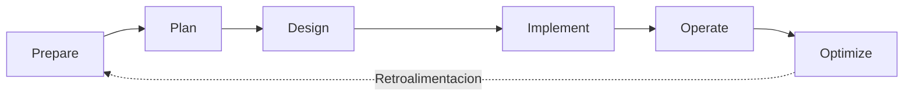
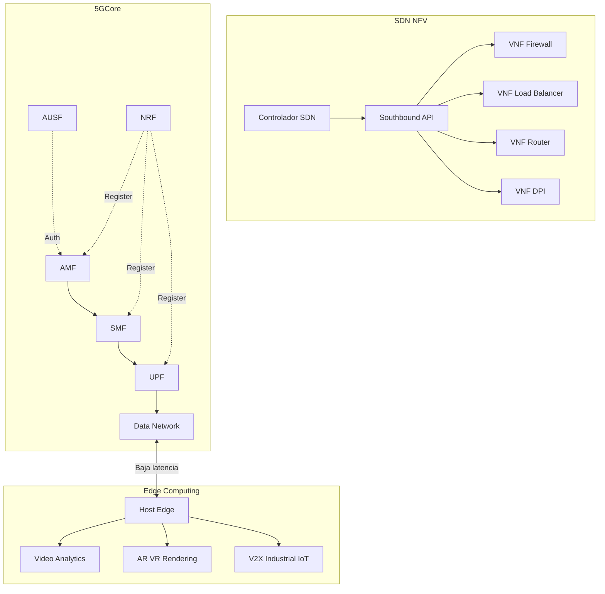

## Fases del diseño de una red (Metodología PPDIOO)

Cisco **PPDIOO** (Prepare, Plan, Design, Implement, Operate, Optimize) es el marco estándar para el ciclo de vida de una red. {a Apuntes de Introducción a las comunicaciones · Unidad 7}


{d}

### 1. Prepare (Preparación)
- Definir **alcance, objetivos de negocio, presupuesto, cronograma, riesgos**.
- Identificar stakeholders y patrocinadores. {a Apuntes de Introducción a las comunicaciones · Unidad 7}

### 2. Plan (Planificación)
- **Recopilar requerimientos** (funcionales, no funcionales, regulatorios).
- **Auditoría de red actual** (inventario, topología, rendimiento, capacidad, seguridad).
- **Línea base (baseline)** de tráfico, latencia, errores, utilización.
- Análisis de brechas (gap analysis) entre actual y objetivo. {a Apuntes de Introducción a las comunicaciones · Unidad 7}

### 3. Design (Diseño) — Fase crítica
- **Diseño lógico**: direccionamiento IP, VLANs, routing, seguridad (zonas, ACLs), QoS, alta disponibilidad (HSRP/VRRP, stacking, vPC), gestión (SNMP, NetFlow, syslog).
- **Diseño físico**: rack, cableado, puertos, fibra/UTP, PoE, alimentación, refrigeración, rack diagrams.
- **Selección de equipos**: switches (acceso/distribución/core), routers, firewalls, APs, controladores, balanceadores.
- **Pruebas de concepto (PoC)** para tecnologías nuevas.
- **Documentación**: diagramas L1/L2/L3, hoja de IP (IPAM), configuraciones base, plan de migración. {a Apuntes de Introducción a las comunicaciones · Unidad 7}

### 4. Implement (Implementación)
- **Staging / pre-config** en laboratorio.
- **Despliegue por fases** (piloto → producción) con ventana de mantenimiento.
- **Cableado, etiquetado, pruebas de continuidad/certificación** (TIA-568).
- **Configuración** (plantillas, automatización Ansible/Python/NetBox).
- **Pruebas funcionales** (ping, iperf, failover, seguridad, QoS).
- **Documentación as-built** y entrega. {a Apuntes de Introducción a las comunicaciones · Unidad 7}

### 5. Operate (Operación)
- **Monitoreo 24×7** (NOC/SOC): disponibilidad, rendimiento, seguridad.
- **Gestión de incidentes** (ITIL: incidente, problema, cambio, servicio).
- **Gestión de cambios** (CAB, ventanas, rollback, pruebas previas).
- **Backups** de configuraciones (Git/NetBox), firmware, licencias. {a Apuntes de Introducción a las comunicaciones · Unidad 7}

### 6. Optimize (Optimización)
- **Análisis de tendencias** de capacidad (capacity planning).
- **Ajuste de QoS, routing, seguridad** según uso real.
- **Actualizaciones** de firmware/software (ventanas, testing).
- **Incorporación de nuevas tecnologías** (Wi-Fi 7, SDN, 5G, IA). {a Apuntes de Introducción a las comunicaciones · Unidad 7}

## Análisis de solicitud de red (Network Request Analysis)

Proceso estructurado para **entender qué necesita el cliente/negocio** antes de diseñar. {a Apuntes de Introducción a las comunicaciones · Unidad 7}

**Pasos**:
1. **Entrevistas stakeholders**: dueños de apps, usuarios, seguridad, compliance, facilities.
2. **Recolección de requerimientos**:
   - *Funcionales*: apps, usuarios, sitios, ancho de banda, latencia, disponibilidad (SLA).
   - *No funcionales*: seguridad (segmentación, cifrado), escalabilidad, gestionabilidad, costo.
   - *Restricciones*: presupuesto, plazos, proveedores, normativa, espacio físico, energía.
3. **Caracterización del tráfico** (traffic profiling):
   - **Tipos**: voz (VoIP), video (conferencia, streaming), datos (web, DB, backup), señalización, IoT/OT.
   - **Parámetros**: ancho de banda (pico/promedio), latencia, jitter, pérdida, burstiness, DSCP/CoS.
   - **Patrones**: Norte-Sur (cliente-servidor, Internet), Este-Oeste (servidor-servidor, backup, replicación), multicast.
4. **Modelado de tráfico**: matrices de tráfico (source-dest, volumen, QoS), simulación (OpNet, Riverbed, GNS3, EVE-NG).
5. **Documento de requerimientos (RFP/RFI)** → base para diseño. {a Apuntes de Introducción a las comunicaciones · Unidad 7}

:::clave Caracterización de tráfico = QoS exitoso
Sin saber qué tráfico hay (voz, video, datos, criticidad), no se puede diseñar QoS ni dimensionar enlaces. {d}
:::

```clasificar
titulo: Clasificá cada requisito
categorias: [Funcional, No funcional, Restricción]
items:
  - {x: "La red debe soportar 500 usuarios concurrentes de VoIP con MOS > 4.0", cat: 0, porque: "Define capacidad y calidad de servicio (función)."}
  - {x: "Latencia < 50 ms entre sede central y sucursales", cat: 1, porque: "Requisito de rendimiento (no funcional)."}
  - {x: "Presupuesto máximo USD 150.000", cat: 2, porque: "Límite económico (restricción)."}
  - {x: "Segmentación PCI-DSS para tarjetas de crédito", cat: 1, porque: "Requisito de seguridad/compliance (no funcional)."}
  - {x: "Implementación en 3 meses", cat: 2, porque: "Plazo fijo (restricción)."}
  - {x: "Redundancia de core (sin SPOF)", cat: 0, porque: "Función de alta disponibilidad."}
  - {x: "Gestión centralizada con NetBox + Ansible", cat: 1, porque: "Operabilidad/gestionabilidad (no funcional)."}
o: d
```

## IoT (Internet of Things)

**IoT**: red de **objetos físicos** ("cosas") con sensores, actuadores, conectividad y software que intercambian datos por Internet. {a Apuntes de Introducción a las comunicaciones · Unidad 7}

**Arquitecturas de referencia**:
- **ITU-T Y.2060**: cuatro capas (Aplicación, Servicio/Capa de soporte, Red, Dispositivo).
- **IoT World Forum (Cisco)**: 7 capas (Colaboración/Procesos, Aplicación, Análisis de datos, Acumulación, Conectividad, Borde, Dispositivos físicos).
- **OneM2M**: Capa de aplicación, Capa de servicios comunes, Capa de red. {a Apuntes de Introducción a las comunicaciones · Unidad 7}

**Protocolos IoT clave**:
| Capa | Protocolo | Características |
|---|---|---|
| **Transporte** | **MQTT** (MQ Telemetry Transport) | Pub/Sub, broker central, QoS 0/1/2, cabecera 2 bytes, ideal ancho de banda bajo, TCP 1883/8883 (TLS). |
| | **CoAP** (Constrained Application Protocol) | RESTful sobre UDP, DTLS, confirmable/no confirmable, descubrimiento `.well-known/core`, puerto 5683/5684. |
| | **AMQP** | Mensajería empresarial, más pesado, TCP 5672. |
| | **HTTP/HTTPS** | Ubicuo, overhead mayor, REST/JSON. |
| | **WebSocket** | Full-duplex sobre TCP, tiempo real. |
| **Red** | **6LoWPAN** | IPv6 sobre IEEE 802.15.4 (baja potencia), compresión de cabecera (HC-01/HC-02). |
| | **Thread** | Mesh IPv6 sobre 802.15.4 (materia, hogar). |
| | **LoRaWAN** | LPWAN, larga distancia (km), baja tasa (0.3–50 kbps), no IP nativo (gateway → IP). |
| | **Sigfox** | LPWAN ultra-narrowband, uplink only, muy baja tasa. |
| | **NB-IoT / LTE-M** | Celular LPWAN, licenciado, cobertura amplia, IP nativo. |
| | **Wi-Fi HaLow (802.11ah)** | Sub-1 GHz, largo alcance, baja potencia, IP nativo. | {a Apuntes de Introducción a las comunicaciones · Unidad 7}

**Desafíos IoT**:
- **Escala**: miles/millones de dispositivos por red.
- **Energía**: baterías años (sleep modes, duty cycling).
- **Seguridad**: superficie de ataque enorme; actualizaciones OTA seguras, certificados, zero-touch provisioning.
- **Interoperabilidad**: múltiples estándares (Matter/Thread, Zigbee, Z-Wave, Bluetooth Mesh, Wi-Fi).
- **Gestión de datos**: volumen, velocidad, variedad → edge computing, streaming analytics. {a Apuntes de Introducción a las comunicaciones · Unidad 7}

```explorable
titulo: Protocolos IoT por caso de uso
variante: pasos
nodos:
  - {id: mqtt, titulo: MQTT, resumen: "Pub/Sub ligero, QoS 0/1/2", detalle: "Telemetría sensores, telemetría industrial, automoción, hogar (Home Assistant). Broker: Mosquitto, EMQX, HiveMQ, AWS IoT Core."}
  - {id: coap, titulo: CoAP, resumen: "REST sobre UDP, DTLS", detalle: "Dispositivos muy restringidos (Clase 0/1), descubrimiento .well-known/core."}
  - {id: lorawan, titulo: LoRaWAN, resumen: "LPWAN km, baja tasa, gateway", detalle: "Smart city (medidores, parking), agricultura, logística. No IP nativo."}
  - {id: nbiot, titulo: NB-IoT / LTE-M, resumen: "Celular LPWAN licenciado, IP nativo", detalle: "Cobertura nacional, roaming, seguridad SIM/eSIM. Medidores inteligentes, tracking."}
  - {id: thread, titulo: Thread / Matter, resumen: "Mesh IPv6 802.15.4", detalle: "Hogar inteligente (Google, Apple, Amazon, Samsung). Border Router → Wi-Fi/Ethernet."}
  - {id: ble, titulo: Bluetooth LE / Mesh, resumen: "Corto alcance, beacon", detalle: "Wearables, proximidad, llaves digitales, sensores batería."}
o: d
```

## Tendencias e innovación en redes

### SDN (Software-Defined Networking)
Separación del **plano de control** (lógica de decisión) del **plano de datos** (reenvío). Controlador centralizado (OpenDaylight, ONOS, OpenFlow, P4, gNMI). **Northbound API** (apps/negocio) / **Southbound API** (dispositivos). {a Apuntes de Introducción a las comunicaciones · Unidad 7}

**Beneficios**: provisión automática, políticas centralizadas, visibilidad global, innovación rápida (apps de red), automatización (NetDevOps). {a Apuntes de Introducción a las comunicaciones · Unidad 7}

### NFV (Network Functions Virtualization)
**Virtualizar funciones de red** (firewall, load balancer, router, CGNAT, DPI, IMS/EPC/5G Core) como **VNFs** (Virtual Network Functions) sobre servidores COTS (x86/ARM) con hipervisor/K8s. ETSI MANO (MANO: NFVO, VNFM, VIM). {a Apuntes de Introducción a las comunicaciones · Unidad 7}

### 5G (5th Generation Mobile Networks)
- **eMBB** (Enhanced Mobile Broadband): >10 Gbps pico, 100 Mbps experiencia.
- **URLLC** (Ultra-Reliable Low Latency): <1 ms, 99.9999% fiabilidad (industrial, vehículo autónomo, cirugía remota).
- **mMTC** (Massive Machine-Type Communications): 1M dispositivos/km² (IoT masivo).
- **Arquitectura 5GC (Service-Based Architecture)**: NFs stateless, HTTP/2+JSON, network slicing (cortes lógicos por caso de uso). {a Apuntes de Introducción a las comunicaciones · Unidad 7}

### Edge Computing / MEC (Multi-access Edge Computing)
Procesamiento **cerca del origen de datos** (base station, central office, on-prem). Reduce latencia, ancho de banda backbone, privacidad (datos no salen). Casos: AR/VR, gaming, industria 4.0, video analytics, V2X. {a Apuntes de Introducción a las comunicaciones · Unidad 7}

### Wi-Fi 6/6E/7 (802.11ax/be)
Ya visto en Unidad 5: OFDMA, MU-MIMO UL/DL, BSS Coloring, TWT, 6 GHz, MLO. Clave para **alta densidad** (estadios, oficinas, educación) y **baja latencia determinista**. {a Apuntes de Introducción a las comunicaciones · Unidad 7}

### IA/ML en redes (AIOps, Intent-Based Networking)
- **Anomalía**: detección de fallos, seguridad (UEBA), predicción de capacidad.
- **Optimización**: RF planning Wi-Fi, routing adaptativo, QoS dinámico.
- **Automatización**: *Intent-Based* (usuario dice "qué", sistema hace "cómo"), closed-loop assurance. {a Apuntes de Introducción a las comunicaciones · Unidad 7}


{d}

```caso
titulo: Diseño de red para nueva sede corporativa
escenario: "Una empresa abre una sede de 3 plantas, 200 empleados. Requiere: Wi-Fi 6E denso, VoIP, videoconferencia, servidores on-prem (DB, ERP), conexion a DC central (1 Gbps), segmentacion PCI-DSS para TPV, gestion automatizada."
pasos:
  - pregunta: "¿Que fase PPDIOO define el direccionamiento IP, VLANs y routing?"
    opciones:
      - {x: "Design (Diseño)", ok: true, consecuencia: "Correcto: diseño lógico define IP, VLAN, routing, seguridad, QoS."}
      - {x: "Plan (Planificación)", ok: false, consecuencia: "Plan recopila requerimientos y audita; no define diseño técnico detallado."}
      - {x: "Implement (Implementación)", ok: false, consecuencia: "Implement configura lo ya diseñado."}
  - pregunta: "Para la segmentación PCI-DSS, ¿que diseño de red aplica?"
    opciones:
      - {x: "Zona DMZ / red aislada con firewall L7 y ACLs estrictas", ok: true, consecuencia: "Correcto: PCI-DSS requiere aislamiento de datos de tarjeta (CDE)."}
      - {x: "Misma VLAN que usuarios con QoS alto", ok: false, consecuencia: "Incorrecto: no cumple aislamiento PCI."}
      - {x: "Solo ACL en switch de acceso", ok: false, consecuencia: "Insuficiente: requiere firewall stateful, logging, segmentación L3."}
  - pregunta: "¿Que tecnología Wi-Fi elegir para 200 usuarios en 3 plantas con alta densidad?"
    opciones:
      - {x: "Wi-Fi 6E (802.11ax) con APs 802.11ax 4x4, canales 160 MHz en 6 GHz", ok: true, consecuencia: "Correcto: 6 GHz limpio, OFDMA, MU-MIMO, BSS Coloring para densidad."}
      - {x: "Wi-Fi 5 (802.11ac) Wave 2", ok: false, consecuencia: "Funciona pero sin OFDMA ni 6 GHz; menos eficiente en denso."}
      - {x: "Wi-Fi 4 (802.11n)", ok: false, consecuencia: "Obsoleto para densidad alta."}
o: d
```

:::sintesis
- PPDIOO: Prepare → Plan → **Design (lógico + físico)** → Implement → Operate → Optimize (cíclico).
- Análisis de solicitud: requerimientos funcionales/no funcionales/restricciones + **caracterización de tráfico** (voz, video, datos, QoS).
- IoT: objetos conectados. Protocolos: **MQTT** (pub/sub TCP), **CoAP** (REST UDP), **LoRaWAN/Sigfox/NB-IoT** (LPWAN), **Thread/Matter** (mesh hogar), **BLE**.
- Tendencias: **SDN** (control/plano datos separados), **NFV** (VNFs en COTS), **5G** (eMBB/URLLC/mMTC, SBA, slicing), **Edge/MEC** (proceso cerca), **Wi-Fi 6/7** (densidad), **IA/AIOps** (anomalía, optimización, intent-based). {a Apuntes de Introducción a las comunicaciones · Unidad 7}
:::