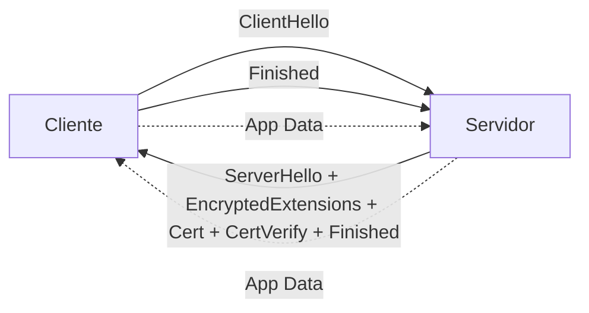
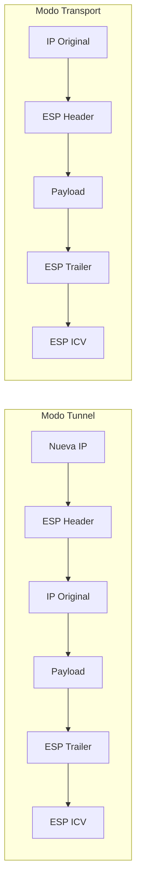

## Seguridad física

Protección de **activos tangibles**: equipos, cableado, instalaciones, medios de almacenamiento, energía. {a Apuntes de Introducción a las comunicaciones · Unidad 8}

**Controles físicos**:
- **Perimetrales**: vallas, barreras, guardias, CCTV, iluminación, control de acceso vehicular.
- **Acceso a instalaciones**: tarjetas de proximidad, biometría, mantrap (trampa de hombre), registros de visitantes, escolta.
- **CPD / Sala de servidores**: acceso restringido (solo personal autorizado), sensores de temperatura/humedad/inundación/humo, supresión de incendios (gas inerte, niebla de agua), UPS + generador, rack cerrados, gestión de cables.
- **Medios extraíbles**: política de uso, cifrado obligatorio, destrucción segura (degauss, triturado).
- **Energía**: UPS (on-line double conversion), PDU monitorizadas, redundancia N+1/2N. {a Apuntes de Introducción a las comunicaciones · Unidad 8}

:::clave Seguridad física = primera línea
Si un atacante accede físicamente al switch/router/servidor, puede: resetear contraseñas (consola), instalar keylogger/hardware sniffer, robar discos, causar DoS. {d}
:::

## Seguridad lógica

Protección de **información, sistemas y comunicaciones** mediante controles técnicos y administrativos. {a Apuntes de Introducción a las comunicaciones · Unidad 8}

**Pilares (Triada CIA + Extensiones)**:
- **Confidencialidad**: solo autorizados acceden (cifrado, ACL, segmentación).
- **Integridad**: datos no alterados sin autorización (hashes, firmas digitales, versionado, WORM).
- **Disponibilidad**: sistemas accesibles cuando se necesitan (HA, backup, DR, DDoS mitigation).
- **Autenticidad**: verificación de identidad (certificados, MFA, firmas).
- **No repudio**: prueba irrefutable de acción (logs inmutables, firmas digitales, auditoría).
- **Accountability (Rendición de cuentas)**: trazabilidad de acciones a identidades. {a Apuntes de Introducción a las comunicaciones · Unidad 8}

**Defensa en profundidad (Capas)**:
1. **Políticas y conciencia** (gobernanza, entrenamiento, phishing simulations).
2. **Perímetro** (firewall, IDS/IPS, WAF, DDoS scrubbing).
3. **Red** (segmentación VLAN, microsegmentación, Zero Trust, NAC, 802.1X).
4. **Host/Endpoint** (EDR/XDR, hardening, patch management, cifrado disco, HIDS).
5. **Aplicación** (SAST/DAST, WAF, API security, secure coding).
6. **Datos** (cifrado en reposo/tránsito, DLP, clasificación, tokenización). {a Apuntes de Introducción a las comunicaciones · Unidad 8}

## Cifrado (Cryptography)

Proceso de convertir información legible (**plaintext**) en ilegible (**ciphertext**) usando un **algoritmo** y una **clave**. {a Apuntes de Introducción a las comunicaciones · Unidad 8}

### Cifrado simétrico (Clave secreta compartida)
Misma clave para cifrar y descifrar. **Rápido, eficiente para grandes volúmenes**. {a Apuntes de Introducción a las comunicaciones · Unidad 8}

| Algoritmo | Tipo | Clave | Estado | Uso |
|---|---|---|---|---|
| **AES** (Advanced Encryption Standard) | Bloque (128 bits) | 128/192/256 | **Estándar actual** (FIPS 197) | TLS, IPsec, disco (BitLocker, LUKS), ZIP, SSH |
| **ChaCha20-Poly1305** | Stream + AEAD | 256 | **Moderno, rápido en software** | TLS 1.3, WireGuard, QUIC |
| 3DES (Triple DES) | Bloque (64 bits) | 168 (efectiva 112) | **Obsoleto** (NIST 2023) | Legado (TLS 1.2, PCI antiguo) |
| RC4 | Stream | Variable | **Roto / Prohibido** | Legado (WEP, TLS antiguo) | {a Apuntes de Introducción a las comunicaciones · Unidad 8}

**Modos de operación (bloques)**: GCM (AEAD, autenticación integrada), CCM, CTR, CBC (requiere padding, vulnerable a padding oracle si mal implementado). **GCM/CCM preferidos (AEAD)**. {a Apuntes de Introducción a las comunicaciones · Unidad 8}

### Cifrado asimétrico (Clave pública / privada)
Par de claves matemáticamente ligadas: **pública** (cifra/verifica) y **privada** (descifra/firma). **Lento, para intercambio de claves, firmas, identidad**. {a Apuntes de Introducción a las comunicaciones · Unidad 8}

| Algoritmo | Base matemática | Clave típica | Estado | Uso |
|---|---|---|---|---|
| **RSA** | Factorización enteros grandes | 2048–4096 bits | **Amplio uso, legado** | TLS (certificados), firma, SSH keys |
| **ECDSA** / **EdDSA (Ed25519)** | Curvas elípticas | 256 bits | **Moderno, preferido** | TLS 1.3, SSH, JWT, blockchain, passkeys |
| **DH / ECDH** | Logaritmo discreto / Curvas | 2048 / 256 | **Intercambio de claves** | TLS (ECDHE), IPsec, WireGuard, Signal |
| **ML-KEM (Kyber)** / **ML-DSA (Dilithium)** | Redes (Lattice) | NIST PQC | **Post-cuántico (estándar 2024)** | Futuro TLS, firmas, KEM | {a Apuntes de Introducción a las comunicaciones · Unidad 8}

### Infraestructura de Clave Pública (PKI)
- **CA (Certificate Authority)**: emite/firma certificados X.509.
- **RA (Registration Authority)**: valida identidad antes de emitir.
- **Certificado X.509**: sujeto, clave pública, validez, CA emisora, extensiones (SAN, Key Usage, Extended Key Usage, CRL/OCSP).
- **Cadena de confianza**: Root CA (offline) → Intermediate CA(s) → Leaf (servidor/cliente/usuario).
- **Revocación**: CRL (lista), OCSP (online), OCSP Stapling (servidor adjunta respuesta OCSP firmada). {a Apuntes de Introducción a las comunicaciones · Unidad 8}

### TLS (Transport Layer Security) — Capa 4-5 OSI / Capa App TCP/IP
**TLS 1.3 (RFC 8446, 2018)** — **Única versión recomendada** (1.0/1.1/1.2 deprecados). {a Apuntes de Introducción a las comunicaciones · Unidad 8}

**Handshake TLS 1.3 (1-RTT)**:
1. ClientHello (soporta grupos KEX, firmas, versiones, SNI, ALPN).
2. ServerHello + **EncryptedExtensions** + Certificate + CertificateVerify + Finished (todo cifrado tras ServerHello).
3. Client Finished → **App data cifrado**. {a Apuntes de Introducción a las comunicaciones · Unidad 8}

**Cipher suites TLS 1.3** (solo AEAD):
- `TLS_AES_256_GCM_SHA384`
- `TLS_CHACHA20_POLY1305_SHA256`
- `TLS_AES_128_GCM_SHA256` {a Apuntes de Introducción a las comunicaciones · Unidad 8}

**0-RTT** (datos tempranos): reusa PSK (Pre-Shared Key) de sesión previa; riesgo de replay (solo idempotentes). {a Apuntes de Introducción a las comunicaciones · Unidad 8}

### IPsec (IP Security) — Capa 3 OSI / Capa Interred TCP/IP
Cifra y autentica **paquetes IP** (site-to-site VPN, remote access, host-to-host). {a Apuntes de Introducción a las comunicaciones · Unidad 8}

**Dos protocolos**:
- **ESP (Encapsulating Security Payload, proto 50)**: **cifrado + integridad + autenticación** (confidencialidad). Modo **tunnel** (nueva IP cabecera) o **transport** (cabecera IP original).
- **AH (Authentication Header, proto 51)**: solo **integridad + autenticación** (sin cifrado); raro hoy. {a Apuntes de Introducción a las comunicaciones · Unidad 8}

**IKEv2 (Internet Key Exchange v2, RFC 7296)**: negociación de SAs (Security Associations), autenticación (certificados, PSK, EAP), rekeying, MOBIKE (movilidad). **Más robusto que IKEv1**. {a Apuntes de Introducción a las comunicaciones · Unidad 8}


{d}


{d}

## Autenticación, Autorización y Accounting (AAA)

Marco para **controlar quién accede a qué, y auditarlo**. {a Apuntes de Introducción a las comunicaciones · Unidad 8}

| Componente | Función | Protocolos |
|---|---|---|
| **Authentication** (Autenticación) | Verificar identidad (credenciales, certificado, MFA, token) | RADIUS, TACACS+, LDAP, SAML/OIDC, Kerberos, 802.1X/EAP |
| **Authorization** (Autorización) | Qué recursos/acciones permite (RBAC, ABAC, políticas) | RADIUS (atributos), TACACS+ (comandos), PBAC, OPA |
| **Accounting** (Contabilidad/Auditoría) | Qué hizo, cuándo, cuánto (logs, billing, forense) | RADIUS Accounting, TACACS+ Accounting, Syslog, NetFlow | {a Apuntes de Introducción a las comunicaciones · Unidad 8}

**RADIUS** (UDP 1812/1813): estándar AAA para acceso a red (NAS → Servidor). Cifra solo password (PAP/CHAP/MS-CHAPv2/EAP). Atributos VSA para autorización. **No confiable** (UDP, retransmisión app). {a Apuntes de Introducción a las comunicaciones · Unidad 8}

**TACACS+** (TCP 49): Cisco propietario (abierto). Cifra **todo el payload**. Separación clara Auth/Autz/Acct. **Autorización por comando** (CLI privilege). Preferido para administración de dispositivos de red. {a Apuntes de Introducción a las comunicaciones · Unidad 8}

**LDAP / Active Directory**: directorio centralizado de identidades; integra con RADIUS (NPS, FreeRADIUS), SAML/OIDC (Azure AD, Okta, Keycloak). {a Apuntes de Introducción a las comunicaciones · Unidad 8}

## 802.1X (Port-Based Network Access Control)

**Control de acceso a nivel de puerto** (switch/AP). Tres roles: **Suplicante** (cliente), **Autenticador** (switch/AP), **Servidor de autenticación** (RADIUS). {a Apuntes de Introducción a las comunicaciones · Unidad 8}

**Flujo EAPOL** (EAP over LAN):
1. Puerto **no autorizado** (solo EAPOL, CDP, STP, LLDP pasan).
2. Suplicante envía **EAPOL-Start** o Autenticador **EAP-Request/Identity**.
3. Suplicante responde **EAP-Response/Identity**.
4. Autenticador reenvía a RADIUS (**RADIUS Access-Request** con EAP encapsulado).
5. RADIUS elige **método EAP** (EAP-TLS, PEAP-MSCHAPv2, EAP-TTLS, EAP-PEAP, EAP-FAST).
6. Intercambio EAP (TLS tunnel, credenciales, certificados).
7. RADIUS **Access-Accept/Reject** → Autenticador **EAP-Success/Failure** → Puerto **autorizado/bloqueado**. {a Apuntes de Introducción a las comunicaciones · Unidad 8}

**Métodos EAP comunes**:
- **EAP-TLS**: certificado cliente + certificado servidor (mutual TLS). **Más seguro**, requiere PKI cliente.
- **PEAP-MSCHAPv2**: túnel TLS servidor + credenciales usuario/contraseña dentro. **Común empresarial** (Windows nativo).
- **EAP-TTLS**: similar a PEAP, soporta más métodos internos (PAP, CHAP, MSCHAP, EAP).
- **EAP-FAST**: PAC (Protected Access Credential) en lugar de certificado servidor; Cisco. {a Apuntes de Introducción a las comunicaciones · Unidad 8}

**MAB (MAC Authentication Bypass)**: para dispositivos sin supplicant (impresoras, IoT, cámaras). Switch envía MAC como user/pass a RADIUS. **Menos seguro** (MAC spoofing); usar con perfil restringido VLAN/ACL. {a Apuntes de Introducción a las comunicaciones · Unidad 8}

## Zero Trust (Confianza Cero)

**Principio**: "Nunca confíes, siempre verifica". **No hay perímetro de confianza implícita** (ni red corporativa, ni VPN). {a Apuntes de Introducción a las comunicaciones · Unidad 8}

**Pilares (NIST SP 800-207 / CISA)**:
1. **Identidad fuerte** (MFA, FIDO2/WebAuthn, certificados, passkeys).
2. **Dispositivo sano** (posture check: parches, EDR, cifrado disco, jailbreak/root detect).
3. **Acceso de menor privilegio** (just-in-time, just-enough, microsegmentación).
4. **Política basada en atributos** (ABAC: quién, qué, dónde, cuándo, cómo, riesgo).
5. **Monitoreo continuo y respuesta** (telemetría, UEBA, SOAR). {a Apuntes de Introducción a las comunicaciones · Unidad 8}

**Arquitectura**: Policy Engine (PE) + Policy Administrator (PA) + Policy Enforcement Point (PEP). **Microsegmentación** (host-level, identity-based, no IP-based). {a Apuntes de Introducción a las comunicaciones · Unidad 8}

## Amenazas comunes

| Amenaza | Descripción | Contramedidas clave |
|---|---|---|
| **Malware** | Software malicioso: virus, gusano, troyano, ransomware, spyware, rootkit, cryptominer, APT. | EDR/XDR, AV/NGAV, application allowlisting, patching, backup inmutable, segmentación. |
| **Phishing / Ingeniería social** | Engaño para credenciales, malware, transferencia dinero (BEC, spear-phishing, whaling, smishing, vishing, quishing). | Entrenamiento continuo, simulacros, DMARC/DKIM/SPF, MFA resistente a phishing (FIDO2), filtros email/web. |
| **DDoS** (Distributed Denial of Service) | Saturación voluntaria: volumétrico (UDP reflection, NTP, DNS, memcached), protocolo (SYN flood), aplicación (HTTP flood, Slowloris). | Scrubbing center (cloud), Anycast, rate limiting, WAF, SYN cookies, DNS Response Rate Limiting. |
| **Exploits / Vulnerabilidades** | Aprovechar bugs (CVE) sin parchear: RCE, priv esc, bypass auth, path traversal, deserialización. | Gestión de vulnerabilidades (SCAP, CVSS), patch management (SLAs), virtual patching (WAF/IPS), hardening. |
| **Credential theft / Credential stuffing** | Robo de credenciales (phishing, keylogger, dump LSAS, pass-the-hash, golden ticket) + reuso en otros sitios. | MFA (FIDO2), passwordless, gestor contraseñas, rotación, detección reuso (HaveIBeenPwned), PAM. |
| **Insider threat** | Empleado/contratista malicioso o negligente (exfiltración, sabotaje, sombra IT). | DLP, UEBA, least privilege, logging inmutable, separación de funciones, monitor actividad privilegiada. |
| **Supply chain / Third-party** | Compromiso en proveedor (SolarWinds, Log4j, dependencias npm/PyPI, hardware). | SBOM (Software Bill of Materials), firma artefactos, SLSA, vetting proveedores, zero trust supply chain. | {a Apuntes de Introducción a las comunicaciones · Unidad 8}

## Medidas de protección en redes

### Firewall (Cortafuegos)
- **Stateful (Generación 1-2)**: tabla de estado (5-tupla), inspección L3-L4. Reglas: allow/deny por IP, puerto, protocolo, estado.
- **Next-Gen (NGFW, Generación 3+)**: **App-ID** (L7), **User-ID** (integra AD/RADIUS), **Content-ID** (IPS, AV, URL filtering, file blocking, SSL decryption), **SSL/TLS inspection** (MITM controlado con CA propia). {a Apuntes de Introducción a las comunicaciones · Unidad 8}

**Topologías**: Edge (perímetro), Internal segmentation (Data Center, DMZ, OT), Distributed (host/hypervisor - microsegmentación), Cloud (VPC, Security Groups, Cloud NGFW). {a Apuntes de Introducción a las comunicaciones · Unidad 8}

### IDS / IPS (Intrusion Detection / Prevention System)
- **IDS** (pasivo): detecta, alerta (SPAN/TAP). **Snort, Suricata, Zeek (Bro)**.
- **IPS** (en línea): detecta y **bloquea** (drop, reset, shun). False positives = impacto negocio → tuning crítico.
- **Detección**: Firma (signatures, reglas Snort/Suricata), Anomalía (baseline, ML), Reputación (IP/URL/file reputation). {a Apuntes de Introducción a las comunicaciones · Unidad 8}

### VPN (Virtual Private Network)
- **IPsec Site-to-Site**: conecta redes (oficina-oficina, oficina-cloud). IKEv2 + ESP Tunnel.
- **Remote Access**: cliente → red corporativa. **IPsec (IKEv2 + EAP)**, **SSL/TLS VPN** (OpenVPN, AnyConnect, GlobalProtect, FortiClient), **WireGuard** (moderno, kernel, Noise protocol, 1-RTT, simples).
- **Zero Trust Network Access (ZTNA)**: acceso por aplicación (no red), identity-based, continuous verification (Cloudflare Access, Tailscale, Twingate, NetBird, Pomerium). {a Apuntes de Introducción a las comunicaciones · Unidad 8}

### SIEM / SOAR / XDR
- **SIEM** (Security Information and Event Management): ingesta logs, correlación reglas, alertas, dashboards, compliance (Splunk, Elastic, QRadar, Sentinel, Graylog, Wazuh).
- **SOAR** (Security Orchestration, Automation and Response): playbooks automáticos (enriquecimiento, contención, ticketing).
- **XDR** (Extended Detection and Response): unifica endpoint + red + cloud + email + identidad; correlación nativa (CrowdStrike, SentinelOne, Cortex XDR, Microsoft Defender XDR, Trend Vision One). {a Apuntes de Introducción a las comunicaciones · Unidad 8}

### EDR / XDR (Endpoint)
- **EDR** (Endpoint Detection & Response): telemetría kernel/usuario, detección comportamiento, respuesta (aislar, matar proceso, rollback ransomware).
- **XDR**: extiende EDR con fuentes de red, cloud, identidad, email. {a Apuntes de Introducción a las comunicaciones · Unidad 8}

## Políticas de monitoreo y respuesta a incidentes

**Monitoreo continuo**:
- **Red**: NetFlow/IPFIX (tráfico, anomalías), SNMP/Telemetría gNMI (salud dispositivos), syslog (eventos), packet capture (forense).
- **Seguridad**: SIEM (correlación), UEBA (comportamiento usuario/entidad), threat intel feeds (IOCs), vulnerability scanning (continua). {a Apuntes de Introducción a las comunicaciones · Unidad 8}

**Ciclo de respuesta a incidentes (NIST SP 800-61 / PICERL)**:
1. **Preparation**: políticas, playbooks, herramientas, entrenamiento, backups, jump bag.
2. **Identification**: detección (alerta SIEM, reporte usuario, threat hunt), triaje, alcance, severidad.
3. **Containment**: corto plazo (aislar red, bloquear IP, deshabilitar cuenta), largo plazo (parche, rebuild, hardening).
4. **Eradication**: eliminar causa raíz (malware, acceso no autorizado, vulnerabilidad).
5. **Recovery**: restaurar sistemas (backups verificados), validar, monitoreo reforzado.
6. **Lessons Learned**: post-mortem sin culpa, actualizar playbooks, mejorar detección, métricas (MTTD, MTTR). {a Apuntes de Introducción a las comunicaciones · Unidad 8}

```clasificar
titulo: Clasificá cada control de seguridad
categorias: [Prevención, Detección, Respuesta, Recuperación]
items:
  - {x: "Firewall NGFW con App-ID e IPS", cat: 0, porque: "Bloquea tráfico malicioso antes de entrar (prevención)."}
  - {x: "SIEM correlacionando logs y generando alerta", cat: 1, porque: "Detecta patrones anómalos (detección)."}
  - {x: "Playbook SOAR que aísla endpoint al detectar ransomware", cat: 2, porque: "Contención automática (respuesta)."}
  - {x: "Restaurar servidor desde backup inmutable verificado", cat: 3, porque: "Recupera servicio tras incidente (recuperación)."}
  - {x: "Entrenamiento anti-phishing y simulacros", cat: 0, porque: "Previene compromiso inicial (prevención humana)."}
  - {x: "EDR detectando inyección de proceso y matándolo", cat: 1, porque: "Detección comportamental en endpoint."}
  - {x: "Parcheo de vulnerabilidad CVE crítica en 48h", cat: 0, porque: "Previene explotación (prevención)."}
  - {x: "Análisis post-mortem y actualización de playbooks", cat: 3, porque: "Mejora futura (recuperación/lecciones)."}
o: d
```

```asociar
titulo: Uní cada tecnología con su capa/función principal
pares:
  - [AES-256-GCM, Cifrado simétrico AEAD (confidencialidad + integridad)]
  - [RSA / ECDSA, Cifrado asimétrico / Firmas digitales (identidad, intercambio claves)]
  - [TLS 1.3, Cifrado en tránsito (capa 4-5) - HTTPS, API, Email]
  - [IPsec ESP, Cifrado en capa 3 (VPN site-to-site, host-host)]
  - [RADIUS, AAA (Auth/Autz/Acct) para acceso red - UDP 1812/1813]
  - [TACACS+, AAA para administración dispositivos - TCP 49, cifrado total, autz por comando]
  - [802.1X / EAP, Control de acceso a puerto (NAC) - Suplicante, Autenticador, RADIUS]
  - [Zero Trust, Arquitectura "nunca confíes, siempre verifiques" - identidad, dispositivo, menor privilegio]
  - [NGFW, Firewall L7 (App-ID, User-ID, SSL inspect, IPS, URL filtering)]
  - [IDS/IPS, Detección/Prevención intrusión (firma, anomalía, reputación)]
  - [VPN (IPsec, WireGuard, SSL), Acceso remoto / site-to-site cifrado]
  - [ZTNA, Acceso por aplicación (identity-based), sin VPN de red]
  - [SIEM/SOAR/XDR, Correlación logs, automatización respuesta, detección extendida]
  - [EDR/XDR, Telemetría endpoint, detección comportamiento, respuesta (aislar, rollback)]
o: d
```

```caso
titulo: Incidente de ransomware en red corporativa
escenario: "Un empleado abre adjunto phishing -> ejecuta macro -> descarga ransomware -> cifra archivos locales y compartidos (SMB) -> exige rescate. EDR detecta cifrado masivo y aisla endpoint. SIEM correlaciona: phishing email + ejecucion PowerShell + acceso SMB anómalo."
pasos:
  - pregunta: "¿Cual es la primera acción de contención (corto plazo)?"
    opciones:
      - {x: "Aislar el endpoint de la red (deshabilitar puerto switch / bloquear MAC / EDR network isolation)", ok: true, consecuencia: "Correcto: detiene propagación lateral inmediata."}
      - {x: "Pagar el rescate para recuperar archivos", ok: false, consecuencia: "Incorrecto: no garantiza recuperación; alienta criminales; ilegal en muchas jurisdicciones."}
      - {x: "Apagar el servidor de archivos", ok: false, consecuencia: "Parcial: detiene cifrado pero causa impacto negocio mayor; aislar endpoint es más quirúrgico."}
  - pregunta: "¿Qué control hubiera prevenido la ejecución inicial de la macro?"
    opciones:
      - {x: "Políticas de Office: deshabilitar macros por defecto / solo firmadas / Protected View", ok: true, consecuencia: "Correcto: hardening de aplicación (prevención)."}
      - {x: "Firewall perimetral", ok: false, consecuencia: "Insuficiente: el email ya entró; la macro se ejecuta en endpoint."}
      - {x: "VPN obligatoria", ok: false, consecuencia: "Irrelevante: el usuario ya está en red corporativa."}
  - pregunta: "En la fase de erradicación, ¿que es esencial además de limpiar el malware?"
    opciones:
      - {x: "Identificar y cerrar vector inicial (phishing: bloquear remitente, actualizar filtros, entrenar usuario; vulnerabilidad: parchear)", ok: true, consecuencia: "Correcto: si no se cierra la causa raíz, reincide."}
      - {x: "Cambiar todas las contraseñas de la empresa", ok: false, consecuencia: "Excesivo si no hay evidencia de robo de credenciales; rotar las comprometidas sí."}
      - {x: "Comprar nuevo antivirus", ok: false, consecuencia: "Incorrecto: el EDR ya detectó; el problema es vector/higiene, no herramienta."}
o: d
```

:::sintesis
- Seguridad física: primera línea (CPD, acceso, energía, medios). Lógica: CIA + autenticidad + no repudio + accountability. Defensa en profundidad (capas).
- Cifrado: **Simétrico** (AES-GCM, ChaCha20-Poly1305 - datos bulk) + **Asimétrico** (RSA/ECDSA/Ed25519 - claves, firmas, identidad) + **PKI** (X.509, CA, revocación).
- **TLS 1.3** (1-RTT, solo AEAD, 0-RTT opcional). **IPsec ESP** (tunnel/transport, IKEv2).
- **AAA**: RADIUS (red, UDP), TACACS+ (admin, TCP, autz comando), LDAP/AD (identidad central).
- **802.1X/EAP**: NAC a nivel puerto (EAP-TLS, PEAP-MSCHAPv2). MAB para IoT sin supplicant.
- **Zero Trust**: sin perímetro implícito; identidad fuerte, dispositivo sano, menor privilegio, política atributos, monitoreo continuo.
- Amenazas: malware, phishing, DDoS, exploits, credential theft, insider, supply chain.
- Protección: **NGFW** (App-ID, SSL inspect), **IDS/IPS** (firma/anomalía), **VPN/ZTNA** (IPsec, WireGuard, SSL, ZTNA), **SIEM/SOAR/XDR**, **EDR/XDR**.
- Respuesta incidentes: Preparation → Identification → Containment → Eradication → Recovery → Lessons Learned (NIST 800-61). {a Apuntes de Introducción a las comunicaciones · Unidad 8}
:::