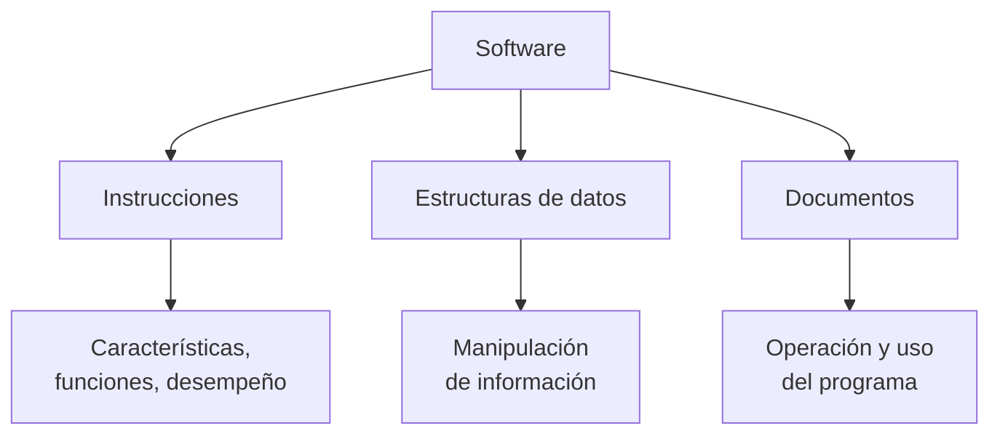
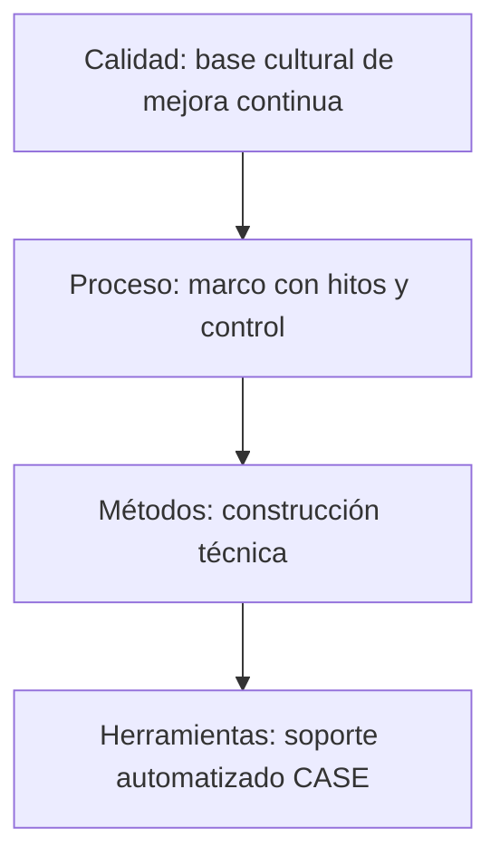

**Software** es un conjunto de **instrucciones**, **estructuras de datos** y **documentos** que controlan la operación de una computadora y viabilizan la información. {a Apuntes de Paradigmas de Programación · Unidad 2}

## Componentes del software

- **Instrucciones**: al ejecutarse, proveen características, funciones y desempeño.
- **Estructuras de datos**: permiten manipular la información adecuadamente.
- **Documentos**: describen la operación y uso de los programas. {a Apuntes de Paradigmas de Programación · Unidad 2}


{d}

## Características únicas del software

Intangible · alto contenido intelectual · no se desgasta · maleable · no es activo contable · sin separación I+D/producción. {a Apuntes de Paradigmas de Programación · Unidad 2}

## Software vs. hardware

- **Hardware**: producción sistemática, base de conocimiento clara, fiabilidad predecible.
- **Software**: costos difíciles de prever, difícil de mantener, difícil cambiar de entorno. {a Apuntes de Paradigmas de Programación · Unidad 2}

```clasificar
titulo: ¿Corresponde a hardware o software?
categorias: [Hardware, Software]
items:
  - {x: Producción sistemática en fábrica, cat: 0, porque: El hardware se manufactura físicamente.}
  - {x: Costos difíciles de prever, cat: 1, porque: El software tiene incertidumbre en estimación.}
  - {x: Base de conocimiento clara y estable, cat: 0, porque: La física del hardware es conocida.}
  - {x: No se desgasta físicamente, cat: 1, porque: El software no sufre degradación material.}
  - {x: Fiabilidad predecible por curvas de fallo, cat: 0, porque: El hardware sigue modelos físicos.}
  - {x: Difícil de mantener y evolucionar, cat: 1, porque: El software cambia constantemente.}
  - {x: Cambiar de entorno requiere reingeniería, cat: 1, porque: El software depende de la plataforma.}
o: d
```

## Ingeniería de Software

La **crisis del software** (1968) reconoció problemas sistémicos: sistemas que fallan, exceden presupuesto y plazos y no cumplen expectativas. La **ingeniería de software** es la aplicación de un enfoque sistemático, disciplinado y cuantificable para el desarrollo, operación y mantenimiento del software. {a Apuntes de Paradigmas de Programación · Unidad 2}

## Capas de la Ingeniería de Software

- **Calidad**: base cultural de mejora continua.
- **Proceso**: marco de trabajo con hitos y control.
- **Métodos**: cómo construir técnicamente el software.
- **Herramientas**: soporte automatizado (CASE). {a Apuntes de Paradigmas de Programación · Unidad 2}


{d}

## Disciplinas de la Ingeniería de Software

- **Técnicas**: requerimientos, análisis, diseño, implementación, prueba, despliegue.
- **De gestión**: planificación, monitoreo y control.
- **De soporte**: configuración, calidad, métricas. {a Apuntes de Paradigmas de Programación · Unidad 2}

## Sistema de información

Un **sistema de información (SI)** es un conjunto de elementos interrelacionados que permiten recuperar y procesar información para una organización. Sus recursos son humanos, datos, actividades e informáticos. **SI ≠ sistema informático**: el sistema informático es solo parte del SI. {a Apuntes de Paradigmas de Programación · Unidad 2}

```mermaid Sistema de información vs. sistema informático: el SI engloba al informático
flowchart TB
  SI[Sistema de Información]
  SI --> H[Humanos]
  SI --> D[Datos]
  SI --> A[Actividades]
  SI --> INF[Informáticos]
  INF --> SI2[Sistema Informático]
  SI2 --> HW[Hardware]
  SI2 --> SW[Software]
  SI2 --> RED[Redes]
```
{d}

## Desarrollo de software

El desarrollo de software transforma ideas y necesidades en un producto. El gran software cumple necesidades, se entrega a tiempo y respeta el presupuesto. {a Apuntes de Paradigmas de Programación · Unidad 2}

## Las 4 «P»

- **Personas**: factor clave (analistas, programadores).
- **Proceso**: actividades definidas.
- **Proyecto**: esfuerzo temporal y único.
- **Producto**: artefactos resultantes. {a Apuntes de Paradigmas de Programación · Unidad 2}

```mermaid Las 4 P del desarrollo de software: factores clave interrelacionados
flowchart TB
  P1[Personas\nanalistas, programadores]
  P2[Proceso\nactividades definidas]
  P3[Proyecto\nesfuerzo temporal y único]
  P4[Producto\nartefactos resultantes]
  P1 --> P2
  P2 --> P3
  P3 --> P4
  P4 --> P1
```
{d}

```asociar
titulo: Unir cada P con su descripción
pares:
  - ["Personas", "Factor clave: analistas y programadores"]
  - ["Proceso", "Actividades definidas"]
  - ["Proyecto", "Esfuerzo temporal y único"]
  - ["Producto", "Artefactos resultantes"]
o: d
```

## Características de un proyecto de software

Temporal · único · orientado a objetivos · elaboración gradual. {a Apuntes de Paradigmas de Programación · Unidad 2}

## Actividades del desarrollo de software

Recolectar requerimientos (la más difícil) · planificar · estimar · diseñar · programar · revisar técnicamente · probar · controlar configuración · monitorear. {a Apuntes de Paradigmas de Programación · Unidad 2}

:::sintesis
- El software es intangible y no se desgasta.
- La ingeniería de software aplica un enfoque sistemático al desarrollo.
- El SI es más amplio que el sistema informático.
- Las 4 P son personas, proceso, proyecto y producto. {a Apuntes de Paradigmas de Programación · Unidad 2}
:::
