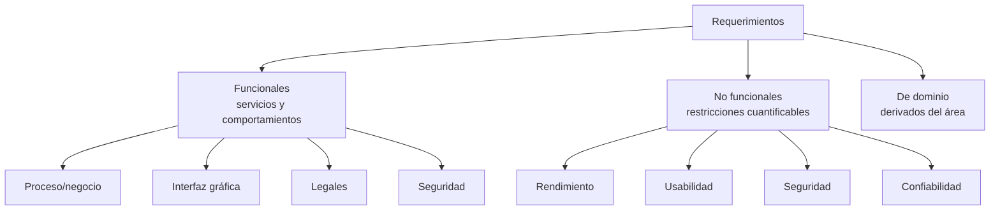

Un **requerimiento** (IEEE) es una necesidad del usuario para lograr un objetivo, una capacidad requerida del sistema, o su representación formal en un documento. Especifica **qué debe implementarse**. La especificación deficiente es la principal causa de fallos en proyectos. {a Apuntes de Paradigmas de Programación · Unidad 2}

## Gestión e ingeniería de requerimientos

- **Gestión de requerimientos**: definir, documentar y mantener lo que el sistema debe hacer.
- **Ingeniería de requerimientos**: uso sistemático para asegurar que sean completos, consistentes y relevantes.
- Los requerimientos técnicos deben ser comprensibles y **firmados por ambas partes**. {a Apuntes de Paradigmas de Programación · Unidad 2}

## Origen de los requerimientos

- **Del sistema**: necesidades del usuario.
- **Del proyecto**: especificaciones. {a Apuntes de Paradigmas de Programación · Unidad 2}

## Por qué definir los requerimientos

- El impacto del cambio tardío: los cambios al final cuestan un orden de magnitud más.
- Control de cambios: registro de impacto en tiempo y costo. {a Apuntes de Paradigmas de Programación · Unidad 2}

**Problemas habituales**: falta de claridad, falta de actualización, alta complejidad, baja participación del usuario. {a Apuntes de Paradigmas de Programación · Unidad 2}

## Clasificación de requerimientos

- **Requerimientos funcionales**: servicios y comportamientos del sistema (función y comportamiento). Subtipos: proceso/negocio, interfaz gráfica, legales, seguridad.
- **Requerimientos no funcionales**: restricciones del sistema; deben ser **cuantificables** (ej.: ❌ «fácil de usar» → ✅ «máximo 3 errores diarios» / «respuesta < 2 segundos con 100 usuarios»).
- **Requerimientos de dominio**: derivan del área de aplicación. {a Apuntes de Paradigmas de Programación · Unidad 2}


{d}

```clasificar
titulo: Clasificar cada requerimiento
categorias: [Funcional, No funcional, De dominio]
items:
  - {x: El sistema debe permitir registrar un cliente, cat: 0, porque: Describe un servicio del sistema.}
  - {x: La respuesta debe ser menor a 2 segundos, cat: 1, porque: Es una restricción cuantificable de rendimiento.}
  - {x: Debe cumplir la normativa contable local, cat: 2, porque: Proviene del área de aplicación contable.}
  - {x: El usuario debe poder exportar a PDF, cat: 0, porque: Es una función del sistema.}
  - {x: Disponibilidad del 99.9% mensual, cat: 1, porque: Restricción cuantificable de confiabilidad.}
  - {x: Cálculo de impuestos según ley vigente, cat: 2, porque: Regla del dominio contable/tributario.}
o: d
```

## Niveles de descripción de un requerimiento

- **Nivel de negocio**: objetivos generales.
- **Nivel de usuario**: tareas del usuario.
- **Nivel de sistema**: especificación precisa (parte del contrato). {a Apuntes de Paradigmas de Programación · Unidad 2}

```mermaid Niveles de descripción: del objetivo general a la especificación contractual
flowchart TB
  N1[Nivel de negocio\nobjetivos generales]
  N2[Nivel de usuario\ntareas del usuario]
  N3[Nivel de sistema\nespecificación precisa]
  N1 --> N2
  N2 --> N3
```
{d}

```asociar
titulo: Unir cada nivel con su foco
pares:
  - [Nivel de negocio, Objetivos generales de la organización]
  - [Nivel de usuario, Tareas que realiza el usuario]
  - [Nivel de sistema, Especificación precisa para el contrato]
o: d
```

## Características de un buen requerimiento

**Individuales**: necesario, completo, consistente, correcto, factible, modificable, priorizado, verificable, rastreable, claro. Debe indicar **qué** (funcionalidad), **por qué** (justificación) y **cómo se verifica** (criterios). {a Apuntes de Paradigmas de Programación · Unidad 2}

**Especificación de requerimientos**: documento que describe todos los requerimientos; debe ser completa, consistente, modificable y trazable. {a Apuntes de Paradigmas de Programación · Unidad 2}

## Técnicas de recopilación

Entrevistas · cuestionarios y encuestas · grupos focales · revisión documental · observación · prototipado rápido · casos de uso · historias de usuario · diagramas y modelos · benchmarking · análisis de problemas · técnicas creativas · análisis de restricciones · análisis de riesgos · conversaciones informales. {a Apuntes de Paradigmas de Programación · Unidad 2}

**Buenas prácticas**: combinar técnicas y validar con los interesados. {a Apuntes de Paradigmas de Programación · Unidad 2}

```clasificar
titulo: ¿Qué tipo de técnica es?
categorias: [Directa con usuarios, Indirecta / Análisis, Creativa / Colaborativa]
items:
  - {x: Entrevistas con stakeholders, cat: 0, porque: Interacción directa con usuarios.}
  - {x: Cuestionarios y encuestas, cat: 0, porque: Contacto directo aunque asincrónico.}
  - {x: Revisión documental, cat: 1, porque: Análisis de artefactos existentes.}
  - {x: Observación en contexto, cat: 0, porque: Observación directa del usuario.}
  - {x: Benchmarking de competidores, cat: 1, porque: Análisis externo de referentes.}
  - {x: Brainstorming y SCAMPER, cat: 2, porque: Técnicas creativas grupales.}
  - {x: Prototipado rápido, cat: 2, porque: Colaborativo y experimental.}
  - {x: Análisis de riesgos, cat: 1, porque: Análisis técnico de amenazas.}
o: d
```

:::sintesis
- Un requerimiento especifica qué debe implementarse.
- Se clasifican en funcionales, no funcionales y de dominio.
- Los no funcionales deben ser cuantificables.
- Hay múltiples técnicas de recopilación que conviene combinar. {a Apuntes de Paradigmas de Programación · Unidad 2}
:::
