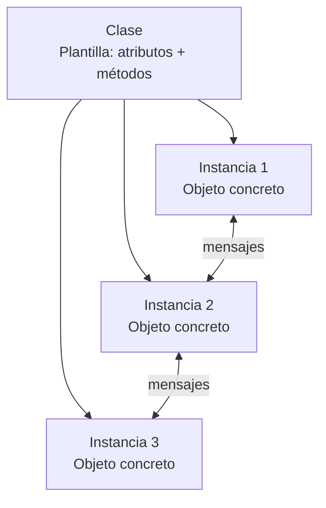
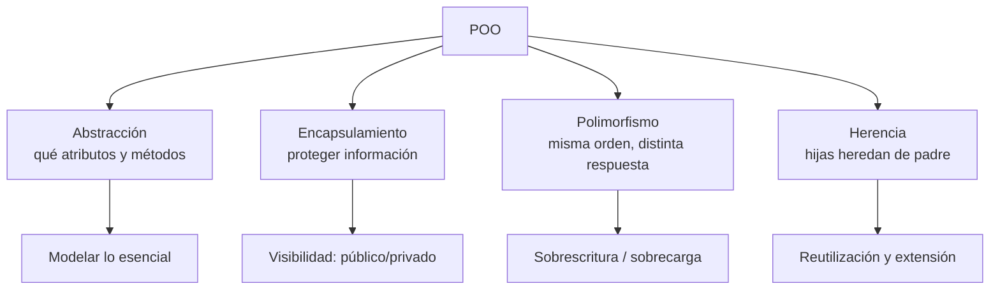
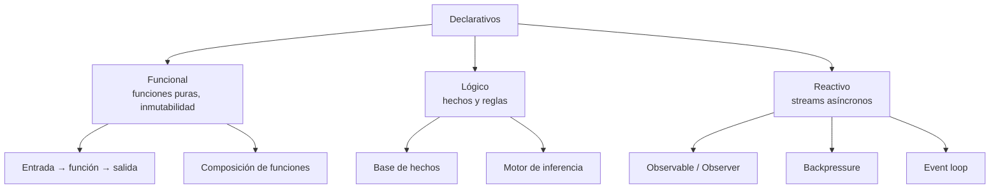

Un **paradigma de programación** es una forma preestablecida de construir un programa: un conjunto de ideas o modelo que define las herramientas conceptuales para resolver problemas con código. {a Apuntes de Paradigmas de Programación · Unidad 3}

## Dos grupos básicos

- **Imperativos**: secuencia definida de instrucciones conectadas paso a paso que determinan qué debe hacer la computadora en cada momento (el «cómo»).
- **Declarativos**: se basan en las matemáticas y la lógica; se declara **qué** se quiere obtener, sin especificar ampliamente cómo lograrlo. {a Apuntes de Paradigmas de Programación · Unidad 3}

```mermaid Clasificación de paradigmas: dos grandes familias y sus subparadigmas
flowchart TB
  P[Paradigmas de programación]
  P --> IMP[Imperativos\nel «cómo»]
  P --> DEC[Declarativos\nel «qué»]
  IMP --> ESTR[Estructurado]
  IMP --> OO[Orientado a objetos]
  DEC --> FUNC[Funcional]
  DEC --> LOG[Lógico]
  DEC --> REAC[Reactivo]
```
{d}

## Paradigma estructurado

Controla el software mediante el diseño descendente y la segmentación, con el objetivo de lograr programas eficientes y de fácil mantenimiento. {a Apuntes de Paradigmas de Programación · Unidad 3}

- **Diseño descendente**: las instrucciones se ordenan de arriba hacia abajo.
- **Segmentación**: dividir el problema en módulos que resuelven tareas específicas.
- **Estructuras de control**: secuenciales (lineales), selectivas (condicionales) e iterativas (repetición).
- **Método**: analizar el problema → listar tareas → agrupar en módulos → crear algoritmos con las estructuras. {a Apuntes de Paradigmas de Programación · Unidad 3}

```mermaid Paradigma estructurado: diseño descendente, segmentación y estructuras de control
flowchart TB
  subgraph MET [Método]
    A1[Analizar problema]
    A2[Listar tareas]
    A3[Agrupar en módulos]
    A4[Crear algoritmos]
    A1 --> A2 --> A3 --> A4
  end
  subgraph EST [Estructuras de control]
    SEC[Secuenciales]
    SEL[Selectivas]
    ITE[Iterativas]
  end
  A4 --> SEC
  A4 --> SEL
  A4 --> ITE
```
{d}

```clasificar
titulo: ¿Qué estructura de control es?
categorias: [Secuencial, Selectiva, Iterativa]
items:
  - {x: Instrucciones que se ejecutan una tras otra, cat: 0, porque: Flujo lineal sin saltos.}
  - {x: Ejecutar bloque solo si se cumple condición, cat: 1, porque: Decisión binaria o múltiple.}
  - {x: Repetir bloque mientras condición sea verdadera, cat: 2, porque: Ciclo controlado por condición.}
  - {x: Leer A, leer B, sumar, mostrar resultado, cat: 0, porque: Secuencia lineal de pasos.}
  - {x: Si edad >= 18 entonces «mayor» sino «menor», cat: 1, porque: Bifurcación condicional.}
  - {x: Mientras contador < 10 hacer contador++, cat: 2, porque: Repetición con condición de salida.}
o: d
```

## Paradigma orientado a objetos (POO)

El más usado en el mundo: cada elemento del sistema es un **objeto** con **datos** (atributos) y **funcionalidad** (métodos) que se comunican entre sí. {a Apuntes de Paradigmas de Programación · Unidad 3}

- **Clase**: plantilla o molde que define la estructura básica del objeto.
- **Instancia**: proceso de crear un objeto a partir de una clase. {a Apuntes de Paradigmas de Programación · Unidad 3}


{d}

## Pilares de la POO

- **Abstracción**: pensar qué atributos y métodos debe tener cada clase.
- **Encapsulamiento**: proteger la información; define datos protegidos, privados o públicos.
- **Polimorfismo**: dar la misma orden a diferentes objetos y que cada uno responda a su manera.
- **Herencia**: las clases hijas heredan atributos y funcionalidades de una clase padre y agregan las propias. {a Apuntes de Paradigmas de Programación · Unidad 3}


{d}

```asociar
titulo: Unir cada pilar con su definición
pares:
  - [Abstracción, Pensar qué atributos y métodos debe tener cada clase]
  - [Encapsulamiento, Proteger la información; visibilidad público/privado/protegido]
  - [Polimorfismo, Dar la misma orden a diferentes objetos y que cada uno responda a su manera]
  - [Herencia, Las clases hijas heredan de la padre y agregan lo propio]
o: d
```

## Otros paradigmas

- **Funcional**: se basa en funciones (evita datos mutables); cada función realiza una sola cosa y puede usarse como entrada o salida de otras.
- **Lógico**: se apoya en la lógica y las matemáticas (hechos y reglas) para deducir respuestas.
- **Reactivo**: opera y maneja flujos (streams) de datos asíncronos; el sistema reacciona a los cambios en tiempo real. {a Apuntes de Paradigmas de Programación · Unidad 3}


{d}

```clasificar
titulo: ¿A qué paradigma declarativo pertenece?
categorias: [Funcional, Lógico, Reactivo]
items:
  - {x: Funciones puras sin efectos secundarios, cat: 0, porque: Base del paradigma funcional.}
  - {x: Inmutabilidad de datos por defecto, cat: 0, porque: Evita estado mutable.}
  - {x: Programación con hechos y reglas (Prolog), cat: 1, porque: Motor de inferencia lógica.}
  - {x: Deducir respuestas consultando una base de conocimiento, cat: 1, porque: Resolución por unificación.}
  - {x: Manejo de streams de eventos asíncronos, cat: 2, porque: Reactivo a flujos de datos.}
  - {x: Propagación automática de cambios (reactividad), cat: 2, porque: El sistema reacciona en tiempo real.}
o: d
```

:::sintesis
- Los paradigmas se agrupan en imperativos y declarativos.
- El paradigma estructurado usa diseño descendente y segmentación.
- La POO se basa en objetos, clases e instancias, con cuatro pilares.
- Los paradigmas funcional, lógico y reactivo tienen enfoques distintos. {a Apuntes de Paradigmas de Programación · Unidad 3}
:::
