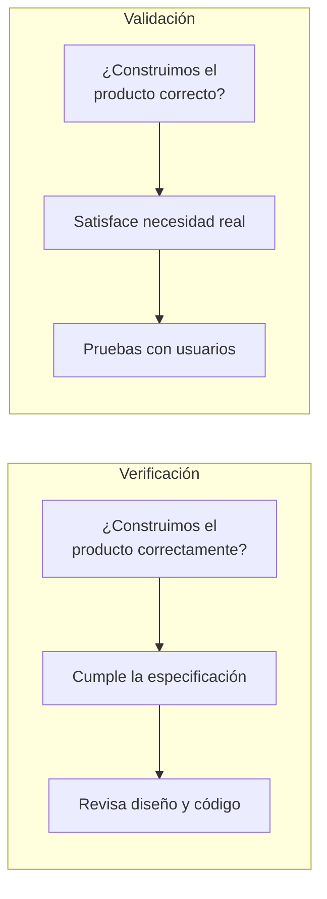
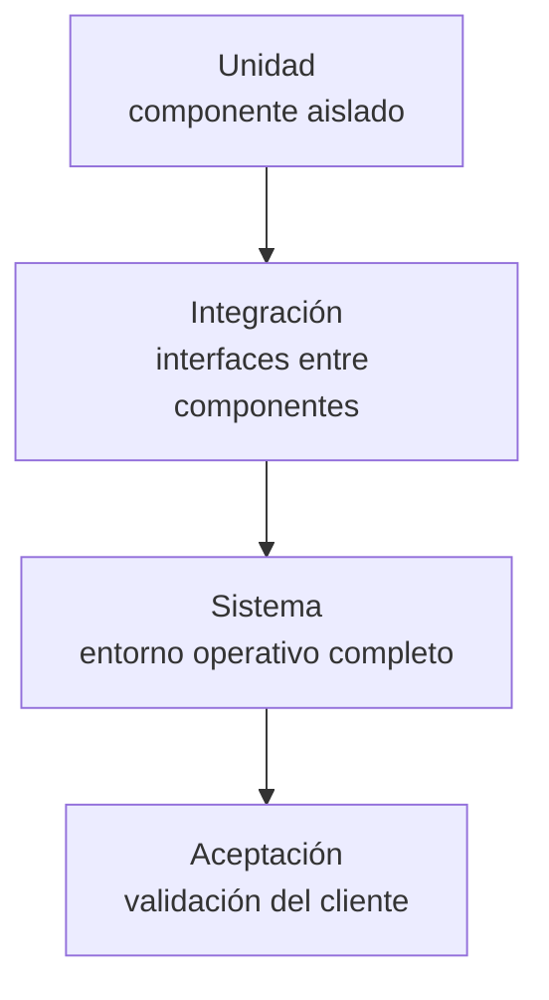
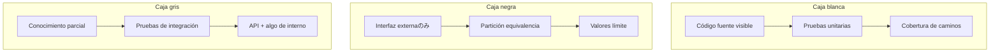
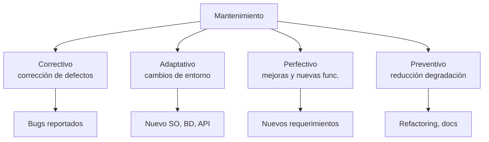
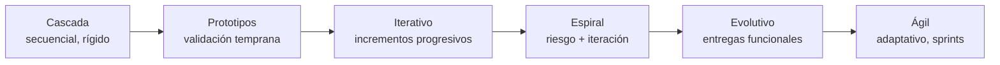

**Implementación** es la fase donde se traduce el diseño previo a código ejecutable y bases de datos; solo corresponde iniciarla después de un análisis exhaustivo de requisitos y de aplicar principios de diseño. {a Apuntes de Paradigmas de Programación · Unidad 4}

## Selección de herramientas

Depende de las decisiones tomadas en diseño y del entorno. IDEs (Visual Studio, Eclipse, IntelliJ), lenguajes (Python, Java, C++, JavaScript, Ruby) y DBMS (MySQL, PostgreSQL, SQL Server, MongoDB). {a Apuntes de Paradigmas de Programación · Unidad 4}

## Implementación ágil

La fase se divide en ciclos cortos llamados *sprints*, con entrega incremental y adaptación continua. {a Apuntes de Paradigmas de Programación · Unidad 4}

## Clean Code (código limpio)

Prácticas para que el código sea funcional, sostenible y fácil de mantener: código legible, nombres descriptivos, algoritmos apropiados, lógica simple, comentarios informativos, sangrías y espacios. {a Apuntes de Paradigmas de Programación · Unidad 4}

## Pruebas: verificación y validación

Las pruebas detectan y corrigen errores originados en las fases anteriores. Parten del principio de que errar es humano. {a Apuntes de Paradigmas de Programación · Unidad 4}

- **Verificación**: «¿construimos el producto correctamente?» (cumple el diseño).
- **Validación**: «¿construimos el producto correcto?» (satisface la necesidad del usuario). {a Apuntes de Paradigmas de Programación · Unidad 4}


{d}

```asociar
titulo: Unir cada concepto con su pregunta clave
pares:
  - [Verificación, ¿Construimos el producto correctamente?]
  - [Validación, ¿Construimos el producto correcto?]
  - [Verificación, Cumple el diseño y la especificación]
  - [Validación, Satisface la necesidad del usuario]
o: d
```

## Niveles de prueba

- **Unidad**: examina cada componente individual de forma aislada.
- **Integración**: evalúa las interfaces entre componentes ensamblados.
- **Sistema**: evalúa el sistema completo en su entorno operativo.
- **Aceptación**: validada por el cliente para autorizar el despliegue. {a Apuntes de Paradigmas de Programación · Unidad 4}


{d}

## Tipos de prueba por caja

- **Caja blanca**: visibilidad total del código fuente.
- **Caja negra**: el componente se trata como caja opaca.
- **Caja gris**: enfoque híbrido con conocimiento parcial del interior. {a Apuntes de Paradigmas de Programación · Unidad 4}


{d}

```clasificar
titulo: ¿Qué tipo de prueba por caja es?
categorias: [Caja blanca, Caja negra, Caja gris]
items:
  - {x: El probador ve el código fuente y prueba caminos, cat: 0, porque: Visibilidad total del interior.}
  - {x: Solo se prueba la interfaz sin saber cómo funciona, cat: 1, porque: Caja opaca, solo entradas/salidas.}
  - {x: Se conoce la API y algo de la arquitectura, cat: 2, porque: Conocimiento parcial híbrido.}
  - {x: Cobertura de sentencias y ramas del código, cat: 0, porque: Requiere ver el código.}
  - {x: Partición de equivalencia en entradas, cat: 1, porque: Técnica de caja negra.}
  - {x: Pruebas de integración con conocimiento de BD, cat: 2, porque: Caja gris típica.}
o: d
```

## Técnicas de casos

- **Partición de equivalencia**: agrupar entradas que producen el mismo comportamiento.
- **Análisis de valores límite**: la mayoría de los errores se concentra en los bordes (mínimo, máximo, justo por encima y por debajo).
- **Cobertura**: medir qué porcentaje del código se ejecuta. {a Apuntes de Paradigmas de Programación · Unidad 4}

```mermaid Técnicas de diseño de casos de prueba: equivalencia, límites y cobertura
flowchart TB
  subgraph PE [Partición de equivalencia]
    PE1[Entradas válidas]
    PE2[Entradas inválidas]
    PE3[Una prueba por partición]
    PE1 --> PE3
    PE2 --> PE3
  end
  subgraph AVL [Análisis de valores límite]
    AVL1[Mínimo, máximo]
    AVL2[Justo arriba, justo abajo]
    AVL3[Bordes = alta probabilidad error]
    AVL1 --> AVL3
    AVL2 --> AVL3
  end
  subgraph COB [Cobertura]
    COB1[% sentencias ejecutadas]
    COB2[% ramas ejecutadas]
    COB3[Meta: 80-100% crítico]
    COB1 --> COB3
    COB2 --> COB3
  end
```
{d}

```caso
titulo: Diseño de casos para validar edad (18-65 años)
escenario: Un sistema debe validar que la edad ingresada esté entre 18 y 65 años inclusive.
pasos:
  - pregunta: ¿Qué particiones de equivalencia definís?
    opciones:
      - {x: "Válida: 18-65; Inválidas: <18 y >65", ok: true, consecuencia: "Correcto: tres particiones cubren todo el dominio."}
      - {x: "Válida: 18-65; Inválida: <18", ok: false, consecuencia: "Falta la partición >65."}
      - {x: "Solo válida 18-65", ok: false, consecuencia: "No prueba entradas inválidas."}
  - pregunta: ¿Qué valores límite probás?
    opciones:
      - {x: "17, 18, 65, 66", ok: true, consecuencia: "Correcto: bordes y justo fuera."}
      - {x: "18, 65", ok: false, consecuencia: "Faltan los valores justo fuera de rango."}
      - {x: "0, 100", ok: false, consecuencia: "No son los límites de la especificación."}
o: d
```

## Pruebas alfa y beta

- **Alfa**: versiones tempranas a usuarios internos.
- **Beta**: liberación a un subconjunto de usuarios externos antes del lanzamiento masivo. {a Apuntes de Paradigmas de Programación · Unidad 4}

## Despliegue y mantenimiento

## Despliegue

Puesta en marcha del sistema en producción, con instalación, configuración y capacitación. {a Apuntes de Paradigmas de Programación · Unidad 4}

## Tipos de mantenimiento

- **Correctivo**: corrección de defectos.
- **Adaptativo**: adaptación a cambios del entorno.
- **Perfectivo**: mejoras y nuevas funcionalidades.
- **Preventivo**: reducción de degradación futura. {a Apuntes de Paradigmas de Programación · Unidad 4}


{d}

```asociar
titulo: Unir cada tipo de mantenimiento con su ejemplo
pares:
  - [Correctivo, Corregir un error de cálculo en facturación]
  - [Adaptivo, Migrar la BD de MySQL a PostgreSQL]
  - [Perfectivo, Agregar exportación a Excel solicitada]
  - [Preventivo, Refactorizar módulo legacy para evitar fallos]
o: d
```

## Modelos de ciclo de vida

Cascada · prototipos · iterativo · espiral · evolutivo · ágil. {a Apuntes de Paradigmas de Programación · Unidad 4}


{d}

```clasificar
titulo: ¿Qué modelo de ciclo de vida es?
categorias: [Predictivo, Iterativo / Incremental, Adaptativo / Ágil]
items:
  - {x: "Cascada: fases secuenciales sin retroceso", cat: 0, porque: "Todo planificado al inicio."}
  - {x: "Espiral: ciclos con análisis de riesgo", cat: 1, porque: "Iterativo con gestión de riesgo."}
  - {x: "Iterativo: entregas parciales crecientes", cat: 1, porque: "Incrementos sucesivos."}
  - {x: "Ágil: sprints, adaptación continua", cat: 2, porque: "Abraza el cambio constante."}
  - {x: "Evolutivo: prototipos que crecen al producto", cat: 1, porque: "Entregas funcionales incrementales."}
  - {x: "Prototipos: validar requisitos temprano", cat: 1, porque: "Iteración sobre prototipo."}
o: d
```

:::sintesis
- Verificación comprueba que construimos el producto correctamente.
- Validación comprueba que construimos el producto correcto.
- Hay cuatro niveles de prueba: unidad, integración, sistema y aceptación.
- Los tipos de mantenimiento son correctivo, adaptativo, perfectivo y preventivo. {a Apuntes de Paradigmas de Programación · Unidad 4}
:::
