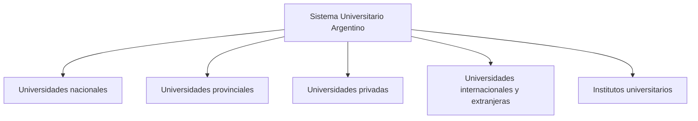

El **Sistema Universitario Argentino (SUA)** es una vasta red institucional abierta y flexible que articula y coordina la actividad universitaria en todo el territorio nacional. Está integrado por universidades de gestión pública (nacionales y provinciales), universidades de gestión privada, universidades internacionales y extranjeras, e institutos universitarios. {a Apuntes de Universidad, sociedad y conocimientos · Unidad 1}


{d}

## Rasgos de la universidad pública argentina

- Gratuita en las carreras de grado.
- Laica y autónoma.
- Regida por cogobierno.
- Financiada por el Estado Nacional. {a Apuntes de Universidad, sociedad y conocimientos · Unidad 1}

```asociar
titulo: Unir cada rasgo con su descripción
pares:
  - [Gratuita, Sin aranceles en carreras de grado]
  - [Laica, Independencia de toda confesión religiosa]
  - [Autónoma, Dictan sus propios estatutos]
  - [Cogobierno, Gestión compartida entre claustros]
  - [Financiada por el Estado, Recursos del presupuesto nacional]
o: d
```

## Autonomía y cogobierno

- **Autonomía universitaria**: capacidad legal de las universidades para dictar sus propios estatutos, elegir autoridades y administrar sus recursos sin injerencia directa del poder político.
- **Cogobierno**: modelo de gestión democrática donde las decisiones se comparten entre los claustros: docentes, estudiantes, graduados y personal no docente. {a Apuntes de Universidad, sociedad y conocimientos · Unidad 1}

```explorable
titulo: Autonomía y cogobierno
variante: capas
nodos:
  - {id: auto, titulo: Autonomía, resumen: Gobierno propio y estatutos propios., detalle: Capacidad legal para dictar estatutos, elegir autoridades y administrar recursos sin injerencia política directa.}
  - {id: cogo, titulo: Cogobierno, resumen: Decisiones compartidas entre claustros., detalle: Docentes, estudiantes, graduados y no docentes participan en la gestión universitaria.}
o: d
```

## Funciones fundamentales de la universidad pública

Docencia, investigación, extensión y vinculación tecnológica. {a Apuntes de Universidad, sociedad y conocimientos · Unidad 1}

```clasificar
titulo: ¿Cuál es la función universitaria?
categorias: [Docencia, Investigación, Extensión, Vinculación tecnológica]
items:
  - {x: Dictar clases y evaluar estudiantes, cat: 0, porque: Es la función de enseñar y formar profesionales.}
  - {x: Generar nuevos conocimientos científicos, cat: 1, porque: La investigación produce conocimiento verificado.}
  - {x: Articular con la comunidad y organizaciones, cat: 2, porque: La extensión dialoga con la sociedad.}
  - {x: Transferir tecnología al sector productivo, cat: 3, porque: La vinculación tecnológica aplica el conocimiento.}
o: d
```

## UNRaf

Universidad nacional creada en **2014** por la **Ley N° 27.062**, con identidad centrada en la innovación, la competitividad y el desarrollo ligado al territorio de Rafaela y su región. {a Apuntes de Universidad, sociedad y conocimientos · Unidad 1}

Espacios de ciencia y tecnología: CIT Rafaela UNRaf-CONICET, UNRaf Tec, Observatorio de la Industria Argentina de Videojuegos. {a Apuntes de Universidad, sociedad y conocimientos · Unidad 1}

:::sintesis
- El SUA es una red institucional que coordina la actividad universitaria nacional.
- La universidad pública argentina es gratuita, laica, autónoma, con cogobierno y financiada por el Estado.
- La UNRaf fue creada en 2014 por la Ley N° 27.062. {a Apuntes de Universidad, sociedad y conocimientos · Unidad 1}
:::