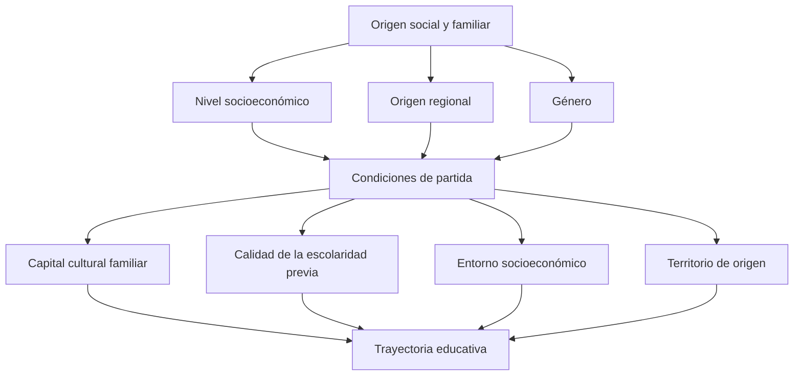

La **desigualdad educativa** es la distribución desigual de oportunidades y resultados en el acceso, la permanencia y la calidad de la educación, atravesada por factores económicos, regionales y de género. {a Apuntes de Universidad, sociedad y conocimientos · Unidad 1}


{d}

## Principales vectores de desigualdad

- Nivel socioeconómico.
- Origen regional.
- Género.
- Origen social y familiar. {a Apuntes de Universidad, sociedad y conocimientos · Unidad 1}

```asociar
titulo: Unir cada vector con su manifestación
pares:
  - [Nivel socioeconómico, Recursos económicos del hogar]
  - [Origen regional, Diferencias entre zonas urbanas y rurales]
  - [Género, Brechas en acceso y permanencia según identidad de género]
  - [Origen social y familiar, Capital cultural y redes de contactos]
o: d
```

## Relación entre desigualdad social y trayectoria educativa

La trayectoria educativa es **condicionada (no determinada)** por el origen social; la universidad pública busca interrumpir esa reproducción de la desigualdad. {a Apuntes de Universidad, sociedad y conocimientos · Unidad 1}

## Trayectorias educativas

Recorridos reales que los estudiantes realizan en su paso por el sistema educativo: pueden ser continuos o discontinuos, lineales o con interrupciones, según sus condiciones de vida. {a Apuntes de Universidad, sociedad y conocimientos · Unidad 1}

```explorable
titulo: Tipos de trayectorias educativas
variante: pasos
nodos:
  - {id: cont, titulo: Continua, resumen: Sin interrupciones desde el ingreso al egreso., detalle: El estudiante avanza año a año sin repetir ni abandonar.}
  - {id: disc, titulo: Discontinua, resumen: Con pausas o abandonos temporales., detalle: Interrupciones por trabajo, cuidado familiar o dificultades económicas.}
  - {id: lin, titulo: Lineal, resumen: Progresión esperada por edad y grado., detalle: Coincide con la trayectoria normativa del sistema educativo.}
  - {id: int, titulo: Con interrupciones, resumen: Cambios de institución, repitencia o reingreso., detalle: El recorrido se desvía de la norma por condiciones de vida.}
o: d
```

## Meritocracia

Principio según el cual el éxito depende solo del esfuerzo y el mérito individual; se critica cuando ignora las condiciones estructurales de partida desiguales. {a Apuntes de Universidad, sociedad y conocimientos · Unidad 1}

## Condiciones de partida que condicionan el ingreso a la universidad

El capital cultural familiar, la calidad de la escolaridad previa, el entorno socioeconómico y el territorio de origen. {a Apuntes de Universidad, sociedad y conocimientos · Unidad 1}

```clasificar
titulo: ¿Condiciona el ingreso a la universidad?
categorias: [Sí, condiciona, No, no condiciona directamente]
items:
  - {x: Capital cultural familiar, cat: 0, porque: Influye en las expectativas y recursos simbólicos.}
  - {x: Calidad de la escolaridad previa, cat: 0, porque: Define la preparación académica inicial.}
  - {x: Entorno socioeconómico, cat: 0, porque: Afecta la disponibilidad de tiempo y recursos para estudiar.}
  - {x: Territorio de origen, cat: 0, porque: Determina la oferta educativa accesible.}
  - {x: Color de ojos, cat: 1, porque: No tiene relación con el acceso educativo.}
o: d
```

## Estrategias institucionales para la inclusión educativa

Cursos de nivelación, becas, acompañamiento académico y articulación con la escuela media. {a Apuntes de Universidad, sociedad y conocimientos · Unidad 1}

```caso
titulo: Diseñar un programa de inclusión
escenario: La universidad detecta alta deserción en el primer año de estudiantes de zonas rurales.
pasos:
  - pregunta: ¿Qué estrategia priorizás para empezar?
    opciones:
      - {x: Articulación con escuelas medias de la zona, ok: true, consecuencia: Permite trabajar la transición antes del ingreso.}
      - {x: Solo dar becas económicas, ok: false, consecuencia: La beca ayuda pero no resuelve la brecha académica y cultural.}
      - {x: Exigir un examen de ingreso más difícil, ok: false, consecuencia: Agrava la exclusión en lugar de incluir.}
  - pregunta: ¿Qué complementás para sostener la permanencia?
    opciones:
      - {x: Acompañamiento académico y tutorías, ok: true, consecuencia: Refuerza el aprendizaje y la pertenencia institucional.}
      - {x: Reducir la cantidad de materias, ok: false, consecuencia: Debilita la formación profesional.}
o: d
```

:::sintesis
- La desigualdad educativa afecta el acceso, la permanencia y la calidad.
- Los vectores principales son el nivel socioeconómico, el origen regional, el género y el origen social.
- La trayectoria educativa es condicionada, no determinada, por el origen social.
- La meritocracia ignora las condiciones estructurales de partida. {a Apuntes de Universidad, sociedad y conocimientos · Unidad 1}
:::