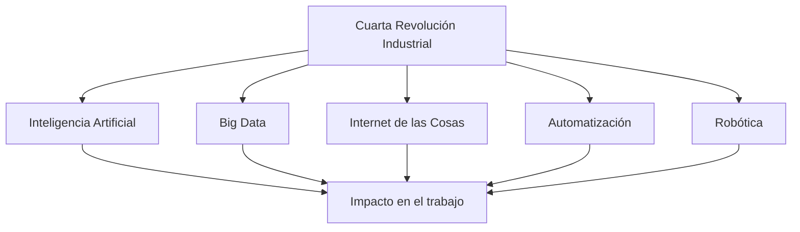

La **Cuarta Revolución Industrial** es la transformación económica y social impulsada por tecnologías digitales: inteligencia artificial, big data, internet de las cosas, automatización y robótica. {a Apuntes de Universidad, sociedad y conocimientos · Unidad 1}


{d}

## Impacto de la IA en el mundo del trabajo

- Automatización de tareas rutinarias.
- Transformación de profesiones existentes.
- Creación de nuevas ocupaciones.
- Cambios en las habilidades demandadas. {a Apuntes de Universidad, sociedad y conocimientos · Unidad 1}

```asociar
titulo: Unir cada impacto con su ejemplo
pares:
  - [Automatización de tareas rutinarias, Un robot ensambla piezas en una fábrica]
  - [Transformación de profesiones, Un contador usa IA para auditar datos masivos]
  - [Creación de nuevas ocupaciones, Ingeniero de prompts para modelos generativos]
  - [Cambios en habilidades demandadas, Se valora más el pensamiento crítico que el cálculo manual]
o: d
```

## Inteligencia artificial (IA)

Rama de la informática que desarrolla sistemas capaces de realizar tareas que requieren inteligencia humana: razonar, aprender, percibir y tomar decisiones. {a Apuntes de Universidad, sociedad y conocimientos · Unidad 1}

## Principales usos de la IA

- Chatbots y asistentes virtuales.
- Análisis predictivo de datos.
- Automatización de procesos.
- Generación de contenido. {a Apuntes de Universidad, sociedad y conocimientos · Unidad 1}

```explorable
titulo: Usos de la inteligencia artificial
variante: capas
nodos:
  - {id: chat, titulo: Chatbots y asistentes, resumen: Conversación automática con usuarios., detalle: Atención al cliente, tutores virtuales, asistentes personales.}
  - {id: pred, titulo: Análisis predictivo, resumen: Modelos que anticipan tendencias., detalle: Riesgo crediticio, demanda de productos, mantenimiento predictivo.}
  - {id: auto, titulo: Automatización de procesos, resumen: Ejecución de flujos repetitivos sin intervención humana., detalle: Procesamiento de facturas, onboarding, conciliación bancaria.}
  - {id: gen, titulo: Generación de contenido, resumen: Creación de texto, código, imágenes o audio., detalle: Redacción de informes, programación asistida, diseño gráfico.}
o: d
```

## Competencias clave para el siglo XXI

Pensamiento crítico, creatividad, colaboración, comunicación y alfabetización digital. {a Apuntes de Universidad, sociedad y conocimientos · Unidad 1}

```clasificar
titulo: ¿Competencia clave para el siglo XXI?
categorias: [Sí, es clave, No, no está en la lista]
items:
  - {x: Pensamiento crítico, cat: 0, porque: Permite evaluar información y argumentos.}
  - {x: Creatividad, cat: 0, porque: Genera soluciones novedosas a problemas complejos.}
  - {x: Colaboración, cat: 0, porque: El trabajo en red es central en la economía del conocimiento.}
  - {x: Comunicación, cat: 0, porque: Expresar ideas con claridad es imprescindible.}
  - {x: Alfabetización digital, cat: 0, porque: Manejar entornos tecnológicos es requisito básico.}
  - {x: Memorizar datos de memoria, cat: 1, porque: La información está disponible; importa saber usarla.}
o: d
```

## Rol de la universidad frente a la IA

Formar profesionales capaces de usar críticamente la tecnología, comprender sus límites éticos y adaptarse al cambio permanente del conocimiento. {a Apuntes de Universidad, sociedad y conocimientos · Unidad 1}

## Ética en la IA

Conjunto de principios que orientan el desarrollo y uso responsable de los sistemas de IA para evitar sesgos, discriminación y daños sociales. {a Apuntes de Universidad, sociedad y conocimientos · Unidad 1}

```caso
titulo: Decidir el uso de IA en una carrera universitaria
escenario: El consejo directivo debate si permitir el uso de IA generativa en trabajos prácticos.
pasos:
  - pregunta: ¿Qué postura adoptás?
    opciones:
      - {x: "Permitir con pautas claras de cita y uso responsable", ok: true, consecuencia: "Forma en uso crítico y ético, reflejando la realidad profesional."}
      - {x: "Prohibir totalmente so pena de sanción", ok: false, consecuencia: "No prepara para el entorno laboral y es difícil de controlar."}
      - {x: "Dejarlo librado a cada docente sin criterio institucional", ok: false, consecuencia: "Genera inequidad y confusión entre estudiantes."}
  - pregunta: ¿Qué principio ético debe guiar la decisión?
    opciones:
      - {x: "Transparencia y rendición de cuentas", ok: true, consecuencia: "El estudiante declara qué usó y asume la autoría final."}
      - {x: "Eficiencia a toda costa", ok: false, consecuencia: "Ignora sesgos, privacidad y el valor del aprendizaje."}
o: d
```

:::sintesis
- La Cuarta Revolución Industrial transforma la economía y la sociedad con tecnologías digitales.
- La IA automatiza tareas, transforma profesiones y crea nuevas ocupaciones.
- La universidad debe formar para el uso crítico y ético de la tecnología. {a Apuntes de Universidad, sociedad y conocimientos · Unidad 1}
:::