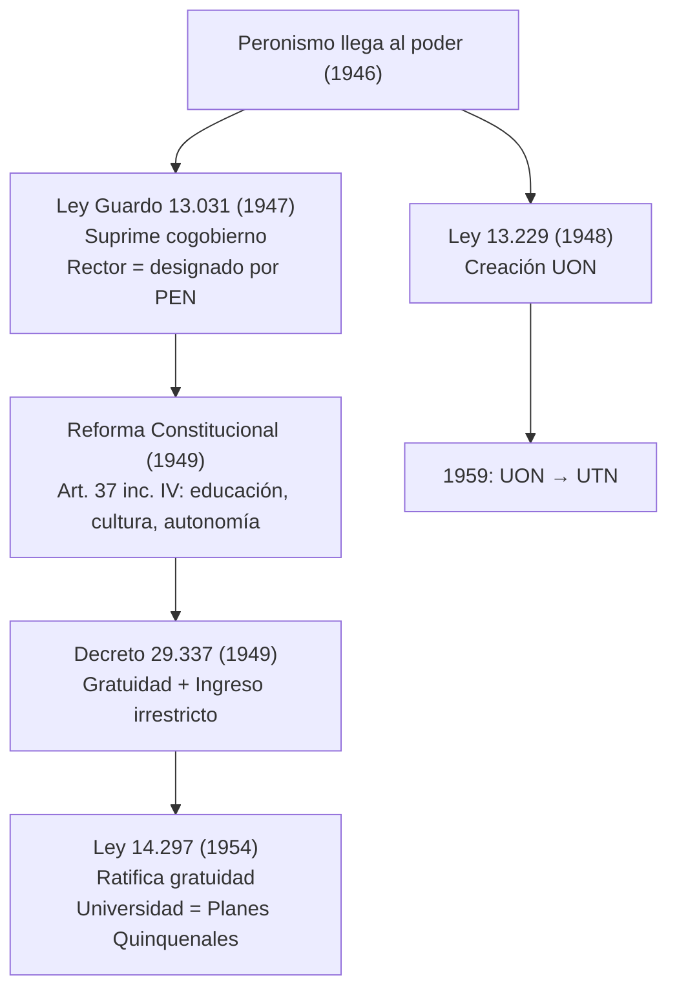

El peronismo amplió el acceso de la clase trabajadora a la universidad con gratuidad e ingreso irrestricto, pero centralizó el control político y suprimió la autonomía y el cogobierno de 1918. {a Apuntes de Universidad, sociedad y conocimientos · Unidad 2}


{d}

## Antecedentes (1943-1946)

- **Golpe del 4 de junio de 1943**: el GOU derrocó a Ramón Castillo e intervino las universidades nacionales.
- **Intervención de la UNL**: Jordán Bruno Genta la intervino y provocó cesantías y renuncias como la de Bernardo Houssay.
- **Elecciones del 24 de febrero de 1946**: tras el triunfo de Perón se volvió a intervenir las universidades y se cesantearon 1.250 docentes (un tercio del total nacional). {a Apuntes de Universidad, sociedad y conocimientos · Unidad 2}

## Marco normativo peronista

- **Ley N° 13.031 de 1947 (Ley Guardo)**: primera ley universitaria del período; suprimió el cogobierno paritario de 1918, el rector pasó a ser nombrado por el Poder Ejecutivo y los estudiantes tuvieron voz pero no voto.
- **Reforma Constitucional de 1949**: sancionada el 22/09/1949; el art. 37 inc. IV constitucionalizó el derecho a la educación, la cultura y la autonomía universitaria.
- **Decreto N° 29.337 de 1949**: firmado el 22/11/1949; consagró la gratuidad universitaria (supresión de aranceles y tasas) y el ingreso irrestricto (eliminación de los exámenes de ingreso).
- **Ley N° 14.297 de 1954**: segunda ley universitaria peronista; ratificó la gratuidad y vinculó la universidad a los objetivos de industrialización de los Planes Quinquenales. {a Apuntes de Universidad, sociedad y conocimientos · Unidad 2}

```asociar
titulo: Unir cada norma con su aporte principal
pares:
  - [Ley Guardo (1947), Suprime cogobierno; rector designado por el PEN]
  - [Reforma Constitucional (1949), Constitucionaliza derecho a educación y autonomía]
  - [Decreto 29.337 (1949), Consagra gratuidad e ingreso irrestricto]
  - [Ley 14.297 (1954), Ratifica gratuidad; vincula universidad a Planes Quinquenales]
o: d
```

## Universidad Obrera Nacional (UON)

Creada por la Ley N° 13.229 (1948) y puesta en funcionamiento en 1953, exclusivamente para la clase trabajadora (certificado de trabajo de fábrica o egresado de escuela técnica), con cursado en turno tarde/noche y título de Ingeniero de Fábrica. {a Apuntes de Universidad, sociedad y conocimientos · Unidad 2}

- Especialidades: instalaciones eléctricas, construcción mecánica, automotores e industria textil.
- «Saber hacer» vs. «saber decir» (Dussel y Pineau): mientras las universidades tradicionales formaban élites dirigentes con el saber decir, la UON reivindicó el saber hacer práctico para la industrialización (ISI).
- Legado: tras la desperonización fue renombrada en 1959 como Universidad Tecnológica Nacional (UTN). {a Apuntes de Universidad, sociedad y conocimientos · Unidad 2}

```clasificar
titulo: ¿Característica de la UON?
categorias: [Sí, era así en la UON, No, no correspondía a la UON]
items:
  - {x: "Exclusivamente para trabajadores con certificado de empleo", cat: 0, porque: "Requisito de ingreso: certificado de trabajo de fábrica o escuela técnica."}
  - {x: Cursado en turno tarde/noche, cat: 0, porque: Permitía compatibilizar trabajo y estudio.}
  - {x: Título de Ingeniero de Fábrica, cat: 0, porque: Formación técnica orientada a la industria.}
  - {x: "Enfoque en «saber hacer» práctico", cat: 0, porque: "Contrapuesta al «saber decir» de las universidades tradicionales."}
  - {x: Cátedras vitalicias y dogmatismo, cat: 1, porque: Eso era el modelo anterior a 1918, no la UON.}
o: d
```

## Impacto social y cuantitativo

- Entre 1943 y 1955 la población estudiantil universitaria se cuadruplicó y los alumnos se triplicaron en menos de 10 años tras la gratuidad.
- El analfabetismo bajó del 15% al 3% y se duplicó la matrícula de la escuela media estatal.
- Ley N° 13.010 (1947): voto femenino, que impulsó la incorporación masiva de mujeres a las aulas.
- Se crearon la CNEA (1950) y la Dirección Nacional de Investigaciones Científicas y Técnicas. {a Apuntes de Universidad, sociedad y conocimientos · Unidad 2}

## Conflicto estudiantil y golpe de 1955

- Confrontación con la FUA: se prohibieron los centros de estudiantes y la actividad gremial universitaria.
- Represión de 1954: tras la huelga de la FUA se clausuraron los centros de estudiantes y se encarceló a ~165 estudiantes varones en Devoto y ~18-20 mujeres en el penal femenino.
- Golpe del 16 de septiembre de 1955: la autodenominada «Revolución Libertadora» derrocó a Perón, derogó la Constitución de 1949 e inició la «desperonización». {a Apuntes de Universidad, sociedad y conocimientos · Unidad 2}

```caso
titulo: Responder a la prohibición de centros de estudiantes
escenario: El gobierno prohíbe los centros de estudiantes y la actividad gremial universitaria. Sos delegado de tu facultad.
pasos:
  - pregunta: ¿Qué hacés?
    opciones:
      - {x: Organizar asambleas clandestinas y solidaridad interclaustro, ok: true, consecuencia: Mantiene la organización estudiantil viva bajo represión.}
      - {x: Aceptar la prohibición y esperar a que pase, ok: false, consecuencia: Desmoviliza al movimiento y facilita el control autoritario.}
      - {x: Convocar a paro inmediato sin coordinar con docentes, ok: false, consecuencia: Aísla a los estudiantes y facilita la represión selectiva.}
  - pregunta: ¿Cómo articular la resistencia?
    opciones:
      - {x: Alianza con docentes y no docentes por la autonomía, ok: true, consecuencia: Recupera el espíritu del cogobierno reformista.}
      - {x: Enfrentamiento violento sin respaldo mayoritario, ok: false, consecuencia: Da pretexto para mayor represión y detenciones.}
o: d
```

:::sintesis
- El peronismo amplió el acceso con gratuidad e ingreso irrestricto.
- Suprimió el cogobierno y centralizó el control político.
- La UON formó obreros con el «saber hacer». {a Apuntes de Universidad, sociedad y conocimientos · Unidad 2}
:::