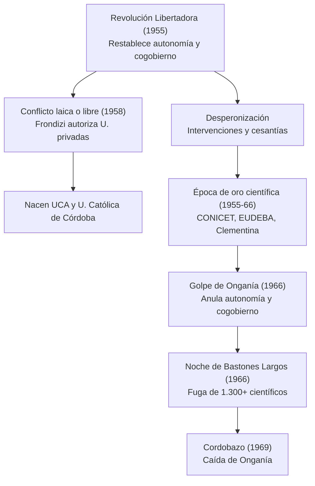

{d}

## Revolución Libertadora (1955-1958)

Golpe cívico-militar del 16 de septiembre de 1955 que derrocó a Perón; primero gobernó Eduardo Lonardi y luego Pedro E. Aramburu, con una línea dura de «desperonización». {a Apuntes de Universidad, sociedad y conocimientos · Unidad 2}

- Decreto-Ley N° 6.403/55: derogó la legislación peronista y restableció la autonomía, el cogobierno tripartito y los concursos públicos.
- Desperonización: intervención de las universidades y cesantías masivas; se prohibió concursar a quienes habían apoyado a Perón.
- UON (1955-1959): desfinanciada tras 1955, en 1959 la Ley N° 14.855 la renombró Universidad Tecnológica Nacional (UTN). {a Apuntes de Universidad, sociedad y conocimientos · Unidad 2}

## Conflicto «laica o libre» (1958)

- Artículo 28 del Decreto-Ley N° 6.403/55 habilitaba a la iniciativa privada a crear universidades.
- Decisión de Frondizi (1958): autorizó a las universidades privadas a emitir títulos profesionales habilitantes, terminando con el monopolio estatal.
- Bando «laica»: FUA, movimiento estudiantil, izquierda y parte del radicalismo: solo el Estado debía habilitar títulos.
- Bando «libre»: Iglesia Católica y sectores conservadores: libertad de enseñanza y educación superior privada.
- Ley N° 14.557 (Ley Domingo Orena): autorizó las universidades privadas sin financiamiento estatal.
- Efectos: nacieron la UCA y la Universidad Católica de Córdoba, entre otras. {a Apuntes de Universidad, sociedad y conocimientos · Unidad 2}

```asociar
titulo: Unir cada bando con su postura
pares:
  - [Bando «laica», Solo el Estado debe habilitar títulos profesionales]
  - [Bando «libre», Libertad de enseñanza y educación superior privada]
  - [FUA y movimiento estudiantil, Defendieron la universidad pública y laica]
  - [Iglesia Católica y conservadores, Impulsaron la libertad de enseñanza]
o: d
```

## «Época de oro» y desarrollo científico (1955-1966)

- CONICET: creado por decreto en febrero de 1958 con Bernardo Houssay como primer presidente; creó la Carrera del Investigador Científico.
- Nuevas carreras: Sociología, Psicología, Antropología, Ciencias de la Educación y Economía.
- EUDEBA (1958): editorial universitaria dirigida por Boris Spivacow que vendió más de 10 millones de ejemplares.
- Instituto de Cálculo (UBA): en 1961 puso en marcha a «Clementina», la primera computadora científica del país.
- Instituto de Investigaciones Bioquímicas: dirigido por Luis Federico Leloir (Premio Nobel de Química en 1970). {a Apuntes de Universidad, sociedad y conocimientos · Unidad 2}

```explorable
titulo: Logros de la época de oro científica
variante: capas
nodos:
  - {id: conicet, titulo: CONICET (1958), resumen: Carrera del Investigador Científico., detalle: Bernardo Houssay primer presidente; institucionalizó la investigación.}
  - {id: carreras, titulo: Nuevas carreras, resumen: Sociología, Psicología, Antropología, etc., detalle: Ampliaron el mapa disciplinar de la universidad argentina.}
  - {id: eudeba, titulo: EUDEBA (1958), resumen: Editorial universitaria masiva., detalle: Boris Spivacow; más de 10 millones de ejemplares vendidos.}
  - {id: clementina, titulo: Instituto de Cálculo (1961), resumen: Primera computadora científica «Clementina»., detalle: Pionera en computación científica en Argentina.}
  - {id: leloir, titulo: Instituto Bioquímico, resumen: Luis Federico Leloir, Nobel 1970., detalle: Investigación de nivel mundial en bioquímica.}
o: d
```

## Golpe de Onganía y «Noche de los Bastones Largos» (1966)

- Golpe del 28 de junio de 1966: las Fuerzas Armadas derrocaron a Arturo Illia e instalaron la dictadura «Revolución Argentina» con el general Juan Carlos Onganía.
- Decreto-Ley N° 16.912: anuló la autonomía y el cogobierno, subordinó las universidades al Ministerio de Educación y prohibió la actividad política y gremial.
- Noche de los Bastones Largos (29/07/1966): docentes, graduados y estudiantes tomaron cinco facultades de la UBA; la Policía Federal desalojó violentamente.
- Consecuencias: más de 200 detenidos, destrucción de laboratorios y la renuncia de más de 1.300 docentes e investigadores, con un éxodo masivo de científicos al exterior. {a Apuntes de Universidad, sociedad y conocimientos · Unidad 2}

```clasificar
titulo: ¿Medida de la dictadura de Onganía?
categorias: [Sí, fue medida de Onganía, No, no fue de Onganía]
items:
  - {x: "Anuló autonomía y cogobierno (Dec. 16.912)", cat: 0, porque: Subordinó universidades al Ministerio de Educación.}
  - {x: "Noche de los Bastones Largos (29/07/1966)", cat: 0, porque: Desalojo violento de 5 facultades de la UBA.}
  - {x: "Renuncia de 1.300+ docentes e investigadores", cat: 0, porque: Fuga de cerebros masiva al exterior.}
  - {x: "Restableció el cogobierno tripartito", cat: 1, porque: Eso fue la Revolución Libertadora (1955).}
  - {x: "Creó el CONICET", cat: 1, porque: Fue creado en 1958, antes de Onganía.}
o: d
```

## Cordobazo (29/05/1969)

Histórica pueblada obrero-estudiantil en Córdoba que debilitó a Onganía y provocó su caída en 1970. {a Apuntes de Universidad, sociedad y conocimientos · Unidad 2}

```caso
titulo: El Cordobazo y la caída de Onganía
escenario: Mayo de 1969. Obreros y estudiantes toman las calles de Córdoba contra la dictadura.
pasos:
  - pregunta: ¿Qué factor fue clave para que el Cordobazo derrocara a Onganía?
    opciones:
      - {x: Alianza obrera-estudiantil masiva en las calles, ok: true, consecuencia: Desbordó la capacidad de represión y aisló al gobierno.}
      - {x: Solo la protesta estudiantil universitaria, ok: false, consecuencia: Sin la clase obrera, no tenía la fuerza para tumbar a la dictadura.}
      - {x: Un golpe militar interno, ok: false, consecuencia: Onganía cayó por la presión popular, no por un golpe interno.}
  - pregunta: ¿Qué consecuencia tuvo para la universidad?
    opciones:
      - {x: Debilitó al régimen y abrió camino a la normalización, ok: true, consecuencia: Cayó Onganía en 1970; se inició transición a la democracia.}
      - {x: Mayor represión y cierre de universidades, ok: false, consecuencia: El Cordobazo forzó la salida, no el endurecimiento.}
o: d
```

:::sintesis
- La Revolución Libertadora restauró la autonomía y el cogobierno.
- El conflicto laica o libre autorizó las universidades privadas.
- La época de oro científica creó el CONICET y grandes institutos.
- Onganía anuló la autonomía y provocó la fuga de cerebros. {a Apuntes de Universidad, sociedad y conocimientos · Unidad 2}
:::