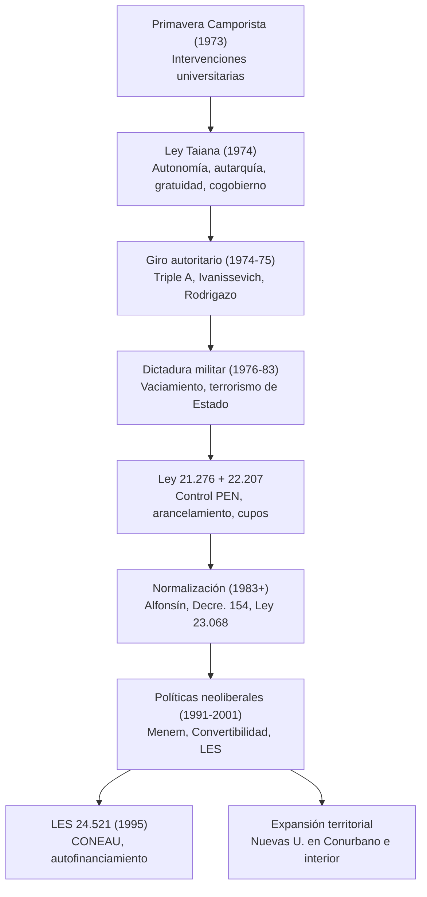

{d}

## Tercer Gobierno Peronista (1973-1976)

- Regreso democrático y la Primavera Camporista: tras 18 años de proscripción del peronismo, triunfó en las elecciones de marzo de 1973 la fórmula Cámpora-Solano Lima; durante el breve gobierno de Héctor J. Cámpora las universidades fueron intervenidas por sectores vinculados a la Juventud Peronista y Montoneros.
- Ley Taiana (Ley N° 20.654 de 1974): restituyó plenamente los principios reformistas: autonomía, autarquía, gratuidad y cogobierno tripartito.
- Giro autoritario: tras la muerte de Perón (1 de julio de 1974) y la asunción de Isabel Perón, el ministro Oscar Ivanissevich aplicó una dura persecución; la Triple A clausuró centros de estudiantes y despidió docentes.
- Rodrigazo (junio de 1975): brutal ajuste y devaluación que desató hiperinflación y protesta social. {a Apuntes de Universidad, sociedad y conocimientos · Unidad 2}

```explorable
titulo: Etapas del Tercer Gobierno Peronista
variante: pasos
nodos:
  - {id: camp, titulo: Primavera Camporista (1973), resumen: Intervenciones por JP y Montoneros., detalle: Retorno democrático tras 18 años de proscripción.}
  - {id: taiana, titulo: Ley Taiana (1974), resumen: Restituye principios reformistas., detalle: Autonomía, autarquía, gratuidad y cogobierno tripartito.}
  - {id: giro, titulo: Giro autoritario (1974-75), resumen: Triple A, persecución, Ivanissevich., detalle: Clausura de centros de estudiantes y despidos.}
  - {id: rodrigazo, titulo: Rodrigazo (1975), resumen: Ajuste brutal e hiperinflación., detalle: Desató protesta social y crisis terminal.}
o: d
```

## Dictadura militar (1976-1983)

- Golpe del 24 de marzo de 1976: Junta Militar (Videla, Massera y Agosti) derrocó a Isabel Perón.
- Terrorismo de Estado: suspensión de garantías constitucionales, plan sistemático de genocidio con secuestros, torturas y desaparición forzada.
- Vaciamiento universitario: Ley N° 21.276 (29/03/1976) puso las universidades bajo control del Ministerio de Educación; se nombraron oficiales militares como rectores; se eliminó el cogobierno; el 21% de las personas desaparecidas eran estudiantes universitarios.
- Estrategias de vaciamiento: cesantías y exilio de docentes, transferencia de recursos a institutos extrauniversitarios, cierre de carreras (Humanidades, Psicología, Sociología, Antropología, Cinematografía), clausura de la Universidad Nacional de Luján, arancelamiento y cupos.
- Ley Orgánica N° 22.207 (1980): mantuvo el control del PEN sobre los rectores y el arancelamiento. {a Apuntes de Universidad, sociedad y conocimientos · Unidad 2}

```clasificar
titulo: ¿Estrategia de vaciamiento de la dictadura?
categorias: [Sí, fue estrategia de vaciamiento, No, no lo fue]
items:
  - {x: "Cesantías y exilio de docentes", cat: 0, porque: "Desmanteló el plantel académico crítico."}
  - {x: "Transferencia de recursos a institutos extrauniversitarios", cat: 0, porque: "Desfinanció a las universidades públicas."}
  - {x: "Cierre de carreras (Humanidades, Psicología, etc.)", cat: 0, porque: "Eliminó disciplinas críticas y de pensamiento."}
  - {x: "Clausura de la Univ. Nac. de Luján", cat: 0, porque: "Cerró una universidad del conurbano bonaerense."}
  - {x: "Arancelamiento y cupos de ingreso", cat: 0, porque: "Restringió el acceso gratuito e irrestricto."}
  - {x: "Creación de nuevas universidades públicas", cat: 1, porque: "Eso ocurrió en los 90 con el neoliberalismo."}
o: d
```

## Normalización (1983 en adelante)

- Retorno a la democracia: el 10 de diciembre de 1983 asumió Raúl Alfonsín.
- CONADEP elaboró el informe «Nunca Más»; Juicio a las Juntas (1985) condenó a Videla y Massera.
- Decreto N° 154 (diciembre de 1983): designó rectores normalizadores y restableció los estatutos vigentes previos a 1966.
- Ley N° 23.068 (1984): reguló la reincorporación de docentes cesanteados y concursos públicos.
- Restablecimiento definitivo del ingreso irrestricto y la gratuidad; recomposición del cogobierno tripartito; creación de CONADU (1985) y CIN (1985); reapertura de la Universidad Nacional de Luján (1984). {a Apuntes de Universidad, sociedad y conocimientos · Unidad 2}

```asociar
titulo: Unir cada medida de normalización con su efecto
pares:
  - [Decreto 154 (1983), "Rectores normalizadores y estatutos pre-1966"]
  - [Ley 23.068 (1984), "Reincorporación de docentes y concursos públicos"]
  - [Ingreso irrestricto y gratuidad, "Acceso universal sin barreras económicas ni académicas"]
  - [Cogobierno tripartito, "Docentes, estudiantes y graduados gestionan la universidad"]
  - [CONADU y CIN (1985), "Representación gremial e interuniversitaria"]
  - [Reapertura UNLu (1984), "Recuperación de universidad clausurada por la dictadura"]
o: d
```

## Políticas neoliberales (1991-2001)

- Menemismo y Consenso de Washington: privatizaciones, Plan de Convertibilidad (1 peso = 1 dólar), desindustrialización y desempleo.
- Ley Federal de Educación N° 24.195 (1993): descentralizó el sistema.
- Ley de Educación Superior N° 24.521 (1995): englobó universidades públicas, privadas e institutos; creó la CONEAU para evaluar y acreditar carreras; habilitó el autofinanciamiento; garantizó mayoría docente en claustros.
- Expansión territorial: creación de universidades públicas en el Conurbano e interior (Quilmes, La Matanza, General Sarmiento, San Martín, Tres de Febrero, Villa María).
- Programa Nacional de Incentivos a docentes-investigadores (1993) y FOMEC (1995). {a Apuntes de Universidad, sociedad y conocimientos · Unidad 2}

```caso
titulo: Evaluar la Ley de Educación Superior de 1995
escenario: Debate en el Congreso sobre la LES. Sos legislador y debés votar.
pasos:
  - pregunta: ¿Qué evaluás de la creación de la CONEAU?
    opciones:
      - {x: "Positivo: acredita calidad y transparencia", ok: true, consecuencia: "Sistema de evaluación externo e independiente para todas las U."}
      - {x: "Negativo: control estatal excesivo", ok: false, consecuencia: "La CONEAU evalúa con pares académicos, no es control político."}
  - pregunta: ¿Qué pensás del autofinanciamiento habilitado por la LES?
    opciones:
      - {x: "Riesgo: mercantiliza el título y debilita la gratuidad", ok: true, consecuencia: "Permite cobrar por servicios, tensionando el principio de gratuidad."}
      - {x: "Beneficio: más recursos para la universidad", ok: false, consecuencia: "Los recursos no sustituyen el financiamiento estatal obligatorio."}
o: d
```

:::sintesis
- El Tercer Peronismo restituyó los principios reformistas con la Ley Taiana.
- La dictadura vació las universidades y reprimió a la comunidad universitaria.
- La normalización restauró la gratuidad, el ingreso irrestricto y el cogobierno.
- Las políticas neoliberales crearon la CONEAU y habilitaron el autofinanciamiento. {a Apuntes de Universidad, sociedad y conocimientos · Unidad 2}
:::