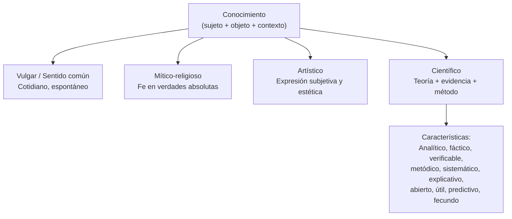

{d}

## Noción de conocimiento

Relación e interacción intencional entre un **sujeto cognoscente** y un **objeto cognoscible**, inscripta en un contexto espacial, temporal, cultural e institucional determinado. {a Apuntes de Universidad, sociedad y conocimientos · Unidad 3}

## Pluralidad de saberes

No hay un saber único: múltiples aproximaciones legítimas a lo real coexisten, y la ciencia moderna no posee el monopolio de la verdad. La ecología de saberes (Boaventura de Sousa Santos) propone la convivencia y el diálogo entre conocimiento científico y saberes no científicos. {a Apuntes de Universidad, sociedad y conocimientos · Unidad 3}

## Cuatro tipos de conocimiento

- **Conocimiento vulgar (sentido común)**: saber cotidiano, espontáneo, no sistematizado, basado en la vivencia propia.
- **Conocimiento mítico-religioso**: saber fundado en la adhesión afectiva a verdades absolutas, sin prueba empírica.
- **Conocimiento artístico**: expresión subjetiva y estética de la experiencia humana.
- **Conocimiento científico**: sistema de ideas conectadas lógicamente que articula componentes teóricos con componentes empíricos mediante el método científico. {a Apuntes de Universidad, sociedad y conocimientos · Unidad 3}

```clasificar
titulo: ¿Qué tipo de conocimiento es?
categorias: [Vulgar, Mítico-religioso, Artístico, Científico]
items:
  - {x: "Creer que 'siempre llueve cuando lavo el auto'", cat: 0, porque: "Generalización espontánea sin sistematización ni evidencia."}
  - {x: "La virgen se apareció en el cerro", cat: 1, porque: "Verdad absoluta basada en fe, sin prueba empírica."}
  - {x: "Un poema sobre la lluvia", cat: 2, porque: "Expresión subjetiva y estética de la experiencia."}
  - {x: "Estudio meteorológico con datos y modelos predictivos", cat: 3, porque: "Teoría, evidencia empírica, método sistemático y verificable."}
  - {x: "Mi abuela dice que duele la rodilla antes de llover", cat: 0, porque: "Sabiduría popular basada en vivencia, no en método."}
o: d
```

## Características del conocimiento científico

Analítico, fáctico, claro y preciso, comunicable, verificable, metódico, sistemático, explicativo, abierto, útil, predictivo y fecundo, objetivo (con matices). {a Apuntes de Universidad, sociedad y conocimientos · Unidad 3}

```explorable
titulo: Características del conocimiento científico
variante: capas
nodos:
  - {id: analitico, titulo: Analítico, resumen: Descompone el todo en partes., detalle: Analiza los elementos y sus relaciones para comprender la estructura.}
  - {id: factico, titulo: Fáctico, resumen: Se apoya en hechos observables., detalle: No se basa en especulaciones; contrasta con la realidad empírica.}
  - {id: verificable, titulo: Verificable, resumen: Sus afirmaciones pueden probarse., detalle: Cualquier otro investigador puede replicar y confirmar los resultados.}
  - {id: metodico, titulo: Metódico, resumen: Sigue un método planificado., detalle: No es azaroso; usa procedimientos sistemáticos y controlados.}
  - {id: sistematico, titulo: Sistemático, resumen: Forma un sistema coherente., detalle: Las ideas se conectan lógicamente en una estructura unificada.}
  - {id: explicativo, titulo: Explicativo, resumen: Responde al «por qué» de los fenómenos., detalle: Identifica causas y mecanismos, no solo describe.}
  - {id: abierto, titulo: Abierto, resumen: Falible y revisable., detalle: Acepta corrección ante nueva evidencia; no es dogmático.}
  - {id: util, titulo: Útil y predictivo, resumen: Permite anticipar y transformar., detalle: Genera conocimiento aplicable y predicciones comprobables.}
o: d
```

## Ciencia, técnica y tecnología

La ciencia es la producción sistemática de conocimiento verificado; la técnica, el conjunto de procedimientos y destrezas prácticas; la tecnología, la aplicación del conocimiento científico a la resolución sistemática de problemas prácticos, y es la síntesis entre ciencia y técnica. {a Apuntes de Universidad, sociedad y conocimientos · Unidad 3}

La tecnología no es neutral (Karina Pedace): las tecnologías son productos socioculturales moldeados por valores e intereses sociales. {a Apuntes de Universidad, sociedad y conocimientos · Unidad 3}

```asociar
titulo: Unir cada concepto con su definición
pares:
  - [Ciencia, "Producción sistemática de conocimiento verificado"]
  - [Técnica, "Conjunto de procedimientos y destrezas prácticas"]
  - [Tecnología, "Aplicación del conocimiento científico a problemas prácticos"]
  - [Síntesis ciencia-técnica, "La tecnología integra conocimiento teórico y saber hacer"]
o: d
```

## La universidad como lugar de ciencia

En el SUA la universidad se define por tres tareas articuladas: educar (docencia), investigar (producción sistemática de nuevos conocimientos) y realizar extensión (diálogo con la comunidad). {a Apuntes de Universidad, sociedad y conocimientos · Unidad 3}

Las universidades públicas albergan al 60% del personal dedicado a I+D y a cerca del 80% de los investigadores del CONICET. {a Apuntes de Universidad, sociedad y conocimientos · Unidad 3}

```caso
titulo: Definir el perfil de una carrera de ciencias
escenario: El consejo directivo debate el plan de estudios de una nueva licenciatura en Ciencias de Datos.
pasos:
  - pregunta: ¿Qué equilibrio buscás entre ciencia, técnica y tecnología?
    opciones:
      - {x: "Base científica fuerte + herramientas técnicas + proyectos tecnológicos aplicados", ok: true, consecuencia: "Forma profesionales que entienden los fundamentos, saben programar y resuelven problemas reales."}
      - {x: "Solo herramientas técnicas (programación, librerías)", ok: false, consecuencia: "Sin base científica, no pueden validar modelos ni innovar cuando fallen las herramientas."}
      - {x: "Solo teoría matemática sin práctica", ok: false, consecuencia: "Sin técnica ni tecnología, no hay transferencia a problemas reales."}
  - pregunta: ¿Cómo incorporar la ética (tecnología no neutral)?
    opciones:
      - {x: "Materia transversal de ética en datos y sesgos algorítmicos", ok: true, consecuencia: "Los egresados cuestionan qué datos usan, para qué y quién se beneficia."}
      - {x: "Una charla opcional al final de la carrera", ok: false, consecuencia: "La ética no es un accesorio; debe atravesar toda la formación."}
o: d
```

:::sintesis
- Hay pluralidad de saberes: vulgar, mítico-religioso, artístico y científico.
- El conocimiento científico es analítico, fáctico, verificable, metódico, sistemático, explicativo, abierto y útil.
- La ciencia produce conocimiento; la técnica son procedimientos; la tecnología aplica la ciencia.
- La universidad pública es el principal lugar de ciencia en Argentina. {a Apuntes de Universidad, sociedad y conocimientos · Unidad 3}
:::